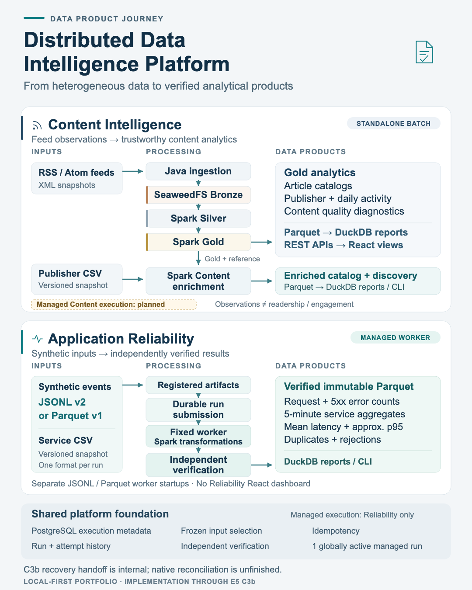
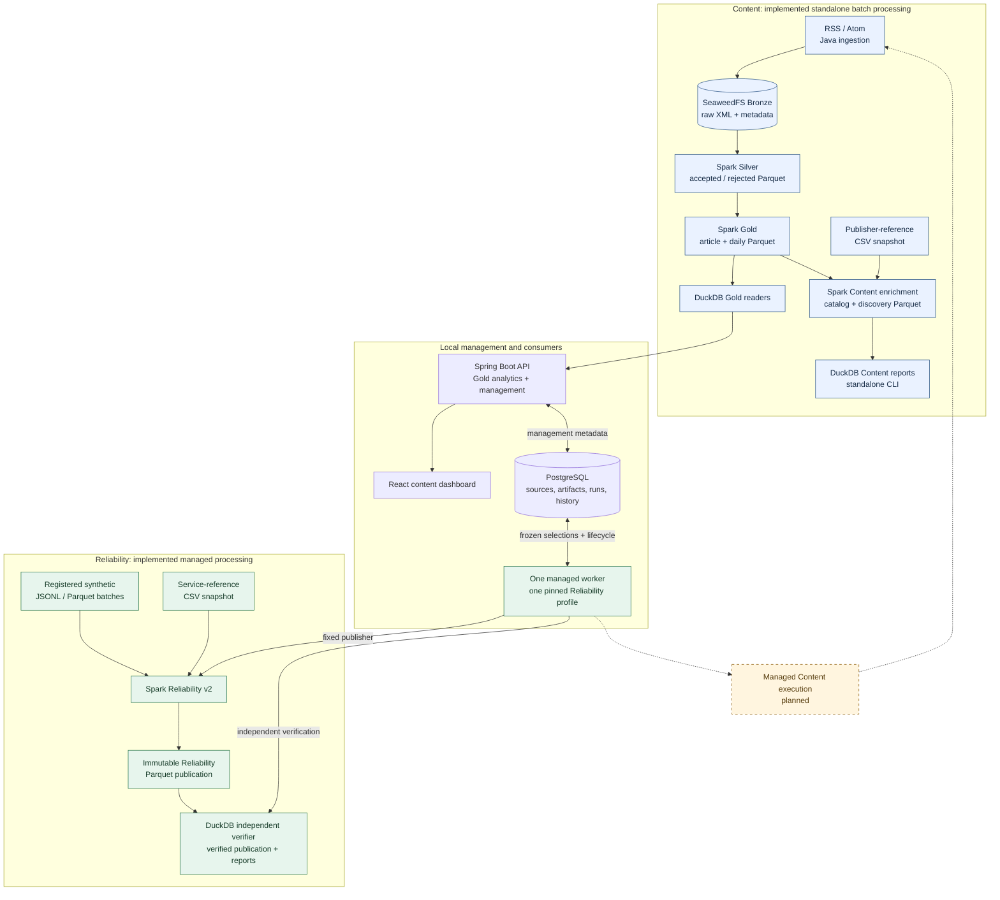

# Distributed Data Intelligence Platform

DDIP turns RSS/Atom feeds and synthetic application request events into reproducible datasets for analysis. Content analysts can explore article catalogs, source activity and data quality; service engineers can examine simulated request volumes, error rates and latency. The platform preserves original inputs, validates transformations and records how results were produced, so an analyst can explain a number, trace a failure or repeat an analysis against the same evidence.

The project combines working standalone Content processing with an asynchronous, locally operational Reliability worker. It is an independent portfolio and learning project, not a production-ready commercial service.

<!-- markdownlint-disable-next-line MD033 -->
<a href="docs/visuals/data-product-journey.png"></a>

[Full-resolution illustration](docs/visuals/data-product-journey.png) · [Editable SVG](docs/visuals/data-product-journey.svg) · [Technical notes and sources](docs/visuals/README.md)

## Capabilities at a Glance

Statuses describe scoped capabilities and evidence, not production readiness.

| Capability | Status | Scope and remaining boundary |
| --- | --- | --- |
| Standalone Content Processing | ✓ Implemented and locally tested | RSS/Atom ingestion, SeaweedFS Bronze, Spark Silver and Gold |
| Publisher Enrichment and Content Reports | ✓ Implemented and locally tested | Versioned publisher-reference enrichment and standalone DuckDB reports |
| Gold REST APIs and React Analytics | ✓ Implemented and locally tested | Four analytical endpoints and dashboard views; final browser acceptance and closeout remain pending |
| Managed Reliability Processing | ✓ Implemented and locally tested | JSONL/Parquet inputs, fixed-profile worker execution, Spark publication and independent output verification |
| Durable Source and Run Management | ✓ Implemented and locally tested | Source revisions, verified imports, frozen run submissions and bounded execution history |
| Execution Recovery | ◐ Partially implemented | Reconciliation admission, fenced handoff, guarded bootstrap, native verification and internal transactional finalization exist; production recovery activation remains unfinished |
| Managed Content Processing | ○ Planned | Worker-managed RSS-to-Content execution |
| Cancellation, Retry and React Operations | ○ Planned | Execution controls and an operator UI |
| Streaming, Performance Benchmarks, AWS Validation and Multiworker Execution | — Deferred | Scale experiments and additional execution/deployment models |

## Inputs, outputs and consumers

| Data product | Selected inputs | Resulting datasets and information | Current consumers |
| --- | --- | --- | --- |
| Content: feed history and Gold analytics | RSS/Atom XML snapshots, preserved with Bronze ingestion metadata in SeaweedFS | Silver accepted/rejected observations; Gold article catalog and source/day activity, with quality diagnostics | Content analysts through DuckDB SQL, Spring Boot REST and the React dashboard |
| Content: publisher enrichment | One completed Gold publication and one versioned publisher-reference CSV snapshot | Immutable `content_catalog_v1` and `content_source_discovery_daily_v1` Parquet; publisher context, first discovery within selected history and reference coverage | Standalone DuckDB reports/CLI; no enriched Content REST or dashboard integration yet |
| Application Reliability v2 | Explicitly registered synthetic JSONL v2 or Parquet v1 request batches, plus one versioned service-reference CSV snapshot | Immutable event, occurrence and five-minute aggregate Parquet; request counts, 5xx error rates, mean latency, rank-qualified approximate p95, duplicate/rejection accounting and reference coverage | Service/data engineers through independent DuckDB reports/CLI; operators inspect managed execution through REST |

Content observation counts describe retained feed observations, **not readership or engagement**. Discovery is scoped to the selected history. Reliability inputs are **synthetic request events, not real production monitoring**. Each Reliability publication uses one homogeneous input format.

## Architecture at a glance



Solid arrows show implemented paths; dashed arrows show planned managed Content execution. Content batches already work independently of the worker. The current React application consumes Gold analytics, while enriched Content and Reliability reports have standalone readers. PostgreSQL stores control and qualification metadata; native files remain the data authority. A newly verified worker result does not automatically replace the API's selected analytics publication.

One worker startup is pinned to one approved execution profile and deployment digest. JSONL and Parquet use separate reviewed startups; stop the worker before changing profiles. It processes compatible runs in submission order. Content and other-profile runs remain queued. Ambiguous execution retains occupied ownership and blocks further dispatch; an expired heartbeat is never permission to take over.

## Execution bounds and performance evidence

The current local admission policy allows **one globally active managed execution** and **at most 20 unfinished runs**, including active and recovery-required work. Reliability selections are bounded to **32 batches, 128 raw files, 1 GiB of raw input and 2 million physical occurrences**, subject to the stricter native per-file/profile limits. Writable volumes require at least **1 GiB free space** before stage authorization. These are admission limits, not measured throughput, guaranteed capacity or hard filesystem quotas; see the [accepted resource policy](docs/architecture/durable-execution.md#security-and-proposed-admission-limits).

Small deterministic fixtures demonstrate correctness, real Spark publication, independent read-back and unchanged replay. [Recorded fixture timings](docs/architecture/application-reliability-publication.md#reader-efficiency-gate-and-measured-observations) are explicitly not scale benchmarks. The [format and benchmark contract](docs/architecture/reliability-format-benchmarks.md#current-owner-approved-sequencing) separates implemented JSONL/Parquet correctness from deferred performance experiments. **No 100K/1M-event throughput result, streaming benchmark, distributed scaling result or AWS validation is claimed.**

## Engineering approach

- **Preserve and transform:** batch ingestion retains raw feed bytes in Bronze. Spark validates and normalizes Silver observations, then builds Gold analytics. Separate Content enrichment adds curated publisher context without rewriting Gold. Reliability accepts two physical formats under one versioned product contract.
- **Publish immutable datasets:** Spark writes Parquet with explicit schemas and completion evidence. Exact input selections determine native publication identities. Identical replay reopens completed results without rewriting their bytes; incomplete output is retained rather than silently repaired.
- **Check data independently:** native readers validate schemas, inventories, hashes, provenance and reconciliation. Reliability's DuckDB verifier independently checks events, occurrences, aggregates and approximate-p95 rank policy. Missing, corrupt or changed dependencies fail closed.
- **Make execution durable:** PostgreSQL captures source revisions, frozen selections, idempotency identities, runs, attempts, stages, controls and audit evidence. Short transactions fence one managed writer; native verification and Spark execution happen outside those transactions.
- **Keep failure boundaries explicit:** known clean failures can release the slot. Uncertain writers or database outcomes retain blocked ownership. The internal recovery handoff is a foundation for recovery, not a complete operational resolver or an exactly-once process guarantee.
- **Separate producers and consumers:** SQL readers, REST projections and the existing frontend consume verified data. Analytics-only startup does not require PostgreSQL. Local-first development uses synthetic tests, pinned runtimes and explicit operator configuration; cloud spending requires separate approval.

## Technology in use

| Area | Implemented technology and role |
| --- | --- |
| Ingestion and APIs | Java 21, Spring Boot 4.1.1, Maven; RSS/Atom ingestion and loopback REST services |
| Processing | Python 3.12.15, PySpark / Apache Spark 4.0.2, Spark SQL |
| Data formats | RSS/Atom XML, JSON metadata and JSONL events, CSV references, Parquet analytical datasets |
| Analytical reads | DuckDB 1.4.5; Spark-free verification and SQL reports |
| Operational persistence | PostgreSQL 17, Spring JDBC and Flyway; migrations V1–V7 |
| Local storage | SeaweedFS 4.48 with a loopback S3-compatible Bronze interface; approved local filesystem roots for analytical publications and private execution evidence |
| Frontend | React, TypeScript, Vite and Recharts; existing Gold analytics dashboard |
| Local infrastructure | Docker Compose for SeaweedFS/PostgreSQL; host-launched ingestion, processing, API and worker roles |

Kafka/Redpanda, Iceberg, cloud S3 and Athena are **future candidates**, not installed platform capabilities. No streaming broker, multiworker deployment or AWS infrastructure is required for the implemented local workflows. Pinned dependencies and private runtime/profile requirements are documented in the guides below.

## Getting started

Choose a standalone Content workflow or the managed Reliability workflow. There is no single command that provisions and configures every role.

1. **Prepare local storage and runtimes:** follow the [SeaweedFS setup](docs/local-seaweedfs.md), [Spark/Python setup](docs/architecture/silver-processing.md#contract-correction-acceptance-and-python-setup) and, for management/worker roles, [PostgreSQL setup and role commands](services/content-api/README.md#e5-b1-persistence-and-runtime-roles). Use Java 21 and the pinned Python dependencies; the frontend and repository checks use Node.js 24. Keep credentials and private profiles in ignored local configuration.
2. **Build Content datasets:** use the [batch ingestion guide](docs/architecture/batch-ingestion.md), [Bronze-to-Silver guide](docs/architecture/bronze-to-silver.md) and [Gold publication guide](docs/architecture/gold-publication.md). [Publisher snapshots](docs/architecture/publisher-reference-snapshots.md) and [Content publication commands](docs/architecture/content-intelligence-publication.md#stage-b-implementation-and-executed-validation) add the standalone enrichment path. Tests and examples provide synthetic alternatives to deliberate live feed retrieval.
3. **Run managed Reliability:** review the [v2 native interfaces and format contract](docs/architecture/reliability-format-benchmarks.md#version-and-interface-boundary), [operator imports](services/content-api/README.md#spark-free-native-input-imports-b2b-1b-a), [source management](services/content-api/README.md#e5-b2a-source-management) and [run submission](services/content-api/README.md#durable-queued-run-submission-b2b-2a). Then follow the [active worker startup and observation guide](services/content-api/README.md#c2b-2-active-reliability-worker). It requires reviewed private storage/runtime bindings and an immutable profile; it does not discover or substitute inputs.
4. **Explore Content analytics:** start the [Spring Boot API](services/content-api/README.md#local-startup) with an explicitly selected completed Gold publication, then the [React dashboard](frontend/README.md#local-startup). See the [REST contracts](docs/architecture/analytics-api-contracts.md) and [standalone SQL guide](docs/architecture/duckdb-analytics.md). Reliability results do not add new dashboard views.
5. **Inspect execution safely:** use the existing [run history APIs](services/content-api/README.md#bounded-run-history-and-inspection-b2b-2b). [RECONCILE controls](services/content-api/README.md#c3a-reconciliation-intent-only) record operator intent only; the [internal recovery handoff](services/content-api/README.md#c3b-internal-recovery-handoff) supplies no production recovery command. Do not clear coordinator records or bypass the installation guard.

## Repository guide

| Path | Purpose |
| --- | --- |
| [ingestion/](ingestion/) | Java RSS/Atom retrieval, batch CLI and Bronze storage |
| [processing/](processing/) | Silver, Gold, Content and Reliability publishers/readers; native verification and synthetic tests |
| [services/content-api/](services/content-api/) | Spring Boot analytics, PostgreSQL management APIs, operator imports and the single Reliability worker |
| [frontend/](frontend/) | React/TypeScript Gold analytics dashboard and article explorer |
| [config/](config/) | Public feed catalog and publisher-reference vocabulary; private deployment configuration is excluded |
| [infrastructure/local/](infrastructure/local/) | Local SeaweedFS/PostgreSQL Compose configuration |
| [docs/](docs/) | Architecture, contracts, decisions, operator guidance and recorded evidence |
| [scripts/](scripts/) | Batch launcher and repository/ingestion checks |

Start with the [execution architecture](docs/architecture/durable-execution.md), [ADR index](docs/adr/README.md) and accepted [coordination](docs/adr/0010-durable-execution-coordination-and-recovery.md) / [import ownership](docs/adr/0011-artifact-import-maintenance-ownership.md) decisions. Native contracts live in the [Silver](docs/architecture/silver-processing.md), [Gold](docs/architecture/gold-contracts.md), [Content](docs/architecture/content-intelligence-publication.md) and [Reliability v2](docs/architecture/reliability-format-benchmarks.md) guides. The broader [product specification](docs/product-specification.md) and domain proposals ([Content](docs/data-products/content-intelligence.md), [Reliability](docs/data-products/application-reliability.md)) retain Proposed scope; accepted implementation slices are documented separately.

Historical context remains available in the [roadmap](docs/charter.md#milestones-m0m9), [M1 closeout](docs/m1-closeout.md), [M2 closeout](docs/m2-closeout.md) and [M6 frontend acceptance notes](frontend/README.md#acceptance-and-design). Older checkpoint paragraphs describe their original evidence, not current completion status.

## Validation and reproducibility

Technical history: the [C3b implementation boundary](docs/architecture/durable-execution.md#c3b-fenced-execution-recovery-handoff) and [local validation record](docs/architecture/durable-execution.md#c3b-validation-and-c3c-prerequisites) report **323 Java unit/component tests, 517 real PostgreSQL integration cases and 20 analytics HTTP/Python compatibility cases passed locally**. That record includes Spark-backed Silver import regressions and database-restart checks. These are historical checkpoint results, not tests rerun for this README refresh, and do not establish a complete native recovery resolver. Other native product acceptance evidence is linked from the processing contracts above.

Hosted evidence: [E5 Phase 1 PR #51](https://github.com/saurabh-tayade/distributed-data-intelligence-platform/pull/51) is merged. Its [successful PR CI run #39794730299](https://github.com/saurabh-tayade/distributed-data-intelligence-platform/actions/runs/39794730299), for PR head `822930d`, passed all four jobs: documentation/hygiene, Java ingestion, Python/Spark/DuckDB with API/PostgreSQL integration, and frontend checks. The [CI definition](.github/workflows/ci.yml) records those checks. This evidence covers that PR snapshot; it does not claim hosted CI success for this README update or later commits.

For documentation and repository checks, from the repository root with Node.js 24:

```sh
npm ci --ignore-scripts --no-audit --no-fund
npm run check
git diff --check
git diff --cached --check
```

The root npm package contains check tooling only; the frontend has its own package and lockfile. Dependency installation needs registry access. Once installed, these checks validate Markdown, local links and repository hygiene without starting data services. Application and synthetic-fixture reproduction commands belong to the linked processing, API and frontend guides.

## Project intent and AI assistance

DDIP is an independent, non-commercial engineering and learning portfolio exploring data processing, analytical products and reliable execution. It is inspired in part by content aggregation systems and is **not affiliated with Microsoft or MSN**. It does not attempt to reproduce a commercial platform.

Development uses AI assistance, primarily OpenAI ChatGPT and Codex, for planning, architecture discussions, implementation, tests, debugging, documentation and review. Generated suggestions and code are inputs to engineering review, not authoritative evidence. The project author remains responsible for architectural decisions, acceptance, correctness validation, measurements and overall direction.

The repository records working implementations, tradeoffs, limitations and future plans separately. Performance claims require reproducible measurements; local demonstrations do not imply commercial readiness, high availability or distributed execution guarantees.
