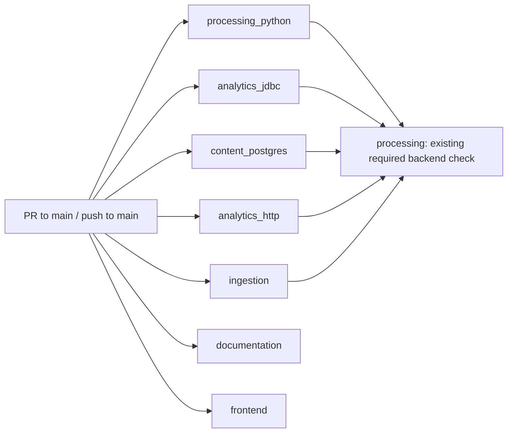

# Backend CI — D02 Phase 1

The [CI workflow](../../.github/workflows/ci.yml) runs every suite on every pull request to main
and every push to main. Phase 1 separates independent backend suites; change-aware filtering
remains Phase 2. Application code, native contracts, dependency pins and test selectors are unchanged.

## Jobs and dependencies

Previously, one processing job installed Python dependencies, ran Python tests, generated Gold
fixtures and checked JDBC, ran the PostgreSQL profile, then ran analytics HTTP integration.
That job had a 90-minute timeout. Documentation, ingestion and frontend already ran independently.

Now each validation job starts independently. Only the aggregate waits for other jobs:



| Job ID | Responsibility | Timeout |
| --- | --- | ---: |
| processing_python | All Python processing, Spark and DuckDB tests | 30 minutes |
| analytics_jdbc | Fresh synthetic Gold fixtures, Python references and Java JDBC compatibility | 15 minutes |
| content_postgres | Content API unit/component tests and the complete PostgreSQL execution/recovery profile | 60 minutes |
| analytics_http | Fresh synthetic Gold fixtures, content API unit/component tests and GoldApiIT HTTP/native compatibility | 15 minutes |
| ingestion | Existing Java ingestion and batch-launch script checks | 10 minutes |
| processing | Aggregate of all five backend jobs above | 5 minutes |
| documentation | Existing Markdown, local-link and repository hygiene checks | 5 minutes |
| frontend | Existing typecheck, lint, component tests and production build | 10 minutes |

Explicit jobs keep fixture preparation and PostgreSQL privileges visible. A matrix or reusable
workflow would need conditional setup for these different responsibilities. Sharing generated
fixtures through uploaded artifacts would add a dependency between otherwise independent jobs.
Instead JDBC and HTTP each generate fixtures once in their own checkout. The PostgreSQL profile
continues to generate its test-specific native fixtures internally.

## Required checks

Read-only GitHub inspection on October 25, 2026 (EDT) confirmed that main's effective repository
[ruleset 25349747](https://github.com/saurabh-tayade/distributed-data-intelligence-platform/rules/25349747)
requires these four GitHub Actions checks (integration ID 15368):

- Documentation and repository hygiene
- Java 21 ingestion and Bronze storage
- **Python 3.12, local Spark processing and DuckDB analytics**
- React publisher dashboard

The legacy branch-protection endpoint returns "Branch not protected"; the effective rules endpoint
does contain these requirements. Checking only the legacy endpoint would miss the active ruleset.

The processing job retains the exact, unique required name and now acts as an aggregate. Its needs
include ingestion and all four new backend suites. Its job-level always() condition schedules it
even after unsuccessful dependencies, following the documented [GitHub needs semantics](https://docs.github.com/en/actions/reference/workflows-and-actions/workflow-syntax#jobsjob_idneeds).
The shell step prints each fixed job ID and result, and succeeds only if all five results equal
success. Failure, cancellation, unexpected skipping, an empty result or an unknown result fails
the gate. There is no continue-on-error. If GitHub cancels the gate itself, it cannot report success.
Documentation and frontend remain separately required checks.

**No owner-managed settings change is required for this split.** Keep the four existing required
contexts. After submission, verify that the old processing context belongs to the aggregate and
that each new suite ran. If the owner later chooses to require individual new contexts, change the
ruleset manually after those contexts appear in hosted CI. Do not remove the aggregate without
replacing its coverage of every backend job. No rules or GitHub objects were modified locally.

## Runtimes, fixtures and isolation

All validation jobs still use ubuntu-24.04 and the existing SHA-pinned actions. Java steps select
the runner's JAVA_HOME_21_X64 and put it first on PATH. This preserves the approved JDK 21 selection;
the hosted runner supplies its patch version, rather than the workflow pinning a Java patch.
The measured baseline used Temurin 21.0.12.1+1. Each of the four native backend jobs independently
installs exact Python 3.12.15 through the existing pinned setup-python action.

Each native job installs both existing requirement files with the unchanged command. These retain
PySpark 4.0.2, Py4J 0.10.9.9, DuckDB 1.4.5 and the complete pinned Bronze dependency set. The job
environment retains SPARK_LOCAL_IP=127.0.0.1, TZ=UTC and PYTHONPATH=processing. Fixture generation sets
PYSPARK_PYTHON to the selected Python. PostgreSQL tests receive that interpreter through
DDIP_TEST_PYTHON; HTTP tests receive it through the existing analytics.python Maven property.

Each job has its own hosted VM, checkout, OS temporary directory and Maven target directories.
Python TemporaryDirectory and JUnit TempDir fixtures remain isolated. Both compatibility jobs
create services/api/target/fixtures from synthetic inputs in their own workspace, once per job.
No job consumes another job's workspace or generated outputs. A local rerun must remove that
generated fixture directory first because the generator intentionally refuses to overwrite it.

Only content_postgres provisions PostgreSQL. Its image is unchanged:

```text
postgres:17.11-bookworm@sha256:3645570cccdfa447589da9f57dd740faa29b30938e861289a5574b6ca6b03826
```

The service's ddip_test bootstrap database/user, disposable test-only password, port and readiness
probe are unchanged. Integration tests create uniquely named temporary databases and tear them
down. DB credentials stay scoped to the PostgreSQL Maven step. No operational database, AWS
credentials or private execution artifacts are required. Workflow permission remains contents: read;
checkout continues to disable persisted credentials.

Existing test-specific restart hooks are unchanged. Ordinary hosted CI does not set the optional
external restart-signal properties: those cases check fresh connections/application restart.
They do not establish an actual PostgreSQL server restart. The existing
[local restart harness](../../scripts/test-recovery-postgres.py) explicitly performs actual
disposable-container restarts when requested; see reproduction below. Phase 1 does not replace
that harness or add an external restart controller to hosted CI.

The existing pip caches remain keyed by all three requirement files. Frontend npm caching is
unchanged. These caches contain downloaded dependencies, not fixtures, native publications,
databases, recovery evidence or Maven target directories. No output/artifact cache or new Maven
cache is introduced. Independent setup and cold dependency downloads can increase runner usage.

## Reproduce the suites locally

From the repository root, use JDK 21 and a dedicated virtual environment containing Python 3.12.15.
Set JAVA_HOME to that JDK and activate that environment before running these common setup commands:

```sh
export PATH="$JAVA_HOME/bin:$PATH"
export SPARK_LOCAL_IP=127.0.0.1 TZ=UTC PYTHONPATH=processing
export PYSPARK_PYTHON="$(command -v python)"
python -m pip install -r processing/requirements-bronze.txt -r processing/requirements-analytics.txt
```

Python processing:

```sh
python --version
java -version
python -m unittest discover -s processing/tests -v
```

JDBC compatibility, in a clean checkout without services/api/target/fixtures:

```sh
PYTHONPATH=processing:processing/tests python services/api/tests/generate_fixtures.py --output services/api/target/fixtures
mvn -B -ntp -f services/api/pom.xml verify
```

PostgreSQL, with DDIP_TEST_DB_URL, DDIP_TEST_DB_USER and DDIP_TEST_DB_PASSWORD pointing only to a
dedicated disposable PostgreSQL 17.11 instance, following the
[database prerequisites](../../services/content-api/README.md#e5-b1-persistence-and-runtime-roles):

```sh
export DDIP_TEST_PYTHON="$(command -v python)"
mvn -B -ntp -f services/content-api/pom.xml verify -Ppostgres
```

HTTP/native analytics, in its own clean checkout without services/api/target/fixtures:

```sh
PYTHONPATH=processing:processing/tests python services/api/tests/generate_fixtures.py --output services/api/target/fixtures
mvn -B -ntp -f services/content-api/pom.xml verify -Pintegration -Danalytics.python="$(command -v python)"
```

The two content-api invocations deliberately retain ordinary unit/component execution as well as
their respective Failsafe profiles. Neither test selectors nor failure reporting are suppressed.
The postgres profile still includes all 16 existing integration classes, including packaged
OperatorRecoveryIT. The integration profile still selects GoldApiIT only.

Existing independent ingestion checks:

```sh
mvn -B -ntp -f ingestion/pom.xml verify
bash scripts/test-run-batch.sh
```

For an additional real PostgreSQL restart regression, the existing harness owns and removes its
own disposable Docker container. Supply the absolute pinned interpreter and JDK paths:

```sh
export DDIP_TEST_PYTHON="$(command -v python)"
python scripts/test-recovery-postgres.py --full
```

This optional command is separate from hosted CI and was not rerun for the workflow-only change.
Frontend reproduction remains in the [frontend guide](../../frontend/README.md).

## Timing baseline and timeout rationale

The baseline was inspected at merged main d919047. Its successful
[main run 40261800565](https://github.com/saurabh-tayade/distributed-data-intelligence-platform/actions/runs/40261800565)
took **42m46s** from run start to completion; its backend job took **42m43s**. The earlier successful
[C3c.4 PR run 40257464896](https://github.com/saurabh-tayade/distributed-data-intelligence-platform/actions/runs/40257464896)
took **49m38s**, with a **49m33s** backend job. Both ran October 26, 2026 UTC (October 25 EDT).
These are historical hosted measurements of the sequential layout, not measurements of the new
parallel workflow. The slower PR observation informs timeout headroom.

The main logs report 373 Python tests, 48 JDBC tests, 702 PostgreSQL integration cases, 20 HTTP
integration cases and 29 ingestion tests, all passing. Each content-api invocation also reports
326 passing unit/component tests, so those units execute twice in the existing workflow.
These observed baseline counts match the retained commands; they were not rerun locally for D02.

| Sequential backend step | Main elapsed | PR elapsed | New job budget | Estimated new job elapsed |
| --- | ---: | ---: | ---: | ---: |
| Python processing tests | 11m34s | 13m19s | 30m | About 12–15m |
| Gold fixtures and JDBC verify | 45s | 51s | 15m | About 1–2m |
| PostgreSQL verify | 29m10s | 33m52s | 60m | About 30–36m |
| Analytics HTTP verify, reusing earlier fixtures/build | 37s | 43s | 15m | About 2–3m with independent fixtures/build |

The 60-minute PostgreSQL budget leaves about 26 minutes over the slower observed test step for setup,
native subprocesses, cleanup and runner variability. Python has over twice its observed test-step
time. Compatibility jobs have room for fresh Spark fixtures and cold Maven downloads. The aggregate
does no checkout, dependency installation or network work; five minutes bounds runner startup and
its short result check. Existing independent-job budgets remain unchanged.

On main, ingestion took 27s, documentation 12s and frontend 31s. The sum of all four job durations
was **2633 seconds / 43.88 runner-minutes**, before per-job billing rounding. On the PR, those jobs
took 30s, 11s and 31s, with **3045 seconds / 50.75 runner-minutes** in total. New-job and new-workflow
hosted elapsed times are **not yet measured**. With enough concurrent runner slots, the observed work
suggests roughly **30–37 minutes** elapsed and **46–58 runner-minutes** in total.
These are planning estimates, not a demonstrated reduction. Extra setup, a second Gold fixture
generation, cold content-api compilation and an aggregate runner add work; parallelism removes the
Python/JDBC/HTTP sequence from the PostgreSQL critical path.

PostgreSQL/native execution remains the expected bottleneck. Runner queueing, account concurrency,
cold caches, Docker pulls and native-runtime variation can change both estimates. No test deadlines
or recovery freshness limits are changed. Capture run start/completion, each job start/completion,
step durations and the sum of job durations on the first owner-submitted hosted run before claiming
a wall-clock improvement. Do not equate elapsed runner-minutes with billed minutes.

## Local workflow validation

Configuration acceptance requires all four suites to be independent, every original test command
and environment to be preserved, only the PostgreSQL job to own a database service, and the old
required check to accept only five successful backend results. There are no job/path filters or
continue-on-error exceptions on the validation jobs. Missing, failed, cancelled and skipped backend
results must fail the aggregate.

Use actionlint 1.7.12 for YAML, expressions and dependency validation, and Node.js 24 for the existing
repository checks:

```sh
actionlint .github/workflows/ci.yml
npm ci --ignore-scripts --no-audit --no-fund
npm run check
git diff --check
```

Local validation passed actionlint, all 20 shell-script syntax checks, and structural comparisons
against the merged workflow: unchanged triggers, required names, independent existing jobs, exact
test commands/environments, pinned actions, dependency installation and PostgreSQL service settings.
The extracted aggregate shell ran 1,039 cases: all 1,024 combinations of success/failure/cancelled/
skipped across five jobs, plus empty, unknown and missing results for each job. Exactly one case
passed: all five jobs successful. The matrix and configuration checks took 1.63s locally. Node.js
24.22.1 ran the existing Markdown/link checks across 51 files and repository hygiene successfully.

Application regressions are not required solely to decompose these unchanged commands. The first
hosted run must still establish independent runtime/fixture readiness and current test counts;
the recorded C3c.4 results are evidence of the baseline, not new execution results.
