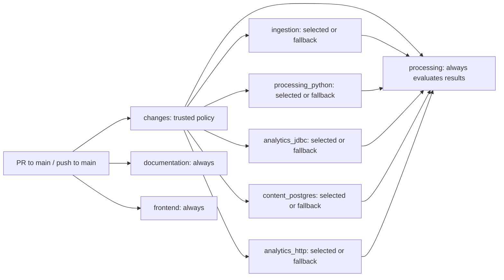

# Change-aware CI — D02 Phase 2

The [CI workflow](../../.github/workflows/ci.yml) classifies pull requests to main and runs the
backend suites selected by a conservative dependency map. Every push to main runs full regression.
There are no workflow-level path filters: required contexts are created for every supported event.
Documentation/hygiene and frontend validation still run on every event. Application code, native
contracts, action/dependency pins, test commands, Maven profiles, resource limits and timeouts are unchanged.

## Acceptance criteria and workflow graph

- Classify the complete PR diff, including both sides of renames and deleted files.
- Run the union of all affected suites, including consumers of shared fixtures and contracts.
- Treat unknown paths, incomplete collection and uncertainty as full validation.
- Reject unsuccessful classification and every unexpected backend result at the required gate.
- Keep the existing required check names and full main regression without changing GitHub settings.
- Verify policy and gate behavior locally; claim performance changes only after hosted measurements.



| Job ID | Responsibility | Timeout |
| --- | --- | ---: |
| changes | Complete Git diff and trusted classification policy | 5 minutes |
| ingestion | Existing Java ingestion and batch-launch script checks | 10 minutes |
| processing_python | All Python processing, Spark and DuckDB tests | 30 minutes |
| analytics_jdbc | Fresh synthetic Gold fixtures, Python references and Java JDBC compatibility | 15 minutes |
| content_postgres | Content API unit/component tests and complete PostgreSQL execution/recovery profile | 60 minutes |
| analytics_http | Fresh synthetic Gold fixtures, content API unit/component tests and GoldApiIT HTTP/native compatibility | 15 minutes |
| processing | Existing required backend context; classification and five-suite aggregate | 5 minutes |
| documentation | Existing Markdown/link/hygiene checks plus focused CI policy tests | 5 minutes |
| frontend | Existing typecheck, lint, component tests and production build | 10 minutes |

The five backend suites depend only on changes and remain parallel with one another. Fixtures are
never shared between job workspaces. The aggregate has no checkout, installation or network dependency.

## Change categories and dependency rules

[Policy source](../../.github/ci/classify.py) is intentionally broader than individual test files.
The output contains explicit true/false decisions for all five backend job IDs. Mixed changes take
the union. Documentation and frontend jobs run regardless of category; selecting frontend therefore
adds no backend suite unless a shared rule also applies.

| Category | Paths | Backend suites required and reasoning |
| --- | --- | --- |
| Documentation/repository hygiene | Explicit module/root READMEs, AGENTS.md, .editorconfig, .gitignore, .markdownlint-cli2.mjs, known placeholders; docs Markdown and image/PDF assets | None; these are not runtime inputs. Unknown executable/config files under docs still select all. |
| Java ingestion | ingestion/src/test/java; run-batch.sh, test-run-batch.sh, test-ingestion.sh | Ingestion; these checks are not imported by native suites. |
| Java ingestion contracts/fixtures | Other ingestion paths, including production Java and ingestion/src/test/resources/feeds | All five; Bronze/Silver consume raw contracts and feed fixtures, and Gold fixture generation calls test_bronze.snapshot, which reads the feed resources. |
| Python/Spark processing | processing source, tests and fixture helpers | All four native suites; PostgreSQL invokes processing fixtures and native CLIs, while JDBC and HTTP generate Gold from shared Python helpers. |
| JDBC compatibility | services/api source/tests, except the shared fixture generator directory | JDBC. |
| Shared JDBC/HTTP fixtures | services/api/tests, including generate_fixtures.py | JDBC and HTTP; each independently executes this generator. PostgreSQL owns separate native fixtures. |
| PostgreSQL backend and analytics HTTP/native | services/content-api source, tests and resources | PostgreSQL and HTTP; both compile the same module and run its complete unit/component suite as well as their retained integration profile. These categories cannot safely be separated by Java package. |
| React frontend | frontend source, tests and configuration other than shared/dependency rules | None; the always-running frontend job validates these changes. |
| Shared configuration/infrastructure | .github, config, infrastructure, .env.example, repository-level tests; schema/schemas/contracts directories anywhere; migrations under content-api resources/db | All five; workflow policy, registered vocabularies, schemas and infrastructure cross component boundaries. |
| Dependency/runtime definitions | Maven POMs, package manifests/locks, requirements files, pyproject.toml, uv.lock, poetry.lock and runtime version files anywhere | All five, including frontend-only dependency updates; broad regression is deliberate. |
| Unknown | Any path not explicitly accounted for above | All five. Add a narrower rule only with dependency evidence and negative tests. |

Shared/dependency rules take precedence over ordinary module rules. Renames classify both the old
and new path; deletions use the old path. A move into documentation cannot hide an affected source
file. Type changes, copies/other unsupported statuses, malformed paths or non-UTF-8 filenames select
full validation. No suffix-wide source or test exclusion is used.

## Complete collection, trust and fail-closed behavior

The classification job checks out the immutable event SHA with full Git history. It executes only
.github/ci/classify.py extracted from the event's PR base SHA (or the push SHA on main), using
Python isolated mode in the runner temporary directory. It does not import PR modules, run PR
instructions, fetch scripts from PR URLs or invoke external diff/textconv drivers. PR filenames
are parsed as NUL-delimited data; SHAs are validated before passing Git arguments. Ordinary suite
jobs still execute repository code under the existing read-only workflow permissions.

For PRs, the policy finds the unique merge base of the event base/head SHAs and compares that tree
to the head, matching PR three-dot diff semantics. It reads git diff --name-status -z with rename
detection and checks record count against the event's changed_files. This avoids the GitHub PR
files API's [3,000-file maximum](https://docs.github.com/en/rest/pulls/pulls#list-pull-requests-files).
Base-only changes after divergence are not attributed to the PR. Missing event fields/commits,
shallow history, ambiguous merge bases, count mismatches, empty/truncated output, collection errors
and Git timeouts produce explicit full-validation plans. Rename heuristics can disagree with the
event count; that safely causes extra validation.

**First deployment:** Phase 1 main has no policy file, so the inline trusted loader emits an explicit
full-validation plan. It also falls back to full when the trusted policy cannot be read. Once the
owner merges Phase 2, subsequent PRs can use that merged base policy. Policy updates in a PR receive
full CI under the old trusted rules and their new tests execute in the documentation job. Skipping
rules added by a PR take effect only after merging. A policy crash, invalid output or failed checkout
blocks the aggregate; downstream jobs request full validation whenever classification fails or lacks
an explicit false output. No classification failure can grant permission to skip.

Unsupported events request full validation in the classifier and are rejected by the gate. They
are not workflow triggers. Pushes to main always request all five suites, and the gate independently
rejects a selective plan on a main push.

## Required checks and aggregate semantics

Read-only inspection on October 26, 2026 confirmed merged main
[dd725da](https://github.com/saurabh-tayade/distributed-data-intelligence-platform/commit/dd725da3dc77ab383ca6f365ad3312a7fb347b70)
and effective [ruleset 25349747](https://github.com/saurabh-tayade/distributed-data-intelligence-platform/rules/25349747).
Its four required GitHub Actions contexts (integration ID 15368) remain:

- Documentation and repository hygiene
- Java 21 ingestion and Bronze storage
- **Python 3.12, local Spark processing and DuckDB analytics**
- React publisher dashboard

The processing aggregate retains the exact, unique required backend name. It directly needs changes
and all five backend jobs and uses job-level always(), following GitHub's
[dependency-result semantics](https://docs.github.com/en/actions/reference/workflows-and-actions/workflow-syntax#jobsjob_idneeds).
An intentionally skipped dependency therefore does not skip the gate. It receives the complete
needs object as JSON through an environment variable and accepts only:

1. A successful classifier job with classified=true, a recognized mode and five explicit boolean strings.
2. success for every job classified true.
3. skipped for every job classified false.
4. All five classified true for a full plan; pushes to main additionally require full mode.

Missing/unknown/extra dependencies, malformed JSON, blank or invalid outputs, failed/cancelled/timed-out
jobs, unexpectedly skipped selected suites and unexpectedly executed unselected suites fail the gate.
There is no continue-on-error. A cancelled gate cannot report success. The five-minute timeout bounds
its local evaluation; platform/runner outages can still prevent any job from completing successfully.

GitHub reports a [job skipped by its condition as successful for branch protection](https://docs.github.com/en/actions/how-tos/write-workflows/choose-when-workflows-run/control-jobs-with-conditions).
Thus the separately required ingestion context remains compatible when explicitly unnecessary; the
required aggregate independently verifies that skip. Documentation and frontend remain fully executed
separate required checks. No check is hidden with a workflow-level path filter.

**No ruleset change is required.** The owner must keep these four contexts. After submitting and merging,
verify the first full run and then representative selective PRs. No commit, push, PR, issue update,
branch switch or GitHub setting change is performed as part of local implementation.

## Alternatives and maintenance tradeoffs

GitHub workflow-level path filters can leave required checks pending and do not express the complete
dependency/gate policy. A third-party path-filter action would add a dependency and still need complete
collection and gate handling. A paginated files API adds read permissions and a hard file limit.
Standard-library Python plus complete Git history keeps those boundaries visible, at the cost of a
small classification job and potentially larger checkout. Trusted-base execution deliberately makes
new skip rules wait until merge. Narrow Java package/test-file filters would save more time but risk
missing shared compilation, contracts and fixture dependencies; this phase retains coarse categories.
This changes CI orchestration only and introduces no application architecture or ADR decision.

## Runtimes, fixtures and isolation

All validation jobs still use ubuntu-24.04 and the existing SHA-pinned actions. Java steps select
the runner's JAVA_HOME_21_X64 and put it first on PATH. This preserves the approved JDK 21 selection;
the hosted runner supplies its patch version, rather than the workflow pinning a Java patch.
The measured baseline used Temurin 21.0.12.1+1. Each of the four native backend jobs independently
installs exact Python 3.12.15 through the existing pinned setup-python action.

Each native job installs both existing requirement files with the unchanged command. These retain
PySpark 4.0.2, Py4J 0.10.9.9, DuckDB 1.4.5 and the complete pinned Bronze dependency set. The job
environment retains SPARK_LOCAL_IP=127.0.0.1, TZ=UTC and PYTHONPATH=processing. Fixture generation sets
PYSPARK_PYTHON to the selected Python. PostgreSQL tests receive that interpreter through
DDIP_TEST_PYTHON; HTTP tests receive it through the existing analytics.python Maven property.

Each job has its own hosted VM, checkout, OS temporary directory and Maven target directories.
Python TemporaryDirectory and JUnit TempDir fixtures remain isolated. Both compatibility jobs
create services/api/target/fixtures from synthetic inputs in their own workspace, once per job.
No job consumes another job's workspace or generated outputs. A local rerun must remove that
generated fixture directory first because the generator intentionally refuses to overwrite it.

Only content_postgres provisions PostgreSQL. Its image is unchanged:

```text
postgres:17.11-bookworm@sha256:3645570cccdfa447589da9f57dd740faa29b30938e861289a5574b6ca6b03826
```

The service's ddip_test bootstrap database/user, disposable test-only password, port and readiness
probe are unchanged. Integration tests create uniquely named temporary databases and tear them
down. DB credentials stay scoped to the PostgreSQL Maven step. No operational database, AWS
credentials or private execution artifacts are required. Workflow permission remains contents: read;
checkout continues to disable persisted credentials.

Existing test-specific restart hooks are unchanged. Ordinary hosted CI does not set the optional
external restart-signal properties: those cases check fresh connections/application restart.
They do not establish an actual PostgreSQL server restart. The existing
[local restart harness](../../scripts/test-recovery-postgres.py) explicitly performs actual
disposable-container restarts when requested; see reproduction below. This workflow does not replace
that harness or add an external restart controller to hosted CI.

The existing pip caches remain keyed by all three requirement files. Frontend npm caching is
unchanged. These caches contain downloaded dependencies, not fixtures, native publications,
databases, recovery evidence or Maven target directories. No output/artifact cache or new Maven
cache is introduced. Independent setup and cold dependency downloads can increase runner usage.

## Reproduce the suites locally

From the repository root, use JDK 21 and a dedicated virtual environment containing Python 3.12.15.
Set JAVA_HOME to that JDK and activate that environment before running these common setup commands:

```sh
export PATH="$JAVA_HOME/bin:$PATH"
export SPARK_LOCAL_IP=127.0.0.1 TZ=UTC PYTHONPATH=processing
export PYSPARK_PYTHON="$(command -v python)"
python -m pip install -r processing/requirements-bronze.txt -r processing/requirements-analytics.txt
```

Python processing:

```sh
python --version
java -version
python -m unittest discover -s processing/tests -v
```

JDBC compatibility, in a clean checkout without services/api/target/fixtures:

```sh
PYTHONPATH=processing:processing/tests python services/api/tests/generate_fixtures.py --output services/api/target/fixtures
mvn -B -ntp -f services/api/pom.xml verify
```

PostgreSQL, with DDIP_TEST_DB_URL, DDIP_TEST_DB_USER and DDIP_TEST_DB_PASSWORD pointing only to a
dedicated disposable PostgreSQL 17.11 instance, following the
[database prerequisites](../../services/content-api/README.md#e5-b1-persistence-and-runtime-roles):

```sh
export DDIP_TEST_PYTHON="$(command -v python)"
mvn -B -ntp -f services/content-api/pom.xml verify -Ppostgres
```

HTTP/native analytics, in its own clean checkout without services/api/target/fixtures:

```sh
PYTHONPATH=processing:processing/tests python services/api/tests/generate_fixtures.py --output services/api/target/fixtures
mvn -B -ntp -f services/content-api/pom.xml verify -Pintegration -Danalytics.python="$(command -v python)"
```

The two content-api invocations deliberately retain ordinary unit/component execution as well as
their respective Failsafe profiles. Neither test selectors nor failure reporting are suppressed.
The postgres profile still includes all 16 existing integration classes, including packaged
OperatorRecoveryIT. The integration profile still selects GoldApiIT only.

Existing independent ingestion checks:

```sh
mvn -B -ntp -f ingestion/pom.xml verify
bash scripts/test-run-batch.sh
```

For an additional real PostgreSQL restart regression, the existing harness owns and removes its
own disposable Docker container. Supply the absolute pinned interpreter and JDK paths:

```sh
export DDIP_TEST_PYTHON="$(command -v python)"
python scripts/test-recovery-postgres.py --full
```

This optional command is separate from hosted CI and was not rerun for the workflow-only change.
Complete the full run with documentation/hygiene and the frontend commands below, using Node.js 24.
The [frontend guide](../../frontend/README.md) describes the isolated test environment.

```sh
npm ci --ignore-scripts --no-audit --no-fund
npm run check
python3 -I -B -m unittest discover -s .github/ci/tests -v
(
  cd frontend
  npm ci --ignore-scripts --no-audit --no-fund
  npm run typecheck
  npm run lint
  npm test
  npm run build
)
```

## Hosted timing evidence

These are successful **Phase 1 parallel-layout hosted measurements**, read from the Actions run/job
APIs on October 26, 2026. Main was dd725da; the PR head was dbec28d. Both used ubuntu-24.04 and the
unchanged suites above. Workflow wall-clock is run_started_at to the run's completed updated_at;
job duration is completed_at minus started_at. Queueing and the final aggregate contribute to workflow
elapsed time. Aggregate runner-minutes sum all eight job durations before billing rounding, including
documentation, ingestion, frontend and the gate; this is not billed usage.

| Measurement | Phase 1 PR [40274271862](https://github.com/saurabh-tayade/distributed-data-intelligence-platform/actions/runs/40274271862) | Phase 1 main [40343648419](https://github.com/saurabh-tayade/distributed-data-intelligence-platform/actions/runs/40343648419) | Phase 2 hosted |
| --- | ---: | ---: | --- |
| Run start (UTC, October 26) | 05:27:02 | 14:51:56 | Pending owner submission |
| Completion (UTC) | 06:12:16 | 15:39:42 | Pending |
| Workflow wall-clock | 45m14s | 47m46s | Pending |
| documentation | 10s | 11s | Pending |
| ingestion | 24s | 28s | Pending |
| processing_python | 17m35s | 18m43s | Pending |
| analytics_jdbc | 1m22s | 1m17s | Pending |
| content_postgres | 44m58s | 47m33s | Pending |
| analytics_http | 2m19s | 2m15s | Pending |
| processing gate | 3s | 4s | Pending |
| Sum of job durations | 4,037s | 4,259s | Pending |
| Aggregate runner-minutes | 67.28 | 70.98 | Pending |

The main PostgreSQL test step alone took 47m05s; Python tests took 18m21s. These observed parallel
runs exceed Phase 1's earlier planning estimates. The existing 60m PostgreSQL and 30m Python budgets
are retained, as are 15m compatibility budgets. PostgreSQL remains the observed longest-running job.
No timeout or native execution deadline is reduced.

For historical context, the previous sequential main run
[40261800565](https://github.com/saurabh-tayade/distributed-data-intelligence-platform/actions/runs/40261800565)
took 42m46s and 43.88 total runner-minutes; the sequential
[PR run 40257464896](https://github.com/saurabh-tayade/distributed-data-intelligence-platform/actions/runs/40257464896)
took 49m38s and 50.75 runner-minutes. These are different runs, not a controlled performance experiment.
Phase 1 is not shown to improve the merged-main wall-clock in these observations. The earlier
sequential logs reported 373 Python, 48 JDBC, 702 PostgreSQL integration, 20 HTTP integration and
29 ingestion cases, plus 326 content-api unit/component cases per invocation. Those are historical
counts; Phase 2 has not rerun the application suites locally or on GitHub.

**No Phase 2 performance improvement is claimed.** Local policy-test elapsed time measures only the
classifier/gate tests. No new hosted estimate substitutes for a measurement. Full changes/main pushes
add classifier overhead and retain all suite work; docs/frontend-only PRs can avoid backend work after
the trusted-base bootstrap. Runner queueing, concurrency, caches, Docker pulls and native variation
still affect actual elapsed time and resource usage.

After owner deployment, fill the Phase 2 column using actual completed runs. Record the immutable
head/base, change category, selected and skipped suites, runner image, cache state where visible and
run attempt. Compare a main full run and representative documentation/frontend, JDBC, processing and
API PRs against the Phase 1 baseline. Preserve both workflow wall-clock and per-job durations; report
sum-of-job-seconds / 60 separately. Reruns must use their own attempt's jobs. Read-only commands:

```sh
gh api repos/saurabh-tayade/distributed-data-intelligence-platform/actions/runs/RUN_ID
gh api 'repos/saurabh-tayade/distributed-data-intelligence-platform/actions/runs/RUN_ID/jobs?per_page=100'
```

The owner handles commit/push, PR submission and merge after review. Retain the four ruleset contexts,
check that the initial deployment runs all suites, then verify classification summaries, skipped job
contexts and required-gate results in subsequent hosted PRs. Phase 2 hosted correctness and timing
comparison remain pending that deployment; issue #54 is not closed by local validation.

## Reproduce and investigate classification

The Classify changed paths job writes a JSON plan to logs and the step summary, including
categories, mode, reason and all suite decisions. The gate logs each fixed job ID, required flag and
actual result as it validates them; an invalid result terminates evaluation. The first-deployment
bootstrap instead writes its full-regression reason to the summary. Start there when an unexpected suite runs/skips. Full fallback reasons distinguish
incomplete history, collection/count problems and unknown paths (unknown appears in categories).

For a local policy reproduction, use a complete checkout containing the event base/head commits.
Save the GitHub PR event payload outside tracked files, then run the trusted base policy in an
isolated temporary directory. No PR checkout or Python dependencies are needed:

```sh
ci_tmp="$(mktemp -d)"
export GITHUB_EVENT_NAME=pull_request
export GITHUB_EVENT_PATH=/absolute/path/to/pr-event.json
export GITHUB_OUTPUT="$ci_tmp/outputs"
export GITHUB_STEP_SUMMARY="$ci_tmp/summary"
git show BASE_SHA:.github/ci/classify.py > "$ci_tmp/classify.py"
python3 -I -B "$ci_tmp/classify.py"
cat "$GITHUB_OUTPUT" "$GITHUB_STEP_SUMMARY"
```

The event needs pull_request.base.ref=main, base.sha, head.sha and the integer changed_files count.
If the policy does not yet exist at BASE_SHA, the hosted bootstrap requires full validation. Inspect
the exact Git list without running PR code using:

```sh
git rev-parse --is-shallow-repository
git merge-base --all BASE_SHA HEAD_SHA
git diff --no-ext-diff --no-textconv --name-status -z --find-renames=50% BASE_SHA...HEAD_SHA --
```

For a proposed rule change, run the focused tests against the working-tree policy, add a positive and
negative dependency case, and review all consumers before narrowing. Keep full fallback until the
cause is understood. For full validation, run every command in Reproduce the suites locally above,
plus the existing documentation and frontend checks; a push to main always provides full hosted CI.

## Local workflow validation

Use Python standard-library tests, actionlint 1.7.12 and the existing Node.js 24 tooling:

```sh
python3 -I -B -m unittest discover -s .github/ci/tests -v
actionlint .github/workflows/ci.yml
npm ci --ignore-scripts --no-audit --no-fund
npm run check
git diff --check
```

The focused tests execute the exact gate Python/shell and trusted loader extracted from the workflow.
They cover README/docs/frontend-only changes; ingestion/processing/JDBC/API/migrations; shared
config/dependencies/schemas/workflows; mixed changes; actual added/modified/deleted/renamed Git paths;
a diverged base; unknown and malformed paths; incomplete lists, count mismatch, missing commits,
shallow history and Git errors/timeouts; a 3,102-file list; unsupported events; full main pushes;
malformed events/outputs; trusted-base bootstrap and hostile PR policy isolation; and failed,
cancelled, timed-out, missing and unexpectedly skipped jobs.

The gate truth table evaluates all **32,768** combinations of five boolean selections and five
success/failure/cancelled/skipped results. Exactly **32** pass: one matching result vector per selection.
Full validation permits only five successes. Configuration tests check triggers, dependency wiring,
required context names, read-only permissions, the sole PostgreSQL service and retained suite commands.
Application regression commands are unchanged; focused orchestration tests do not establish new
hosted application counts or fixture readiness.

Local validation on October 26, 2026 passed all **21 focused tests**, including the 32,768-case gate
matrix, on Python 3.12.14 in 1.44s. This local interpreter is not the hosted suites' pinned 3.12.15.
Actionlint 1.7.12 passed; Node.js 24.19.0 ran Markdown/local-link checks across 51 files and repository
hygiene successfully; git diff --check passed. A parsed YAML comparison against merged main dd725da
confirmed every existing suite step, Maven profile, pin, timeout, environment and service setting is
unchanged. Documentation adds only the focused policy-test step, and frontend is identical.
No application regression, hosted Phase 2 run or performance benchmark was executed locally.
