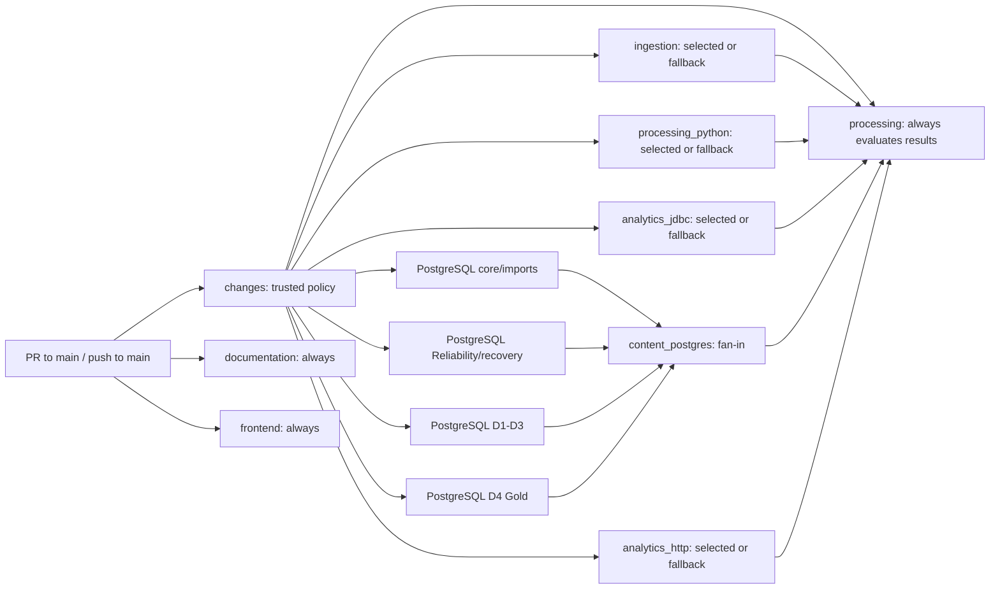

# Change-aware CI — D02 Phase 2

The [CI workflow](../../.github/workflows/ci.yml) classifies pull requests to main and runs the
backend suites selected by a conservative dependency map. Every push to main runs full regression.
There are no workflow-level path filters: required contexts are created for every supported event.
Documentation/hygiene and frontend validation still run on every event. Classification preserves native
contracts, required suite coverage, action/dependency pins and native execution limits. The
[PR #71 correction](#pr-71--d3-hosted-failure-and-postgresql-budget) increases only the PostgreSQL
job timeout from 60 to 90 minutes. D1/D2's added
PostgreSQL tests, prebuilt adapters and isolated storage are described below.
[PR #72](pr72-postgres-partitions.md) replaces sequential PostgreSQL execution with four independent
partitions and an unchanged logical PostgreSQL check. Each execution partition retains the 90-minute ceiling.

## Acceptance criteria and workflow graph

- Classify the complete PR diff, including both sides of renames and deleted files.
- Run the union of all affected suites, including consumers of shared fixtures and contracts.
- Treat unknown paths, incomplete collection and uncertainty as full validation.
- Reject unsuccessful classification and every unexpected backend result at the required gate.
- Keep the existing required check names and full main regression without changing GitHub settings.
- Verify policy and gate behavior locally; claim performance changes only after hosted measurements.



| Job ID | Responsibility | Timeout |
| --- | --- | ---: |
| changes | Complete Git diff and trusted classification policy | 5 minutes |
| ingestion | Existing Java ingestion and batch-launch script checks | 10 minutes |
| processing_python | All Python processing, Spark and DuckDB tests | 30 minutes |
| analytics_jdbc | Fresh synthetic Gold fixtures, Python references and Java JDBC compatibility | 15 minutes |
| content_postgres_core | All Content API units; persistence/import/source/admission integration | 90 minutes |
| content_postgres_reliability | Reliability processing and recovery integration | 90 minutes |
| content_postgres_ingestion | Managed Content D1/D2/D3 integration | 90 minutes |
| content_postgres_gold | Managed Content D4 integration | 90 minutes |
| content_postgres | Original PostgreSQL check; requires every selected partition to succeed | 5 minutes |
| analytics_http | Fresh synthetic Gold fixtures, content API unit/component tests and GoldApiIT HTTP/native compatibility | 15 minutes |
| processing | Existing required backend context; classification and five-suite aggregate | 5 minutes |
| documentation | Existing Markdown/link/hygiene checks plus focused CI policy tests | 5 minutes |
| frontend | Existing typecheck, lint, component tests and production build | 10 minutes |

The four PostgreSQL callers use the same logical `content_postgres` classification output.
They depend only on classification and invoke the [reusable partition workflow](../../.github/workflows/postgres-partition.yml)
on independently provisioned Ubuntu 24.04 runners, each with its own pinned PostgreSQL service,
workspace, fixture roots and full pinned Python/Spark/DuckDB/JDK environment. Only the two managed
Content partitions build the ingestion adapter and start/clean up pinned SeaweedFS. Core/import
fixtures supply their own synthetic Bronze HTTP server and need no SeaweedFS service. Unit tests
run once in core; other PostgreSQL partitions skip only Surefire units, never Failsafe integration.
The analytics HTTP job retains its existing unit/integration command.

The original `content_postgres` name is now a small fail-closed fan-in job. A selected missing,
failed, cancelled, skipped or timed-out partition cannot produce PostgreSQL success. If PostgreSQL
is intentionally unselected, all four callers and that fan-in are skipped, preserving the existing
five-suite aggregate's exact safe-skip rule. Classification and the top-level aggregate retain
all five logical outputs, trust/fallback behavior and original required-check names. Only fan-ins
wait for partition completion; no execution partition waits for another execution partition.

The [explicit inventory](../../.github/ci/postgres-partitions.json) covers every PostgreSQL integration
class exactly once. Default Maven PostgreSQL discovery includes all standard integration names
and excludes only `GoldApiIT`, which remains in the HTTP profile. The always-running documentation
job and every selected partition validate complete source membership. Missing/new/duplicate classes
fail CI until deliberately assigned. Actual Maven XML reports must cover the exact selected classes
with positive test counts and no failures, errors or skips. This guards selection/discovery as
well as test success. [PR #72 evidence](pr72-postgres-partitions.md) records all class assignments,
hosted timing inputs, local measurements, commands and remaining hosted acceptance requirements.

The [D5b-2b inherited recovery increment](d5b2b-inherited-recovery-validation.md) adds
`ContentInheritedRecoveryIT` to Gold. The inventory is now core=10, reliability=7,
ingestion=3 and gold=6 classes (26 total). Its native cases retain separate original/resumed
worker processes, real storage and PostgreSQL restart coverage. The 90-minute ceiling,
change-aware classification and both aggregate gates are unchanged. Measure the expanded
Gold partition on hosted Ubuntu before acceptance; local incremental timings do not establish
a hosted budget guarantee. Do not drop these cases or increase the timeout to hide an overrun.

## Change categories and dependency rules

[Policy source](../../.github/ci/classify.py) is intentionally broader than individual test files.
The output contains explicit true/false decisions for all five backend job IDs. Mixed changes take
the union. Documentation and frontend jobs run regardless of category; selecting frontend therefore
adds no backend suite unless a shared rule also applies.

| Category | Paths | Backend suites required and reasoning |
| --- | --- | --- |
| Documentation/repository hygiene | Explicit module/root READMEs, AGENTS.md, .editorconfig, .gitignore, .markdownlint-cli2.mjs, known placeholders; docs Markdown and image/PDF assets | None; these are not runtime inputs. Unknown executable/config files under docs still select all. |
| Java ingestion | ingestion/src/test/java, except BronzeFixture below; run-batch.sh, test-run-batch.sh, test-ingestion.sh | Ingestion; these checks are not imported by native suites. |
| Shared Bronze acceptance helper | ingestion/src/test/java/platform/ingestion/managed/BronzeFixture.java | Ingestion and PostgreSQL; RssBronzeIT executes this test-only SDK helper against actual SeaweedFS. |
| Java ingestion contracts/fixtures | Other ingestion paths, including production Java and ingestion/src/test/resources/feeds | All five; Bronze/Silver consume raw contracts and feed fixtures, and Gold fixture generation calls test_bronze.snapshot, which reads the feed resources. |
| Python/Spark processing | processing source, tests and fixture helpers | All four native suites; PostgreSQL invokes processing fixtures and native CLIs, while JDBC and HTTP generate Gold from shared Python helpers. |
| JDBC compatibility | services/api source/tests, except the shared fixture generator directory | JDBC. |
| Shared JDBC/HTTP fixtures | services/api/tests, including generate_fixtures.py | JDBC and HTTP; each independently executes this generator. PostgreSQL owns separate native fixtures. |
| PostgreSQL backend and analytics HTTP/native | services/content-api source, tests and resources | PostgreSQL and HTTP; both compile the same module and run its complete unit/component suite as well as their retained integration profile. These categories cannot safely be separated by Java package. |
| React frontend | frontend source, tests and configuration other than shared/dependency rules | None; the always-running frontend job validates these changes. |
| Shared configuration/infrastructure | .github, config, infrastructure, .env.example, repository-level tests; schema/schemas/contracts directories anywhere; migrations under content-api resources/db | All five; workflow policy, registered vocabularies, schemas and infrastructure cross component boundaries. |
| Dependency/runtime definitions | Maven POMs, package manifests/locks, requirements files, pyproject.toml, uv.lock, poetry.lock and runtime version files anywhere | All five, including frontend-only dependency updates; broad regression is deliberate. |
| Unknown | Any path not explicitly accounted for above | All five. Add a narrower rule only with dependency evidence and negative tests. |

Shared/dependency rules take precedence over ordinary module rules. Renames classify both the old
and new path; deletions use the old path. A move into documentation cannot hide an affected source
file. Type changes, copies/other unsupported statuses, malformed paths or non-UTF-8 filenames select
full validation. No suffix-wide source or test exclusion is used.

## Complete collection, trust and fail-closed behavior

The classification job checks out the immutable event SHA with full Git history. It executes only
.github/ci/classify.py extracted from the event's PR base SHA (or the push SHA on main), using
Python isolated mode in the runner temporary directory. It does not import PR modules, run PR
instructions, fetch scripts from PR URLs or invoke external diff/textconv drivers. PR filenames
are parsed as NUL-delimited data; SHAs are validated before passing Git arguments. Ordinary suite
jobs still execute repository code under the existing read-only workflow permissions.

For PRs, the policy finds the unique merge base of the event base/head SHAs and compares that tree
to the head, matching PR three-dot diff semantics. It reads git diff --name-status -z with rename
detection and checks record count against the event's changed_files. This avoids the GitHub PR
files API's [3,000-file maximum](https://docs.github.com/en/rest/pulls/pulls#list-pull-requests-files).
Base-only changes after divergence are not attributed to the PR. Missing event fields/commits,
shallow history, ambiguous merge bases, count mismatches, empty/truncated output, collection errors
and Git timeouts produce explicit full-validation plans. Rename heuristics can disagree with the
event count; that safely causes extra validation.

**First deployment:** Phase 1 main has no policy file, so the inline trusted loader emits an explicit
full-validation plan. It also falls back to full when the trusted policy cannot be read. Once the
owner merges Phase 2, subsequent PRs can use that merged base policy. Policy updates in a PR receive
full CI under the old trusted rules and their new tests execute in the documentation job. Skipping
rules added by a PR take effect only after merging. A policy crash, invalid output or failed checkout
blocks the aggregate; downstream jobs request full validation whenever classification fails or lacks
an explicit false output. No classification failure can grant permission to skip.

Unsupported events request full validation in the classifier and are rejected by the gate. They
are not workflow triggers. Pushes to main always request all five suites, and the gate independently
rejects a selective plan on a main push.

## Required checks and aggregate semantics

Read-only inspection on October 26, 2026 confirmed merged main
[dd725da](https://github.com/saurabh-tayade/distributed-data-intelligence-platform/commit/dd725da3dc77ab383ca6f365ad3312a7fb347b70)
and effective [ruleset 25349747](https://github.com/saurabh-tayade/distributed-data-intelligence-platform/rules/25349747).
Its four required GitHub Actions contexts (integration ID 15368) remain:

- Documentation and repository hygiene
- Java 21 ingestion and Bronze storage
- **Python 3.12, local Spark processing and DuckDB analytics**
- React publisher dashboard

The processing aggregate retains the exact, unique required backend name. It directly needs changes
and all five backend jobs and uses job-level always(), following GitHub's
[dependency-result semantics](https://docs.github.com/en/actions/reference/workflows-and-actions/workflow-syntax#jobsjob_idneeds).
An intentionally skipped dependency therefore does not skip the gate. It receives the complete
needs object as JSON through an environment variable and accepts only:

1. A successful classifier job with classified=true, a recognized mode and five explicit boolean strings.
2. success for every job classified true.
3. skipped for every job classified false.
4. All five classified true for a full plan; pushes to main additionally require full mode.

Missing/unknown/extra dependencies, malformed JSON, blank or invalid outputs, failed/cancelled/timed-out
jobs, unexpectedly skipped selected suites and unexpectedly executed unselected suites fail the gate.
There is no continue-on-error. A cancelled gate cannot report success. The five-minute timeout bounds
its local evaluation; platform/runner outages can still prevent any job from completing successfully.

GitHub reports a [job skipped by its condition as successful for branch protection](https://docs.github.com/en/actions/how-tos/write-workflows/choose-when-workflows-run/control-jobs-with-conditions).
Thus the separately required ingestion context remains compatible when explicitly unnecessary; the
required aggregate independently verifies that skip. Documentation and frontend remain fully executed
separate required checks. No check is hidden with a workflow-level path filter.

**No ruleset change is required.** The owner must keep these four contexts. After submitting and merging,
verify the first full run and then representative selective PRs. No commit, push, PR, issue update,
branch switch or GitHub setting change is performed as part of local implementation.

## Alternatives and maintenance tradeoffs

GitHub workflow-level path filters can leave required checks pending and do not express the complete
dependency/gate policy. A third-party path-filter action would add a dependency and still need complete
collection and gate handling. A paginated files API adds read permissions and a hard file limit.
Standard-library Python plus complete Git history keeps those boundaries visible, at the cost of a
small classification job and potentially larger checkout. Trusted-base execution deliberately makes
new skip rules wait until merge. Narrow Java package/test-file filters would save more time but risk
missing shared compilation, contracts and fixture dependencies; this phase retains coarse categories.
This changes CI orchestration only and introduces no application architecture or ADR decision.

## Runtimes, fixtures and isolation

All validation jobs still use ubuntu-24.04 and the existing SHA-pinned actions. Java steps select
the runner's JAVA_HOME_21_X64 and put it first on PATH. This preserves the approved JDK 21 selection;
the hosted runner supplies its patch version, rather than the workflow pinning a Java patch.
The measured baseline used Temurin 21.0.12.1+1. Each of the four native backend jobs independently
installs exact Python 3.12.15 through the existing pinned setup-python action.

Each native job installs both existing requirement files with the unchanged command. These retain
PySpark 4.0.2, Py4J 0.10.9.9, DuckDB 1.4.5 and the complete pinned Bronze dependency set. The job
environment retains SPARK_LOCAL_IP=127.0.0.1, TZ=UTC and PYTHONPATH=processing. Fixture generation sets
PYSPARK_PYTHON to the selected Python. PostgreSQL tests receive that interpreter through
DDIP_TEST_PYTHON; HTTP tests receive it through the existing analytics.python Maven property.

Each job has its own hosted VM, checkout, OS temporary directory and Maven target directories.
Python TemporaryDirectory and JUnit TempDir fixtures remain isolated. Both compatibility jobs
create services/api/target/fixtures from synthetic inputs in their own workspace, once per job.
No job consumes another job's workspace or generated outputs. A local rerun must remove that
generated fixture directory first because the generator intentionally refuses to overwrite it.

Only content_postgres provisions PostgreSQL. Its image is unchanged:

```text
postgres:17.11-bookworm@sha256:3645570cccdfa447589da9f57dd740faa29b30938e861289a5574b6ca6b03826
```

The service's ddip_test bootstrap database/user, disposable test-only password, port and readiness
probe are unchanged. Integration tests create uniquely named temporary databases and tear them
down. DB credentials stay scoped to the PostgreSQL Maven step. No operational database, AWS
credentials or private execution artifacts are required. Workflow permission remains contents: read;
checkout continues to disable persisted credentials.

Existing test-specific restart hooks are unchanged. Ordinary hosted CI does not set the optional
external restart-signal properties: those cases check fresh connections/application restart.
They do not establish an actual PostgreSQL server restart. The existing
[local restart harness](../../scripts/test-recovery-postgres.py) explicitly performs actual
disposable-container restarts when requested; see reproduction below. This workflow does not replace
that harness or add an external restart controller to hosted CI.

The existing pip caches remain keyed by all three requirement files. Frontend npm caching is
unchanged. These caches contain downloaded dependencies, not fixtures, native publications,
databases, recovery evidence or Maven target directories. No output/artifact cache or new Maven
cache is introduced. Independent setup and cold dependency downloads can increase runner usage.

## Reproduce the suites locally

From the repository root, use JDK 21 and a dedicated virtual environment containing Python 3.12.15.
Set JAVA_HOME to that JDK and activate that environment before running these common setup commands:

```sh
export PATH="$JAVA_HOME/bin:$PATH"
export SPARK_LOCAL_IP=127.0.0.1 TZ=UTC PYTHONPATH=processing
export PYSPARK_PYTHON="$(command -v python)"
python -m pip install -r processing/requirements-bronze.txt -r processing/requirements-analytics.txt
```

Python processing:

```sh
python --version
java -version
python -m unittest discover -s processing/tests -v
```

JDBC compatibility, in a clean checkout without services/api/target/fixtures:

```sh
PYTHONPATH=processing:processing/tests python services/api/tests/generate_fixtures.py --output services/api/target/fixtures
mvn -B -ntp -f services/api/pom.xml verify
```

PostgreSQL, with DDIP_TEST_DB_URL, DDIP_TEST_DB_USER and DDIP_TEST_DB_PASSWORD pointing only to a
dedicated disposable PostgreSQL 17.11 instance, following the
[database prerequisites](../../services/content-api/README.md#e5-b1-persistence-and-runtime-roles):

```sh
export DDIP_TEST_PYTHON="$(command -v python)"
mvn -B -ntp -f ingestion/pom.xml package -DskipTests
mvn -B -ntp -f services/content-api/pom.xml verify -Ppostgres
```

HTTP/native analytics, in its own clean checkout without services/api/target/fixtures:

```sh
PYTHONPATH=processing:processing/tests python services/api/tests/generate_fixtures.py --output services/api/target/fixtures
mvn -B -ntp -f services/content-api/pom.xml verify -Pintegration -Danalytics.python="$(command -v python)"
```

The two content-api invocations deliberately retain ordinary unit/component execution as well as
their respective Failsafe profiles. Neither test selectors nor failure reporting are suppressed.
The postgres profile includes all 16 earlier integration classes plus D1 RssFetchIT, including packaged
OperatorRecoveryIT. The integration profile still selects GoldApiIT only.

Existing independent ingestion checks:

```sh
mvn -B -ntp -f ingestion/pom.xml verify
bash scripts/test-run-batch.sh
```

For an additional real PostgreSQL restart regression, the existing harness owns and removes its
own disposable Docker container. Supply the absolute pinned interpreter and JDK paths:

```sh
export DDIP_TEST_PYTHON="$(command -v python)"
python scripts/test-recovery-postgres.py --full
```

This optional command is separate from hosted CI and was not rerun for the workflow-only change.
Complete the full run with documentation/hygiene and the frontend commands below, using Node.js 24.
The [frontend guide](../../frontend/README.md) describes the isolated test environment.

```sh
npm ci --ignore-scripts --no-audit --no-fund
npm run check
python3 -I -B -m unittest discover -s .github/ci/tests -v
(
  cd frontend
  npm ci --ignore-scripts --no-audit --no-fund
  npm run typecheck
  npm run lint
  npm test
  npm run build
)
```

## Hosted timing evidence

These are successful **Phase 1 parallel-layout hosted measurements**, read from the Actions run/job
APIs on October 26, 2026. Main was dd725da; the PR head was dbec28d. Both used ubuntu-24.04 and the
unchanged suites above. Workflow wall-clock is run_started_at to the run's completed updated_at;
job duration is completed_at minus started_at. Queueing and the final aggregate contribute to workflow
elapsed time. Aggregate runner-minutes sum all eight job durations before billing rounding, including
documentation, ingestion, frontend and the gate; this is not billed usage.

| Measurement | Phase 1 PR [40274271862](https://github.com/saurabh-tayade/distributed-data-intelligence-platform/actions/runs/40274271862) | Phase 1 main [40343648419](https://github.com/saurabh-tayade/distributed-data-intelligence-platform/actions/runs/40343648419) | Phase 2 hosted |
| --- | ---: | ---: | --- |
| Run start (UTC, October 26) | 05:27:02 | 14:51:56 | Pending owner submission |
| Completion (UTC) | 06:12:16 | 15:39:42 | Pending |
| Workflow wall-clock | 45m14s | 47m46s | Pending |
| documentation | 10s | 11s | Pending |
| ingestion | 24s | 28s | Pending |
| processing_python | 17m35s | 18m43s | Pending |
| analytics_jdbc | 1m22s | 1m17s | Pending |
| content_postgres | 44m58s | 47m33s | Pending |
| analytics_http | 2m19s | 2m15s | Pending |
| processing gate | 3s | 4s | Pending |
| Sum of job durations | 4,037s | 4,259s | Pending |
| Aggregate runner-minutes | 67.28 | 70.98 | Pending |

The main PostgreSQL test step alone took 47m05s; Python tests took 18m21s. These observed parallel
runs exceeded Phase 1's earlier planning estimates. At the Phase 2 baseline, the 60m PostgreSQL
and 30m Python budgets were retained, as were 15m compatibility budgets. PR #71 subsequently
raised only PostgreSQL to 90m, as documented below. PostgreSQL remains the observed longest-running job.
No timeout or native execution deadline is reduced.

For historical context, the previous sequential main run
[40261800565](https://github.com/saurabh-tayade/distributed-data-intelligence-platform/actions/runs/40261800565)
took 42m46s and 43.88 total runner-minutes; the sequential
[PR run 40257464896](https://github.com/saurabh-tayade/distributed-data-intelligence-platform/actions/runs/40257464896)
took 49m38s and 50.75 runner-minutes. These are different runs, not a controlled performance experiment.
Phase 1 is not shown to improve the merged-main wall-clock in these observations. The earlier
sequential logs reported 373 Python, 48 JDBC, 702 PostgreSQL integration, 20 HTTP integration and
29 ingestion cases, plus 326 content-api unit/component cases per invocation. Those are historical
counts; Phase 2 has not rerun the application suites locally or on GitHub.

**No Phase 2 performance improvement is claimed.** Local policy-test elapsed time measures only the
classifier/gate tests. No new hosted estimate substitutes for a measurement. Full changes/main pushes
add classifier overhead and retain all suite work; docs/frontend-only PRs can avoid backend work after
the trusted-base bootstrap. Runner queueing, concurrency, caches, Docker pulls and native variation
still affect actual elapsed time and resource usage.

After owner deployment, fill the Phase 2 column using actual completed runs. Record the immutable
head/base, change category, selected and skipped suites, runner image, cache state where visible and
run attempt. Compare a main full run and representative documentation/frontend, JDBC, processing and
API PRs against the Phase 1 baseline. Preserve both workflow wall-clock and per-job durations; report
sum-of-job-seconds / 60 separately. Reruns must use their own attempt's jobs. Read-only commands:

```sh
gh api repos/saurabh-tayade/distributed-data-intelligence-platform/actions/runs/RUN_ID
gh api 'repos/saurabh-tayade/distributed-data-intelligence-platform/actions/runs/RUN_ID/jobs?per_page=100'
```

The owner handles commit/push, PR submission and merge after review. Retain the four ruleset contexts,
check that the initial deployment runs all suites, then verify classification summaries, skipped job
contexts and required-gate results in subsequent hosted PRs. Phase 2 hosted correctness and timing
comparison remain pending that deployment; issue #54 is not closed by local validation.

## Reproduce and investigate classification

The Classify changed paths job writes a JSON plan to logs and the step summary, including
categories, mode, reason and all suite decisions. The gate logs each fixed job ID, required flag and
actual result as it validates them; an invalid result terminates evaluation. The first-deployment
bootstrap instead writes its full-regression reason to the summary. Start there when an unexpected suite runs/skips. Full fallback reasons distinguish
incomplete history, collection/count problems and unknown paths (unknown appears in categories).

For a local policy reproduction, use a complete checkout containing the event base/head commits.
Save the GitHub PR event payload outside tracked files, then run the trusted base policy in an
isolated temporary directory. No PR checkout or Python dependencies are needed:

```sh
ci_tmp="$(mktemp -d)"
export GITHUB_EVENT_NAME=pull_request
export GITHUB_EVENT_PATH=/absolute/path/to/pr-event.json
export GITHUB_OUTPUT="$ci_tmp/outputs"
export GITHUB_STEP_SUMMARY="$ci_tmp/summary"
git show BASE_SHA:.github/ci/classify.py > "$ci_tmp/classify.py"
python3 -I -B "$ci_tmp/classify.py"
cat "$GITHUB_OUTPUT" "$GITHUB_STEP_SUMMARY"
```

The event needs pull_request.base.ref=main, base.sha, head.sha and the integer changed_files count.
If the policy does not yet exist at BASE_SHA, the hosted bootstrap requires full validation. Inspect
the exact Git list without running PR code using:

```sh
git rev-parse --is-shallow-repository
git merge-base --all BASE_SHA HEAD_SHA
git diff --no-ext-diff --no-textconv --name-status -z --find-renames=50% BASE_SHA...HEAD_SHA --
```

For a proposed rule change, run the focused tests against the working-tree policy, add a positive and
negative dependency case, and review all consumers before narrowing. Keep full fallback until the
cause is understood. For full validation, run every command in Reproduce the suites locally above,
plus the existing documentation and frontend checks; a push to main always provides full hosted CI.

## Local workflow validation

Use Python standard-library tests, actionlint 1.7.12 and the existing Node.js 24 tooling:

```sh
python3 -I -B -m unittest discover -s .github/ci/tests -v
actionlint .github/workflows/ci.yml
npm ci --ignore-scripts --no-audit --no-fund
npm run check
git diff --check
```

The focused tests execute the exact gate Python/shell and trusted loader extracted from the workflow.
They cover README/docs/frontend-only changes; ingestion/processing/JDBC/API/migrations; shared
config/dependencies/schemas/workflows; mixed changes; actual added/modified/deleted/renamed Git paths;
a diverged base; unknown and malformed paths; incomplete lists, count mismatch, missing commits,
shallow history and Git errors/timeouts; a 3,102-file list; unsupported events; full main pushes;
malformed events/outputs; trusted-base bootstrap and hostile PR policy isolation; and failed,
cancelled, timed-out, missing and unexpectedly skipped jobs.

The gate truth table evaluates all **32,768** combinations of five boolean selections and five
success/failure/cancelled/skipped results. Exactly **32** pass: one matching result vector per selection.
Full validation permits only five successes. Configuration tests check triggers, dependency wiring,
required context names, read-only permissions, the sole PostgreSQL service and retained suite commands.
Application regression commands are unchanged; focused orchestration tests do not establish new
hosted application counts or fixture readiness.

The original D02 local validation on October 26, 2026 passed all **21 focused tests**, including the 32,768-case gate
matrix, on Python 3.12.14 in 1.44s. This local interpreter is not the hosted suites' pinned 3.12.15.
Actionlint 1.7.12 passed; Node.js 24.19.0 ran Markdown/local-link checks across 51 files and repository
hygiene successfully; git diff --check passed. A parsed YAML comparison against merged main dd725da
confirmed every existing suite step, Maven profile, pin, timeout, environment and service setting is
unchanged. Documentation adds only the focused policy-test step, and frontend is identical.
No application regression, hosted Phase 2 run or performance benchmark was executed for that D02
configuration change. Subsequent [D1 validation](managed-rss-fetch.md#d1-local-validation-and-reproduction-historical)
and [D2 validation](managed-rss-fetch.md#d2-local-validation-and-reproduction) record their added
ingestion/Content API regressions, real storage evidence and current dependency cases separately.

## PR #71 — D3 hosted failure and PostgreSQL budget

October 29, 2026. This correction changes a D3 acceptance fixture and the PostgreSQL job
budget; application execution, admission, recovery and native publication contracts are unchanged.
Managed Content remains **Partially implemented**, with production Content dispatch disabled.

### Hosted observations

Read-only Actions run/job/check-annotation APIs and full logs were inspected for
[run 40894298930](https://github.com/saurabh-tayade/distributed-data-intelligence-platform/actions/runs/40894298930),
head `06de5734e98f048ed9f7107553c62debfe7f2e4a`.
The [PostgreSQL job 123519203618](https://github.com/saurabh-tayade/distributed-data-intelligence-platform/actions/runs/40894298930/job/123519203618)
started at 14:43:30 UTC and completed cancellation at 15:43:53 UTC: **60m23s**.
Its explicit check annotation says it exceeded the maximum execution time of **1h0m0s**.
The test step ran 14:44:21–15:43:50, **59m29s**, before cancellation in `SilverImportIT`.
There is no workflow/job `concurrency` or `cancel-in-progress` setting. This was the configured
60-minute job budget, not an inferred concurrency cancellation. Cleanup steps still ran.

The other four selected backend suites passed. The
[aggregate job 123555489168](https://github.com/saurabh-tayade/distributed-data-intelligence-platform/actions/runs/40894298930/job/123555489168)
correctly failed because the required PostgreSQL job was cancelled. The aggregate remains
fail closed, with the same name, graph, classifier, required checks and success conditions.

The Ubuntu 24.04 D3 matrix completed **31 cases, 1 error, no failures/skips**, in **606.1s**.
`exactNativePublicationAndFullyVerifiedReplay` errored with
`SourceFailure: COORDINATOR_RECOVERY_REQUIRED`; its case duration was **82.24s**.
A native publication with accepted=1/rejected=1 was logged before the error, including completion
SHA-256 `de386945a749827cdd7287be98a5d49bd0fd44f60d6bbe90dd5cbaf95513e351`.
The original log lacked phase/heartbeat-age diagnostics; it cannot establish the exact hosted
heartbeat age. The unique failing call path and bounded reproductions below identify the cause.

### Root cause and correction

The test combined active-execution admission with ownerless read-only replay:

1. D1/D2 committed the original journal and verified Bronze receipt. D3's supervised writer
   and independent qualifier succeeded; Silver became `VERIFIED` and its artifact/link committed.
2. The run/attempt remained `RUNNING`, worker/coordinator `READY`, with the global slot occupied.
   Normal execution heartbeats had stopped because the checkpoint had returned.
3. Two `inspectSilver()` calls performed full Spark qualification. By design, these inspections
   have no Owner token and cannot heartbeat, adopt, release or otherwise modify execution authority.
4. The deliberate duplicate execution was rejected before another Spark writer could start.
   It stops that repository's authorization channel; it does not release or alter the DB owner.
5. The test then submitted an unrelated run. `RunRepository.readiness` requires an occupied
   EXECUTE owner with a coordinator heartbeat no older than **30 seconds**. Slow inspections
   crossed that window. The existing guard correctly raised `COORDINATOR_RECOVERY_REQUIRED`.

There was **no unintended coordinator transition**: this admission rejection leaves the
coordinator `READY` and occupied. It does not set `RECOVERY_ONLY` or clear an owner. The defect
was a timing-dependent test ordering assumption, not corruption, host-guard loss, ambiguous
launch or an application supervisor failure.

The corrected fixture sends a real guarded owner heartbeat, submits the unrelated queued run
and asserts `WORKER_NOT_READY` on a competing claim **before** Silver processing/read-only
inspections. The original run still executes and publishes with the other run queued. Its
run-state assertion now explicitly selects the executing run, since the queued run exists earlier.
All original receipt, file-hash/mtime/inode, replay, duplicate-launch, registration and occupancy
assertions remain. Production freshness thresholds and all execution/recovery code are unchanged.

A separate deterministic `readOnlyReplayDoesNotRenewStaleOwnership` case backdates its
disposable coordinator heartbeat by 31 seconds in a guarded row-version update, then performs
real independent Silver replay. The row-version increment also makes the original Owner token stale.
It requires replay to verify the original artifact without changing the coordinator or publication;
new admission must still fail with `COORDINATOR_RECOVERY_REQUIRED`, and duplicate execution with
the old token must fail with `OWNERSHIP_LOST`. It checks unchanged receipt, publication bytes/identities, counts and slot.
No sleep, weaker admission rule, fabricated owner refresh or automatic ownership release is added.

`D3_CHECKPOINT` test diagnostics report a fixed, bounded scalar projection: phase, guard-held
status, epoch/version, occupied/current-worker flags, heartbeat age/freshness, worker/run/attempt/
Silver states and whether child identity was recorded. Failure checkpoints do not mask the original
exception; diagnostic unavailability emits a fixed classification. They never print credentials,
paths, source/feed URLs, request/receipt bytes, payloads or raw database/native exception messages.
These are test diagnostics, not a new management endpoint or production log protocol.

### Budget and optimization scope

Only `content_postgres.timeout-minutes` changes **60 → 90**. Every other timeout, native child
execution deadline, service, suite command, matrix, pin, gate and classification rule is retained.
A direct workflow comparison verifies that only this job's comment/budget changed; policy/gate
regressions also require D3 inclusion. No concurrency cancellation is introduced. PostgreSQL's
Maven profile still includes the entire D3 matrix and native imports.

Slowest completed hosted PostgreSQL suites were:

| Suite | Cases | Hosted elapsed |
| --- | ---: | ---: |
| RssSilverIT | 31 | 606.1s; one fixture error |
| ReliabilityExecutionIT | 27 | 595.5s |
| OperatorRecoveryIT | 35 | 499.9s |
| ReliabilityWorkerIT | 23 | 357.7s |
| RecoveryFinalizationIT | 53 | 270.6s |
| RecoveryHandoffIT | 118 | 195.0s |
| RssBronzeIT | 43 | 189.2s |
| RecoveryVerificationIT | 40 | 175.6s |

`SilverImportIT` had already consumed approximately **255.5s** when cancellation occurred;
its total duration and final outcome are unknown. Do not count it as passing or rank that partial
observation as a completed suite. Hosted timings are separate from local measurements below.

Practical follow-up is to measure fixture construction, Spark JVM startup, native actions and
qualification/GET/hash phases within these suites before optimizing. Potential test-only savings
include reusing immutable fixture construction with independent per-test copies where mutation
and provenance assertions permit it, and reducing redundant setup/packaging. Production child
isolation, full qualification, fresh recovery evidence, fault coverage and independent test state
must remain intact. Sharing live Spark gateways across fenced stages, dropping cases or loosening
verification is not justified by these timings. Larger job splitting/resource changes are deferred.
The 90-minute budget provides headroom; completion of the full hosted PostgreSQL job still needs
an owner-triggered Ubuntu rerun and is not demonstrated by local scoped regressions.

### Reproduction and validation procedure

The isolated failing case was run first using the existing disposable harness:

```sh
export JAVA_HOME=$(/usr/libexec/java_home -v 21)
export DDIP_TEST_PYTHON="$PWD/outputs/silver-python312/.venv/bin/python"
python3 scripts/test-rss-fetch-postgres.py --offline --silver \
  --case exactNativePublicationAndFullyVerifiedReplay
# Focused D3 matrix, then one broader scoped regression after stabilization:
python3 scripts/test-rss-fetch-postgres.py --offline --silver
python3 scripts/test-rss-fetch-postgres.py --offline --silver --regression
python3 -B -m unittest discover -s .github/ci/tests -v
outputs/d02-ci/actionlint .github/workflows/ci.yml
npm run check
```

For the additional focused admission/supervisor/recovery checks, with disposable `DDIP_TEST_DB_*`,
`BRONZE_S3_*` and the pinned `DDIP_TEST_PYTHON` configured, the Maven selection was:

```sh
mvn -B -ntp -o -Daether.syncContext.named.factory=noop -f services/content-api/pom.xml \
  -Ppostgres \
  -Dtest=RuntimeRoleTest,WorkerCapabilityTest,InstallationHostGuardTest,VerifierProcessTest,RecoveryQuiescenceTest,RecoveryAcknowledgmentProxyTest \
  -Dit.test=RssSilverIT,RunSubmissionIT verify
```

Linux experiments used disposable PostgreSQL/SeaweedFS containers and a test container sharing
one loopback network namespace, not relaxed storage endpoint policy. The image used Python
3.12.15 on Debian Bookworm/glibc 2.36, Temurin **21.0.12.1+1-LTS** from its Ubuntu Noble image,
PySpark 4.0.2 and Boto3/Botocore 1.43.114. Actual kernel/platform was Linux
7.0.14-linuxkit/aarch64. All stages used approved loopback storage and actual pinned Spark.
This exercises Linux process/filesystem behavior, but **does not reproduce hosted Ubuntu 24.04
x86_64 hardware, scheduling or wall-clock performance**. The macOS checks used arm64/macOS
27.2, GraalVM Java 21.0.7 and the existing pinned Python/Spark environment.

The IDE debugger could not create a runnable test configuration (no discovered run points),
so runtime evidence came from bounded test diagnostics and actual isolated executions.
The natural diagnostic reproduction overlapped Linux image construction and crossed the
heartbeat limit before any test-only aging injection: 5,417ms before the first inspection,
19,068ms after it and **31,375ms** after the second, with the same coordinator row version 5,
`READY`/occupied worker, `RUNNING` run/attempt and `VERIFIED` Silver throughout. A temporary
31-second aging injection additionally reproduced the same admission rejection in Linux;
that temporary reproduction switch was removed from the final test source. The permanent
stale-owner case uses explicit disposable-row aging and expects rejection, not success.

### Local results for the correction

These measurements are separate from the hosted observations and from the original D3
implementation's historical counts. Driver elapsed includes Maven/service setup where applicable.

| Execution | Actual result | Driver elapsed |
| --- | --- | ---: |
| Original isolated case, macOS, run before editing | 43 units + 1 D3 case passed; D3 51.64s | 60.33s |
| Diagnostic/aged reproduction, macOS | 43 units passed; 1 D3 case errored with the same admission classification; D3 62.05s | 74.73s |
| Original-order isolated case, fast Linux | 43 units + 1 D3 case passed; D3 31.79s, heartbeat stayed fresh | 38.47s |
| Deterministically aged original-order case, Linux | 43 units passed; 1 D3 case errored with `COORDINATOR_RECOVERY_REQUIRED`; D3 29.46s | 35.93s |
| Corrected Linux replay pair | 43 units + 2 D3 cases passed; D3 55.52s | 64.91s |
| Final focused Linux selection | 60 units + 76 PostgreSQL cases passed, no failures/errors/skips | 301.40s |

The focused selection includes **32 D3 cases** (277.2s) and **44 RunSubmissionIT cases**
(17.41s). Its 60 units include 16 supervisor cases, 9 host-guard cases, 15 recovery-quiescence
cases, 2 acknowledgment-proxy cases, 17 runtime-role cases and 1 production-capability case.
The stale-owner case verified the same immutable artifact and rejected admission with an
unchanged occupied coordinator; the original success fixture still verified accepted=1/rejected=1
and preserved both read-only replays, D1/D2 receipts/checkpoints and native file identities.

An intermediate corrected Linux pair passed its stale-owner case but exposed a fixture query
that still assumed one run row after the queued run was moved earlier (1 of 2 cases errored).
The query was scoped to the executing run before the passing pair and full focused matrix.
This development attempt is not counted as a successful final pass. Temporary diagnostics/aging
reproductions are likewise evidence of the failure path, not additional distinct passing coverage.

The **single broader macOS regression after focused stabilization passed**: **326 units + 262
PostgreSQL cases**, no failures/errors/skips, in **608.60s** (Maven 10m04s). Integration coverage
was WorkerCoordination 56 (33.08s), D3 32 (385.8s), ControlAdmission 52 (26.84s), D1 51 (46.72s),
D2 43 (83.67s) and Persistence 28 (13.23s). The harness performed separate actual PostgreSQL
container restarts for D1 and D2. Expected negative-startup logs inside PersistenceIT did not
represent test errors. No full-platform or second broad regression was run for this correction.

The final CI-policy/gate regression passed **22 tests in 2.185s**. `actionlint` accepted workflow
syntax; a complete working-tree classification selected all five backend jobs. Direct comparison
with HEAD confirmed the workflow changed only the PostgreSQL timeout/comment, preserving all other
settings. Markdown/relative-link and repository hygiene checks passed.

Distinct final coverage is **654 cases**: 588 in the broader run + 44 additional Linux admission
cases + 22 CI-policy cases. The focused run's 60 units and 32 D3 cases overlap the broader run;
isolated pairs/reproductions likewise add no distinct final coverage. Native processing is real
within these integration cases and is not counted again as separate Python tests. Historical
D3 implementation/native-suite results elsewhere are not added to this correction's totals.

Exactly five tracked files change: `.github/workflows/ci.yml`, `.github/ci/tests/test_policy.py`,
`services/content-api/src/test/java/platform/contentapi/management/RssSilverIT.java`,
`docs/operations/ci.md` and `docs/operations/managed-rss-fetch.md`. Production Java/Python,
migrations, dependencies and accepted ADRs are unchanged. Generated logs, container recipes
and disposable data remain ignored/local. No branches, index entries, commits, pushes, PRs,
issue state or GitHub settings were changed by this work.

Outstanding verification is a fresh hosted Ubuntu 24.04 x86_64 run of the corrected head:
confirm the complete PostgreSQL profile, including SilverImportIT and later suites, finishes
within 90 minutes and all five required backend jobs plus the aggregate pass. The exact original
hosted heartbeat age was not retained; the new phase diagnostics will expose it on future runs.
The longer budget is not a throughput optimization or scalability result. Operational Content
recovery, D4/Gold/enrichment and production Content dispatch remain outside this correction.
