# E5 D1 — managed RSS fetch and private journal

Status: **Partially implemented, internal checkpoint — October 26, 2026**, under
[issue #49](https://github.com/saurabh-tayade/distributed-data-intelligence-platform/issues/49).
This implements the accepted [RSS journal protocol](../architecture/durable-execution.md#rss-journal-and-recovery-protocol),
[ADR 0001](../adr/0001-rss-raw-ingestion-contract.md), [ADR 0002](../adr/0002-bronze-object-storage.md)
and [ADR 0010](../adr/0010-durable-execution-coordination-and-recovery.md).
It does not enable managed Content dispatch or implement Bronze PUT, Silver, Gold, Content publication,
activation, cancellation, retry, scheduling or automatic recovery.

## Lifecycle and authorization

Acceptance requires one durable fetch authorization, exact original bytes/metadata, a validated private
journal, a transactionally fenced checkpoint, no refetch after uncertainty, and unchanged native outputs.

The package-private [RssFetchExecution](../../services/content-api/src/main/java/platform/contentapi/execution/RssFetchExecution.java)
is an internal stage adapter. Production WorkerExecutionCapability and WorkerIdleLifecycle still dispatch
only the existing Reliability adapter. Test-only capability wiring admits Content runs for acceptance;
there is no new HTTP endpoint, production startup flag or operator command that activates Content execution.

```mermaid
flowchart LR
  frozen[Frozen source and runtime validation] --> intent[Committed FETCH_SOURCE INTENT]
  intent --> auth[Consume one durable launch authorization]
  auth --> child[Supervised Java fetch and candidate files]
  child --> candidate[Parent validates bytes and current authority]
  candidate --> complete[Completion marker written last and read back]
  complete --> checkpoint[Atomic RSS reference + VERIFIED stage + audit]
  checkpoint --> stop[D1 stops: no Bronze PUT or run success]
```



The adapter selects a source by its frozen UTF-8 ordering/ordinal, never a request URL or current source
revision. Existing FrozenRunSelection checks the captured configuration, endpoint digest, immutable
profile/storage bindings and relational source revision. A later source revision does not replace it.
The reviewed endpoint-ID immutability guard remains intact. Production URI checks retain public HTTP(S),
no credentials/query/fragment and approved source identity. Only an explicitly isolated immutable test
runtime accepts literal loopback endpoints; the production reviewed catalog still rejects them.

WorkerRepository uses the existing coordinator/run/attempt locks, exact instance/epoch/version tokens,
controls, attempt deadline, host guard and audit capacity. The committed INTENT binds the command SHA,
source identity and private namespace. Any earlier FETCH_SOURCE invocation for that run/source or
ordinal vetoes another intent, including an unacknowledged intent in another attempt. Binding the
command address/hash consumes authorization once. No transaction includes HTTP, filesystem I/O or
process execution. Child identity and start time are recorded through the existing supervisor pattern.

The prebuilt [ManagedRssFetch](../../ingestion/src/main/java/platform/ingestion/managed/ManagedRssFetch.java)
child uses the original HttpFeedFetcher with its default 5 MiB subscriber limit, no redirects, explicit
no-proxy policy, 10-second connection timeout and at most the existing 30-second request timeout.
Content-Length/chunked/conflicting-framing behavior is retained. The supervisor bounds the complete
child operation to 45 seconds, rejects descendants and bounds/drains stdout/stderr. Its existing
five-second heartbeat rechecks runtime, host ownership and database fencing. A 128 MiB Java heap is
an additional child bound, not a whole-process memory guarantee. XML is opaque: malformed HTTP framing
fails retrieval, while payload bytes are not parsed, decoded, normalized or decompressed here.

## Runtime and build boundary

No new Maven library dependency or database migration is required. The ingestion module's existing
Jackson and SDK dependency pins remain unchanged. The Content API launches the prebuilt ingestion JAR
with its exact explicit dependency-JAR list; it does not build/install dependencies during execution.
The PostgreSQL CI job now packages ingestion before its existing verify command. The independent
ingestion job continues to run its complete tests.

An immutable rssFetchRuntimeVersion=1 execution-profile row contains exactly pipeline, runProfileId,
runProfileSha256, deploymentSha256, javaHome, manifest, controlBindingId, testEndpoint and
httpTimeoutMillis. Its manifest contains exactly adapter, javaRuntime and classpath. The adapter is
fixed to platform.ingestion.managed.ManagedRssFetch; every classpath item has an absolute regular-file
JAR path and SHA-256. The manifest digest must equal the run's frozen deployment digest. The actual
Java runtime must be Java 21 and exactly match the manifest tuple and parent JAVA_HOME. Paths cannot
be substituted through request arguments or an ambient classpath. Hash checks are bounded to 128 JARs,
64 MiB per JAR and 256 MiB total. Rebuilding a JAR requires a newly reviewed runtime/deployment binding.

The runtime row and run profile must authorize the exact immutable CONTROL binding. Captured local
native roots must be disjoint from CONTROL. The held installation/root/file identities are rechecked;
stage admission requires at least the existing 1 GiB free-space floor. This is cooperative admission,
not a filesystem quota or a throughput/capacity measurement. The subprocess environment contains only
PATH, TZ and LANG, with no database, cloud or S3 credentials.

## Immutable private evidence

The fixed address beneath the installation's CONTROL root is:

```text
runs/<run UUID>/attempts/<attempt UUID>/fetch-source/<source ID>/<checkpoint UUID>/
  command.json
  payload.xml
  metadata.json
  descriptor.json
  result.json
  complete.json
```

Directories require the current owner and exact POSIX mode 0700; files require 0600. Files and the final
directory are created exclusively. Aliases, symlinks, hard-linked files, unexpected membership and
permission changes fail. Earlier evidence is never overwritten, moved, repaired or deleted.

| File | Bound and content |
| --- | --- |
| command.json | At most 64 KiB; protocolVersion=1, run/attempt/epoch/stage/ordinal/checkpoint, source/revision/config/endpoint hashes, frozen URI, runtime hash, exact Java tuple and fixed timeout/test policy |
| payload.xml | At most 5 MiB; exact received bytes, including empty or non-UTF-8 bytes |
| metadata.json | At most 64 KiB separately; exact original Bronze serializer bytes, including source URI, original UUID/UTC Instant, HTTP status, content type, declared length, payload length/hash/key |
| descriptor.json | At most 64 KiB; journalVersion=1, command SHA, immutable stage/source/runtime provenance, original RawFeed fields, actual length/SHA and expected payload/metadata keys and metadata length/SHA |
| result.json | At most 64 KiB; the existing strict version-1 safe machine-result shape, success or allowlisted retrieval failure; no payload or free-form exception |
| complete.json | At most 64 KiB; journalCompletionVersion=1, directory identity and exact candidate file membership, byte lengths, SHA-256 and device/inode/mtime/size stamps |

The additive S3BronzeStorage.preparedMetadata helper delegates to the writer's existing serializer;
the original write/retry/key algorithm is unchanged. The child reconstructs RawFeed from read-back
files and compares the exact shared serializer output. A deterministic nanosecond timestamp vector
verifies that no SQL timestamp conversion truncates the original Instant string.

The child writes only a candidate. After observing clean child exit, the parent verifies strict schemas,
identities, RawFeed/metadata/key agreement, hashes and directory membership. It checks authority again,
writes completion last, reads it back and revalidates all files. The final pre-checkpoint read must
match the original evidence, including completion-file identity/stamp. JSON stamp comparison uses
canonical bytes so equivalent parsed integer representations cannot be confused with a file change.

Each file is written with CREATE_NEW/NOFOLLOW_LINKS and FileChannel.force(true), then read back.
There is no directory fsync or tested power-loss/storage-controller guarantee. A crash during marker
creation can leave a partial marker, which cannot qualify as completion. Existence alone is never
verification. POSIX local filesystems and the existing cooperative installation/one-writer model are
required; hostile filesystem writers and distributed filesystem fencing are not claimed.

## Database checkpoint and failure boundaries

One existing PostgreSQL transaction inserts rss_deliveries in FETCH_JOURNALED, records the stage as
VERIFIED and appends its audit event. It retains exact descriptor bytes/hash, owning attempt, original
ingestion UUID and Instant text, payload length/hash and immutable relative journal address. Its
expected_evidence object contains bronze (the original expected keys/metadata length/hash),
completionSha256 and completionStamp. Stage result_address/hash anchor the exact completion file.
The descriptor carries run/attempt/epoch/checkpoint/stage/source identity. Existing foreign keys and
immutable-row triggers continue to apply. No response body enters SQL or public audit records.

The ledger is a stage checkpoint, not an analytical artifact or successful Content run. D1 leaves the
run RUNNING and coordinator occupied after success. It does not authorize STORE_BRONZE. Detailed fetch
codes stay in the private result; public history uses the existing VERIFIED, FETCH_FAILED and
FETCH_EVIDENCE_LOST classifications. Audit details contain only the fixed protocol version.

| Observation | D1 outcome |
| --- | --- |
| Intent/authorization acknowledgment lost, or interruption before launch | No second authorization/fetch; retain intent and any command files |
| Timeout, HTTP error/redirect, oversized or malformed HTTP framing | Safe private retrieval code; no successful journal; UNKNOWN stage and occupied RECOVERY_REQUIRED when fencing/DB are available |
| Retrieval/candidate lost before completion | Retain partial files; FETCH_EVIDENCE_LOST, no invented UUID/response or automatic refetch |
| Complete journal but no database checkpoint | Retain an orphan; read-only inspection reports no committed checkpoint and never adopts it |
| Database checkpoint acknowledgment lost | Stop authorization; explicit read-only exact-match inspection can confirm the committed row without any journal write, retrieval or token refresh. Database-backed inspection also works without an in-memory stage receipt and under a newly held guard; it never reconstructs an Owner token. |
| Database unavailable or token/host guard stale | No further completion/checkpoint authorization; retain the last durable state and occupied ownership |
| Changed/missing/unexpected/incomplete files, identity, permission or I/O failure | Verification fails; preserve evidence; no repair, silent adoption or successful checkpoint |

Runtime/host/database checks immediately precede effects, but no DB/filesystem distributed transaction
or exactly-once HTTP transport guarantee is implied. A committed intent permits at most one managed
fetch invocation; a lost acknowledgment is not proof that a request did not reach the publisher.
Existing explicit Reliability recovery remains restricted to its qualified pipeline. D1 introduces
no Content recovery command, lease takeover or automatic slot release. Keep production Content
dispatch disabled; qualified Content recovery and D2 storage receipt handling are prerequisites.

## Local validation and reproduction

Use the repository-pinned JDK 21 selection and a disposable PostgreSQL 17.11 image, never an operational
database. From the repository root, with JAVA_HOME pointing to JDK 21:

```sh
mvn -B -ntp -f ingestion/pom.xml verify
python3 scripts/test-rss-fetch-postgres.py --offline
python3 scripts/test-rss-fetch-postgres.py --offline --regression
python3 -I -B -m unittest discover -s .github/ci/tests -v
actionlint .github/workflows/ci.yml
npm run check
git diff --check
```

Omit --offline when populating the existing Maven cache. The harness owns a uniquely named container,
random disposable credentials and loopback port, waits for readiness, actually restarts PostgreSQL at
the test signal and removes only that container/its anonymous volumes in finally. It does not touch
existing databases or native datasets. The regression option adds all Content API unit tests and
existing PersistenceIT, WorkerCoordinationIT and ControlAdmissionIT. Their negative startup tests need
an absolute executable Python path; the harness supplies one when absent. They do not execute Python
or qualify native package versions. No Spark suite runs in this harness. For a single development case,
use --case followed by a RssFetchIT method name. Single-case mode requests a database restart only for
the restart case; default and regression modes require the restart controller acknowledgment.

Tests cover exact bytes, headers/absent headers, UUID and nanosecond Instant preservation; 5 MiB and
64 KiB limits; HTTP fixed/chunked/error/redirect/timeout/conflicting-framing cases; concurrent and
repeated invocation; faults at intent/authorization/child/completion/checkpoint/commit-ack boundaries;
stale epoch/version and guard loss; DB outages/rollback/restart; changed source/runtime binding;
missing/extra/replaced/symlinked/hard-linked/permissive private files; and untouched synthetic native
sentinels (bytes, mtimes and identities). Fault hooks are package-private test seams, not environment
or request-controlled production options.

Validation on October 26, 2026 used macOS 27.0.1/arm64, Oracle GraalVM JDK 21.0.7+8.1, Maven 3.10.0 and
the existing pinned PostgreSQL 17.11-bookworm digest in Docker. Maven ran offline against the existing
cache, with -Daether.syncContext.named.factory=noop for the local cache-lock environment. No dependency
upgrade was performed. These are local correctness measurements, not hosted CI performance or throughput.

| Executed validation | Result | Measured local elapsed |
| --- | --- | --- |
| ingestion Maven verify | 55 cases: 26 new journal/protocol vectors and all 29 earlier cases; zero failures/errors/skips | Maven total 5.156s |
| Scoped regression harness | All 326 Content API units and 184 PostgreSQL cases: PersistenceIT 28, WorkerCoordinationIT 56, ControlAdmissionIT 52 and then-current D1 48; zero failures/errors/skips; actual database restart | Full harness 123.30s |
| Final focused harness after receipt inspection and numeric-boundary additions | 43 existing runtime/guard/supervisor units and all 51 D1 cases; zero failures/errors/skips; actual database restart | Full harness 48.58s; D1 tests alone 39.46s |
| CI policy/gate tests | All 21 tests passed, including 32,768 selection/result combinations and D1 dependency cases | 1.499s on local Python 3.9.6 |
| Actionlint 1.7.12 | Workflow syntax, expressions and dependencies passed | No performance claim |
| Node.js 24.19.0 npm run check | All 52 Markdown files/local links and repository hygiene passed | No performance claim |
| Git whitespace check | git diff --check passed; no staged changes | No performance claim |

The regression and focused counts overlap; they are not additive distinct-test counts. The final focused
pass rechecked every D1 case after read-only receipt inspection and strict numeric guards were complete.
The broad pass exercised existing Reliability metadata, startup fencing, controls and recovery process
unit boundaries; full native Reliability execution/Spark recovery was not rerun. Hosted D1 CI is pending.
IntelliJ exposed debugger tools but could not create a run configuration for the new test, so runtime
validation used Maven. Development faults found and corrected an endpoint-ID fixture violation, JSON
integer/stamp comparison and acknowledgment-proxy leakage between test cases. Production endpoint
immutability and database foreign-key guards were preserved.

## Changed file inventory

```text
.github/ci/tests/test_policy.py
.github/workflows/ci.yml
README.md
docs/architecture/durable-execution.md
docs/operations/ci.md
docs/operations/managed-rss-fetch.md
ingestion/src/main/java/platform/ingestion/bronze/S3BronzeStorage.java
ingestion/src/main/java/platform/ingestion/managed/ManagedRssFetch.java
ingestion/src/test/java/platform/ingestion/managed/ManagedRssFetchTest.java
scripts/test-rss-fetch-postgres.py
services/content-api/pom.xml
services/content-api/src/main/java/platform/contentapi/execution/WorkerRepository.java
services/content-api/src/main/java/platform/contentapi/execution/RssFetchExecution.java
services/content-api/src/main/java/platform/contentapi/execution/RssFetchRuntime.java
services/content-api/src/main/java/platform/contentapi/execution/RssJournalFiles.java
services/content-api/src/test/java/platform/contentapi/execution/RssFetchTestSupport.java
services/content-api/src/test/java/platform/contentapi/management/RssFetchIT.java
```

## D2 prerequisites and remaining limits

D2 must reopen this exact journal against its committed database reference, resolve the original frozen
Bronze binding/credentials, commit STORE_BRONZE intent and use the identical original RawFeed and prepared
metadata through existing storage semantics. It must independently verify exact keys/objects and
reconcile receipt acknowledgments. Neither a current source URI nor a newly fetched response can replace
lost evidence. Complete orphans require explicit process/evidence qualification; D1 provides no adoption.

Manual retention is required: private journals contain original publisher bytes and provenance. Keep
the CONTROL volume persistent and restricted; do not copy it into public artifacts/logs or prune active,
unresolved or referenced evidence. No automatic retention, backup/restore, recovery, disk quota or
Content activation is supplied. Full Reliability native/Spark regression and hosted D1 CI are separate
from the focused local metadata/supervision regression; no new end-to-end Content claim is made.
