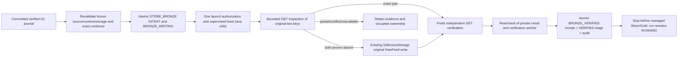

# E5 D1–D5b-2a — managed Content, recovery and explicit resume

Current checkpoint: [D5b-2b inherited-attempt recovery and activation blocker](d5b2b-inherited-recovery-validation.md).
The [Gate B0 envelope audit](content-recovery-envelope.md) corrects the Content admission limit
to eight feeds and documents the remaining admission/retention blocker.
The [completion investigation](content-recovery-envelope-completion.md) records exact
private file budgets, native measurements and interrupted-write gaps. No operational
Content profile has a proved recoverable envelope; Gate B0 is incomplete and Gate B1
activation remains blocked. Retain original journals, ancestor/control evidence and native
data volumes; do not delete files to make capture fit or retry an incomplete publisher.
Ordinary Content worker dispatch remains disabled. The internal native pipeline and explicit
operator resume/recovery paths do not establish resource readiness for worker activation.

Status: **Partially implemented, internal checkpoint — October 30, 2026**, under
[issue #49](https://github.com/saurabh-tayade/distributed-data-intelligence-platform/issues/49).
This implements the accepted [RSS journal protocol](../architecture/durable-execution.md#rss-journal-and-recovery-protocol),
[ADR 0001](../adr/0001-rss-raw-ingestion-contract.md), [ADR 0002](../adr/0002-bronze-object-storage.md)
and [ADR 0010](../adr/0010-durable-execution-coordination-and-recovery.md).
D2 adds internal fenced Bronze publication, independent object reads and durable receipt confirmation.
[D3](#d3-managed-silver-lifecycle) adds fenced native Silver processing and independent qualification.
Managed Content remains **Partially implemented**. [D4](#d4-managed-gold-lifecycle) adds internal Gold;
[D5a](#d5a-managed-content-successful-completion) adds internal Content publication;
[D5b-1](#d5b-1-explicit-content-recovery) adds explicit read-only operator reconciliation.
Production Content dispatch, activation, general cancellation/retry execution, scheduling and automatic recovery remain deferred.
The D1 sections below describe the original fetch checkpoint; the [D2 lifecycle](#d2-storage-and-receipt-lifecycle)
and validation record describe the extension without changing those journal bytes or native contracts.
Earlier checkpoint status paragraphs and test counts are historical; the D5b-2a section records the current recovery and resume boundary.

## Lifecycle and authorization

Acceptance requires one durable fetch authorization, exact original bytes/metadata, a validated private
journal, a transactionally fenced checkpoint, no refetch after uncertainty, and unchanged native outputs.

The package-private [RssFetchExecution](../../services/content-api/src/main/java/platform/contentapi/execution/RssFetchExecution.java)
is an internal stage adapter. Production WorkerExecutionCapability and WorkerIdleLifecycle still dispatch
only the existing Reliability adapter. Test-only capability wiring admits Content runs for acceptance;
there is no new HTTP endpoint, production startup flag or operator command that activates Content execution.

```mermaid
flowchart LR
  frozen[Frozen source and runtime validation] --> intent[Committed FETCH_SOURCE INTENT]
  intent --> auth[Consume one durable launch authorization]
  auth --> child[Supervised Java fetch and candidate files]
  child --> candidate[Parent validates bytes and current authority]
  candidate --> complete[Completion marker written last and read back]
  complete --> checkpoint[Atomic RSS reference + VERIFIED stage + audit]
  checkpoint --> stop[D1 stops: no Bronze PUT or run success]
```



The adapter selects a source by its frozen UTF-8 ordering/ordinal, never a request URL or current source
revision. Existing FrozenRunSelection checks the captured configuration, endpoint digest, immutable
profile/storage bindings and relational source revision. A later source revision does not replace it.
The reviewed endpoint-ID immutability guard remains intact. Production URI checks retain public HTTP(S),
no credentials/query/fragment and approved source identity. Only an explicitly isolated immutable test
runtime accepts literal loopback endpoints; the production reviewed catalog still rejects them.

WorkerRepository uses the existing coordinator/run/attempt locks, exact instance/epoch/version tokens,
controls, attempt deadline, host guard and audit capacity. The committed INTENT binds the command SHA,
source identity and private namespace. Any earlier FETCH_SOURCE invocation for that run/source or
ordinal vetoes another intent, including an unacknowledged intent in another attempt. Binding the
command address/hash consumes authorization once. No transaction includes HTTP, filesystem I/O or
process execution. Child identity and start time are recorded through the existing supervisor pattern.

The prebuilt [ManagedRssFetch](../../ingestion/src/main/java/platform/ingestion/managed/ManagedRssFetch.java)
child uses the original HttpFeedFetcher with its default 5 MiB subscriber limit, no redirects, explicit
no-proxy policy, 10-second connection timeout and at most the existing 30-second request timeout.
Content-Length/chunked/conflicting-framing behavior is retained. The supervisor bounds the complete
child operation to 45 seconds, rejects descendants and bounds/drains stdout/stderr. Its existing
five-second heartbeat rechecks runtime, host ownership and database fencing. A 128 MiB Java heap is
an additional child bound, not a whole-process memory guarantee. XML is opaque: malformed HTTP framing
fails retrieval, while payload bytes are not parsed, decoded, normalized or decompressed here.

## Runtime and build boundary

No new Maven library dependency or database migration is required. The ingestion module's existing
Jackson and SDK dependency pins remain unchanged. The Content API launches the prebuilt ingestion JAR
with its exact explicit dependency-JAR list; it does not build/install dependencies during execution.
The PostgreSQL CI job now packages ingestion before its existing verify command. The independent
ingestion job continues to run its complete tests.

An immutable rssFetchRuntimeVersion=1 execution-profile row contains exactly pipeline, runProfileId,
runProfileSha256, deploymentSha256, javaHome, manifest, controlBindingId, testEndpoint and
httpTimeoutMillis. Its manifest contains exactly adapter, javaRuntime and classpath. The adapter is
fixed to platform.ingestion.managed.ManagedRssFetch; every classpath item has an absolute regular-file
JAR path and SHA-256. The manifest digest must equal the run's frozen deployment digest. The actual
Java runtime must be Java 21 and exactly match the manifest tuple and parent JAVA_HOME. Paths cannot
be substituted through request arguments or an ambient classpath. Hash checks are bounded to 128 JARs,
64 MiB per JAR and 256 MiB total. Rebuilding a JAR requires a newly reviewed runtime/deployment binding.

The runtime row and run profile must authorize the exact immutable CONTROL binding. Captured local
native roots must be disjoint from CONTROL. The held installation/root/file identities are rechecked;
stage admission requires at least the existing 1 GiB free-space floor. This is cooperative admission,
not a filesystem quota or a throughput/capacity measurement. The subprocess environment contains only
PATH, TZ and LANG, with no database, cloud or S3 credentials.

## Immutable private evidence

The fixed address beneath the installation's CONTROL root is:

```text
runs/<run UUID>/attempts/<attempt UUID>/fetch-source/<source ID>/<checkpoint UUID>/
  command.json
  payload.xml
  metadata.json
  descriptor.json
  result.json
  complete.json
```

Directories require the current owner and exact POSIX mode 0700; files require 0600. Files and the final
directory are created exclusively. Aliases, symlinks, hard-linked files, unexpected membership and
permission changes fail. Earlier evidence is never overwritten, moved, repaired or deleted.

| File | Bound and content |
| --- | --- |
| command.json | At most 64 KiB; protocolVersion=1, run/attempt/epoch/stage/ordinal/checkpoint, source/revision/config/endpoint hashes, frozen URI, runtime hash, exact Java tuple and fixed timeout/test policy |
| payload.xml | At most 5 MiB; exact received bytes, including empty or non-UTF-8 bytes |
| metadata.json | At most 64 KiB separately; exact original Bronze serializer bytes, including source URI, original UUID/UTC Instant, HTTP status, content type, declared length, payload length/hash/key |
| descriptor.json | At most 64 KiB; journalVersion=1, command SHA, immutable stage/source/runtime provenance, original RawFeed fields, actual length/SHA and expected payload/metadata keys and metadata length/SHA |
| result.json | At most 64 KiB; the existing strict version-1 safe machine-result shape, success or allowlisted retrieval failure; no payload or free-form exception |
| complete.json | At most 64 KiB; journalCompletionVersion=1, directory identity and exact candidate file membership, byte lengths, SHA-256 and device/inode/mtime/size stamps |

The additive S3BronzeStorage.preparedMetadata helper delegates to the writer's existing serializer;
the original write/retry/key algorithm is unchanged. The child reconstructs RawFeed from read-back
files and compares the exact shared serializer output. A deterministic nanosecond timestamp vector
verifies that no SQL timestamp conversion truncates the original Instant string.

The child writes only a candidate. After observing clean child exit, the parent verifies strict schemas,
identities, RawFeed/metadata/key agreement, hashes and directory membership. It checks authority again,
writes completion last, reads it back and revalidates all files. The final pre-checkpoint read must
match the original evidence, including completion-file identity/stamp. JSON stamp comparison uses
canonical bytes so equivalent parsed integer representations cannot be confused with a file change.

Each file is written with CREATE_NEW/NOFOLLOW_LINKS and FileChannel.force(true), then read back.
There is no directory fsync or tested power-loss/storage-controller guarantee. A crash during marker
creation can leave a partial marker, which cannot qualify as completion. Existence alone is never
verification. POSIX local filesystems and the existing cooperative installation/one-writer model are
required; hostile filesystem writers and distributed filesystem fencing are not claimed.

## Database checkpoint and failure boundaries

One existing PostgreSQL transaction inserts rss_deliveries in FETCH_JOURNALED, records the stage as
VERIFIED and appends its audit event. It retains exact descriptor bytes/hash, owning attempt, original
ingestion UUID and Instant text, payload length/hash and immutable relative journal address. Its
expected_evidence object contains bronze (the original expected keys/metadata length/hash),
completionSha256 and completionStamp. Stage result_address/hash anchor the exact completion file.
The descriptor carries run/attempt/epoch/checkpoint/stage/source identity. Existing foreign keys and
immutable-row triggers continue to apply. No response body enters SQL or public audit records.

The ledger is a stage checkpoint, not an analytical artifact or successful Content run. D1 leaves the
run RUNNING and coordinator occupied after success. It does not authorize STORE_BRONZE. Detailed fetch
codes stay in the private result; public history uses the existing VERIFIED, FETCH_FAILED and
FETCH_EVIDENCE_LOST classifications. Audit details contain only the fixed protocol version.

| Observation | D1 outcome |
| --- | --- |
| Intent/authorization acknowledgment lost, or interruption before launch | No second authorization/fetch; retain intent and any command files |
| Timeout, HTTP error/redirect, oversized or malformed HTTP framing | Safe private retrieval code; no successful journal; UNKNOWN stage and occupied RECOVERY_REQUIRED when fencing/DB are available |
| Retrieval/candidate lost before completion | Retain partial files; FETCH_EVIDENCE_LOST, no invented UUID/response or automatic refetch |
| Complete journal but no database checkpoint | Retain an orphan; read-only inspection reports no committed checkpoint and never adopts it |
| Database checkpoint acknowledgment lost | Stop authorization; explicit read-only exact-match inspection can confirm the committed row without any journal write, retrieval or token refresh. Database-backed inspection also works without an in-memory stage receipt and under a newly held guard; it never reconstructs an Owner token. |
| Database unavailable or token/host guard stale | No further completion/checkpoint authorization; retain the last durable state and occupied ownership |
| Changed/missing/unexpected/incomplete files, identity, permission or I/O failure | Verification fails; preserve evidence; no repair, silent adoption or successful checkpoint |

Runtime/host/database checks immediately precede effects, but no DB/filesystem distributed transaction
or exactly-once HTTP transport guarantee is implied. A committed intent permits at most one managed
fetch invocation; a lost acknowledgment is not proof that a request did not reach the publisher.
Existing explicit Reliability recovery remains restricted to its qualified pipeline. D1 introduces
no Content recovery command, lease takeover or automatic slot release. Keep production Content
dispatch disabled; qualified Content recovery and the remaining managed processing stages are prerequisites.

## D1 local validation and reproduction (historical)

Use the repository-pinned JDK 21 selection and a disposable PostgreSQL 17.11 image, never an operational
database. From the repository root, with JAVA_HOME pointing to JDK 21:

```sh
mvn -B -ntp -f ingestion/pom.xml verify
python3 scripts/test-rss-fetch-postgres.py --offline
python3 scripts/test-rss-fetch-postgres.py --offline --regression
python3 -I -B -m unittest discover -s .github/ci/tests -v
actionlint .github/workflows/ci.yml
npm run check
git diff --check
```

Omit --offline when populating the existing Maven cache. The harness owns a uniquely named container,
random disposable credentials and loopback port, waits for readiness, actually restarts PostgreSQL at
the test signal and removes only that container/its anonymous volumes in finally. It does not touch
existing databases or native datasets. The regression option adds all Content API unit tests and
existing PersistenceIT, WorkerCoordinationIT and ControlAdmissionIT. Their negative startup tests need
an absolute executable Python path; the harness supplies one when absent. They do not execute Python
or qualify native package versions. No Spark suite runs in this harness. For a single development case,
use --case followed by a RssFetchIT method name. Single-case mode requests a database restart only for
the restart case; default and regression modes require the restart controller acknowledgment.

Tests cover exact bytes, headers/absent headers, UUID and nanosecond Instant preservation; 5 MiB and
64 KiB limits; HTTP fixed/chunked/error/redirect/timeout/conflicting-framing cases; concurrent and
repeated invocation; faults at intent/authorization/child/completion/checkpoint/commit-ack boundaries;
stale epoch/version and guard loss; DB outages/rollback/restart; changed source/runtime binding;
missing/extra/replaced/symlinked/hard-linked/permissive private files; and untouched synthetic native
sentinels (bytes, mtimes and identities). Fault hooks are package-private test seams, not environment
or request-controlled production options.

Validation on October 26, 2026 used macOS 27.0.1/arm64, Oracle GraalVM JDK 21.0.7+8.1, Maven 3.10.0 and
the existing pinned PostgreSQL 17.11-bookworm digest in Docker. Maven ran offline against the existing
cache, with -Daether.syncContext.named.factory=noop for the local cache-lock environment. No dependency
upgrade was performed. These are local correctness measurements, not hosted CI performance or throughput.

| Executed validation | Result | Measured local elapsed |
| --- | --- | --- |
| ingestion Maven verify | 55 cases: 26 new journal/protocol vectors and all 29 earlier cases; zero failures/errors/skips | Maven total 5.156s |
| Scoped regression harness | All 326 Content API units and 184 PostgreSQL cases: PersistenceIT 28, WorkerCoordinationIT 56, ControlAdmissionIT 52 and then-current D1 48; zero failures/errors/skips; actual database restart | Full harness 123.30s |
| Final focused harness after receipt inspection and numeric-boundary additions | 43 existing runtime/guard/supervisor units and all 51 D1 cases; zero failures/errors/skips; actual database restart | Full harness 48.58s; D1 tests alone 39.46s |
| CI policy/gate tests | All 21 tests passed, including 32,768 selection/result combinations and D1 dependency cases | 1.499s on local Python 3.9.6 |
| Actionlint 1.7.12 | Workflow syntax, expressions and dependencies passed | No performance claim |
| Node.js 24.19.0 npm run check | All 52 Markdown files/local links and repository hygiene passed | No performance claim |
| Git whitespace check | git diff --check passed; no staged changes | No performance claim |

The regression and focused counts overlap; they are not additive distinct-test counts. The final focused
pass rechecked every D1 case after read-only receipt inspection and strict numeric guards were complete.
The broad pass exercised existing Reliability metadata, startup fencing, controls and recovery process
unit boundaries; full native Reliability execution/Spark recovery was not rerun. Hosted D1 CI is pending.
IntelliJ exposed debugger tools but could not create a run configuration for the new test, so runtime
validation used Maven. Development faults found and corrected an endpoint-ID fixture violation, JSON
integer/stamp comparison and acknowledgment-proxy leakage between test cases. Production endpoint
immutability and database foreign-key guards were preserved.

## D1 changed file inventory (historical)

```text
.github/ci/tests/test_policy.py
.github/workflows/ci.yml
README.md
docs/architecture/durable-execution.md
docs/operations/ci.md
docs/operations/managed-rss-fetch.md
ingestion/src/main/java/platform/ingestion/bronze/S3BronzeStorage.java
ingestion/src/main/java/platform/ingestion/managed/ManagedRssFetch.java
ingestion/src/test/java/platform/ingestion/managed/ManagedRssFetchTest.java
scripts/test-rss-fetch-postgres.py
services/content-api/pom.xml
services/content-api/src/main/java/platform/contentapi/execution/WorkerRepository.java
services/content-api/src/main/java/platform/contentapi/execution/RssFetchExecution.java
services/content-api/src/main/java/platform/contentapi/execution/RssFetchRuntime.java
services/content-api/src/main/java/platform/contentapi/execution/RssJournalFiles.java
services/content-api/src/test/java/platform/contentapi/execution/RssFetchTestSupport.java
services/content-api/src/test/java/platform/contentapi/management/RssFetchIT.java
```

## D2 storage and receipt lifecycle

Acceptance requires a committed D1 reference; unchanged journal bytes, original RawFeed identity and
frozen source/storage linkage; one durable storage authorization; actual bounded reads of both objects;
an atomic fenced receipt/stage/audit checkpoint; and no refetch, implicit repair or downstream execution.
The package-private RssBronzeExecution adapter is internal acceptance wiring, with no production caller,
HTTP endpoint, worker flag or operator retry command. WorkerExecutionCapability remains Reliability-only.



The parent resolves the captured revision/endpoint, immutable original fetch runtime/JAR hashes and
the exact frozen BRONZE binding. A newer source revision is never substituted. A separate immutable
bronzeRuntimeVersion=1 profile has exactly adapter (fixed to platform.ingestion.managed.ManagedBronze),
fetchRuntimeId, fetchRuntimeSha256, runProfileId, runProfileSha256, deploymentSha256, controlBindingId,
storageBindingId and storageBindingSha256. Its CONTROL and BRONZE associations must match the installation
and exact binding bytes. The original deployment/classpath remains authoritative. No new dependency,
migration, configurable command or alternative S3 client is introduced.

The accepted importBronzeVersion=1 binding supplies only endpoint, region, bucket and credentialsFile.
The existing LocalS3 restrictions remain: explicit HTTP loopback endpoint/port, no user info, query,
fragment or non-root path; explicit static credentials; no ambient credential chain or proxy; path-style
SDK requests, maxAttempts=1, and existing 5/10/30/20-second connection/acquisition/call/attempt bounds.
The private canonical credentials file must be owner-only 0600, bounded to 8 KiB, with exactly accessKey
and secretKey. Bytes/hash/file stamp are rechecked; no secrets enter commands, SQL, public audit or
stdout. The child has the existing restricted environment and 128 MiB heap. The supervisor allows at
most 180 seconds for the bounded sequence of SDK calls, rejects descendants and checks runtime,
host guard, evidence and database authority on the existing five-second heartbeat.

The existing coordinator locks, exact worker/attempt/epoch/versions, controls and attempt deadline fence
every authorization and checkpoint. Intent changes FETCH_JOURNALED to BRONZE_WRITING. A prior storage
intent for that ingestion or source ordinal in any attempt vetoes another invocation, including after
an unknown acknowledgment. Command binding consumes authorization once. PostgreSQL transactions do
not encompass object I/O. A database epoch cannot stop an already-issued S3 request; loss of authority
stops further managed authorization/checkpointing and retains the occupied slot for qualified review.

## D2 exact objects and private receipt evidence

The fixed child reopens D1 using its committed descriptor, completion hash/stamp, strict membership and
file identities, then delegates RawFeed reconstruction and exact metadata comparison to ManagedRssFetch.
It never calls HttpFeedFetcher. The unchanged BronzeKeys and S3BronzeStorage preserve original UUID,
nanosecond Instant text, keys, metadata serialization, content and overwrite rules. D1 files remain
byte-for-byte unchanged, including mtimes/inodes. No native analytical output is created or modified.

BronzeObjectVerifier independently GETs both original keys using the existing LocalS3 factory. Fresh
clients perform read-back after writing and a second complete confirmation for an exact pair. It checks
headers, exact body bytes, length and SHA-256 against original payload/metadata, using an 8 KiB read
buffer, the original 5 MiB/64 KiB bounds and abort-on-mismatch to avoid draining oversized responses.
Content-Encoding must be absent/empty. Metadata must have application/json. The writer still sends
application/octet-stream for payload; real pinned SeaweedFS 4.48 returns application/xml for payload.xml.
Its [GET implementation](https://github.com/seaweedfs/seaweedfs/blob/4.48/weed/s3api/s3api_object_handlers.go#L2185)
falls back to the filename MIME when stored MIME is absent. D2 accepts only these two payload read types
and retains the actual observed type in the receipt. It never alters native PUT headers or uses a
response-content-type override. Other types, encodings, lengths or bytes are conflicts.

New evidence is separate from the original journal:

```text
runs/<run>/attempts/<original attempt>/store-bronze/<checkpoint>/
  command.json
  evidence.json
  result.json
  verified.json
```

Each file is bounded to 64 KiB and uses existing exclusive 0600 writes/read-back, private 0700 directory,
no-symlink/hard-link checks and file forcing. verified.json anchors checkpoint/command/evidence/result
hashes plus observed child PID/start and clean exit; the terminal stage stores its exact hash/address.
No directory fsync or additional power-loss guarantee is claimed. An incomplete anchor is not completion.

The strict receiptVersion=1 object contains original runId, attemptId, sourceId, revision,
capturedConfigSha256, ingestionId, ingestedAt, payloadByteLength, payloadSha256, journalSha256,
storageBindingId, storageBindingSha256, bucket, expected (original keys/metadata length/hash),
payloadContentType and metadataContentType. It contains neither response bodies nor credential bytes.
One short transaction CASes the original BRONZE_WRITING row with null receipt to BRONZE_VERIFIED,
stores canonical receipt_bytes and metadata_sha256, verifies the stage and appends audit. Existing
V1–V7 migrations are unchanged. Application writes are write-once; existing DB guards alone do not
make every receipt column immutable against direct administrative SQL. Replay additionally checks
the canonical receipt against original evidence and the immutable terminal stage/private hash anchor;
tampering is rejected rather than adopted.

## D2 recovery classifications and boundaries

Read-only inspection uses a fresh INSPECT_BRONZE private namespace and the same fixed child in GET-only
mode. It accepts no Owner token, changes no receipt or object, refreshes no authority and cannot qualify
writer quiescence. It reports facts, not permission to retry. Repeated store calls cannot launch again.

| Observation | D2 outcome |
| --- | --- |
| Both exact objects | Read-only confirmation; a fresh one-shot stage can verify this existing pair without PUT. A committed receipt is confirmed only with its immutable original stage anchor. |
| Exact NoSuchKey for both keys | ABSENT; a fresh original authorization may publish. Following a consumed intent, inspection only classifies eligibility for future explicit storage-only retry. |
| Matching payload, exact NoSuchKey metadata | PAYLOAD_ONLY; no PUT by D2. ADR 0002 permits completion only under additional explicit retry authority, which is not activated here. |
| Metadata only, wrong bytes/type/length/encoding or inconsistent pair | METADATA_ONLY/CONFLICT; no repair, overwrite, delete or adoption. |
| Generic HTTP 404/NotFound, NoSuchBucket, authentication failure, timeout or I/O error | UNAVAILABLE, never proof of absence; no writes based on that observation. |
| Crash before first PUT or between PUTs | Keep committed intent, partial files and occupied ownership. Independent inspection distinguishes ABSENT/PAYLOAD_ONLY; it does not relaunch. |
| Both PUTs complete, read-back unavailable, or crash before receipt transaction | Exact pair may be inspected, but no verified receipt is invented or automatically finalized. Explicit Content reconciliation remains deferred. |
| Metadata PUT acknowledgment lost, independent GETs exact in the original authorized child | Verify and checkpoint once from actual reads; no repeated PUT. |
| Receipt transaction acknowledgment lost | Stop further authorization. Read-only inspection confirms the committed receipt/stage facts and original anchor; no second fetch, PUT or receipt rewrite. |
| Receipt transaction rolls back, or PostgreSQL unavailable | No partial receipt/stage/audit success. Retain original stage/slot; restore DB access for inspection, never infer rollback from a transport error. |
| Stale worker/epoch/version, host guard loss, changed journal/credentials/runtime/storage binding | Reject authorization/checkpoint; preserve earlier evidence and ownership. Already-issued object effects remain an external ambiguity. |

When ownership is current and DB access works, conflict/partial/unavailable results mark the stage
UNKNOWN and run RECOVERY_REQUIRED while retaining the active attempt. An interruption or lost DB/guard
may leave its last committed INTENT/RUNNING state instead. Neither outcome releases uncertain ownership.
Receipt success alone also leaves the Content run RUNNING with no stage_artifacts or publication.

## D2 local validation and reproduction

With the repository JDK 21 selected, Docker available and no operational database/storage selected:

```sh
mvn -B -ntp -f ingestion/pom.xml verify
python3 scripts/test-rss-fetch-postgres.py --offline --bronze
python3 scripts/test-rss-fetch-postgres.py --offline --bronze --regression
python3 -I -B -m unittest discover -s .github/ci/tests -v
actionlint .github/workflows/ci.yml
npm run check
git diff --check
```

The extended harness owns uniquely named PostgreSQL 17.11 and SeaweedFS 4.48 containers, digest-pinned
to the existing local infrastructure images. Synthetic random credentials, bucket ddip-d2 and random
host loopback ports are private to the run. It uses actual SDK bucket reads for readiness, restarts
PostgreSQL independently for D1/D2 receipt tests, and removes only its owned containers/volumes in finally.
--bronze --case METHOD selects one D2 method; omitting --bronze preserves D1 behavior. --regression
adds all Content API units and existing persistence/coordination/control plus all D1/D2 cases. It does
not execute Spark or the native processing chain. No Bronze production dispatch is enabled for testing.

The real storage suite uses synthetic exact RSS bytes, the actual Java child, a signed-request-preserving
HTTP fault proxy in front of real SeaweedFS, and a direct SDK fixture for seeding/snapshot inspection.
Only test code can seed conflicting pairs. Faults cover intent/authorization/child/read-back/checkpoint
and commit-ack boundaries, each PUT boundary, dropped PUT acknowledgment, DB outages/restart/rollback,
stale/concurrent owners, lost guard, changed private evidence/credentials and receipt/object tampering.
No production fault flags or test helper classes enter the child classpath.

Validation on October 26, 2026 used macOS 27.0.1/ARM64, Oracle GraalVM JDK 21.0.7+8.1, Maven 3.10.0,
PostgreSQL 17.11-bookworm and SeaweedFS 4.48 with the pinned digests above. Maven ran offline with
-Daether.syncContext.named.factory=noop for the local cache environment. The local interpreter was
Python 3.9.6 for harness/policy orchestration; no pinned Spark runtime is claimed by these tests.

| Executed validation | Actual result | Measured local elapsed |
| --- | --- | --- |
| Ingestion Maven verify | 73 cases: all 55 earlier cases plus 18 new verifier cases; zero failures/errors/skips | Maven 4.185s |
| Scoped stable regression, --offline --bronze --regression | 326 Content API units plus 229 PostgreSQL cases: Persistence 28, WorkerCoordination 56, ControlAdmission 52, D1 51, then-current D2 42; all passed, no skips; actual separate D1/D2 database restarts | Harness 204.18s; Maven 3m21s; D2 78.37s |
| Final focused D2 pass after metadata-digest guard | 43 runtime/guard/supervisor units and all 43 D2 cases; zero failures/errors/skips; actual database restart | Harness 92.59s; Maven 1m26s; D2 79.71s |
| CI policy/gate/workflow checks | All 22 passed, including 32,768 gate combinations, new shared-helper selection and pinned storage isolation/cleanup | Python 2.346s |
| Actionlint 1.7.12 | Workflow syntax/expressions/dependencies passed | No performance claim |
| Node.js 24.19.0 npm run check | All 52 Markdown files/local links and repository hygiene passed | No performance claim |
| git diff --check and scope review | Passed; no staged changes; native writer/keys/LocalS3, accepted ADRs, migrations and production worker capability unchanged | No performance claim |

The regression and focused counts overlap. The additional final case rejects tampering with the ledger
metadata digest; the focused pass rechecked every D2 case after this final guard. The broad pass covers
existing Reliability metadata, admission, fencing, controls, import/process/recovery unit boundaries;
full native Reliability execution/recovery and expensive Spark suites were not rerun. CI retains all
those suites. Hosted D2 execution remains pending. These timings measure local correctness runs, not
hosted CI improvement, throughput or capacity. The initial sandboxed ingestion attempt could not bind
its existing loopback fixtures; the same command passed once local socket access was allowed. Earlier
development fixes canonicalized the test credential path and accounted for the real SeaweedFS MIME
fallback; production endpoint and native PUT policies were preserved. IntelliJ had no runnable
configuration for the new integration test, so runtime evidence came from Maven and real services.

The happy-path real SeaweedFS assertions independently read the ten original bytes (base64
PGZlZWQ+AP8NCg==, SHA-256 7d1b649c3a062baf04233412d57c5c792cb0236a0638cdb61f2584e6e4bbb0e7),
compare stored metadata byte-for-byte with D1 metadata.json, verify UUID/Instant and the stored metadata
digest, observe exactly two PUTs and at least eight GETs, then repeat read-only receipt confirmation.
Backend snapshots include actual Base64/length/type/ETag/last-modified values and remain identical across
replay. Journal file hashes/mtimes/inodes and native sentinel snapshots are unchanged; RSS retrieval count
remains one and DELETE count zero. A pre-existing exact pair requires zero PUTs. Receipt bytes and object
snapshots survive an actual PostgreSQL restart. Conflicting pairs and partial or unavailable states never
produce a verified receipt or trigger repair. The real storage test fixture is excluded from the
production child classpath.

### D2 exact changed files

The checkout was on main at merged D1 commit d45a814; no branch switch, staging, commit, push, PR or
GitHub mutation was performed. The expected feature/e5-d2-managed-bronze-receipts branch still needs
owner-managed preparation before any publication. All changes are uncommitted:

```text
.github/ci/classify.py
.github/ci/tests/test_policy.py
.github/workflows/ci.yml
README.md
docs/architecture/durable-execution.md
docs/operations/ci.md
docs/operations/managed-rss-fetch.md
ingestion/src/main/java/platform/ingestion/bronze/BronzeObjectVerifier.java
ingestion/src/main/java/platform/ingestion/managed/ManagedBronze.java
ingestion/src/test/java/platform/ingestion/bronze/BronzeObjectVerifierTest.java
ingestion/src/test/java/platform/ingestion/managed/BronzeFixture.java
scripts/test-rss-fetch-postgres.py
services/content-api/pom.xml
services/content-api/src/main/java/platform/contentapi/execution/PreflightFiles.java
services/content-api/src/main/java/platform/contentapi/execution/RssBronzeContext.java
services/content-api/src/main/java/platform/contentapi/execution/RssBronzeExecution.java
services/content-api/src/main/java/platform/contentapi/execution/RssFetchExecution.java
services/content-api/src/main/java/platform/contentapi/execution/RssFetchRuntime.java
services/content-api/src/main/java/platform/contentapi/execution/WorkerRepository.java
services/content-api/src/test/java/platform/contentapi/execution/RssBronzeTestSupport.java
services/content-api/src/test/java/platform/contentapi/management/BronzeFaultProxy.java
services/content-api/src/test/java/platform/contentapi/management/RssBronzeIT.java
services/content-api/src/test/java/platform/contentapi/management/RssFetchFixtures.java
services/content-api/src/test/java/platform/contentapi/management/RssFetchIT.java
```

No consequential departure from ADR 0002/0010 required a new ADR. The narrow SeaweedFS read-MIME mapping
is an observed adapter compatibility rule; the original writer, metadata serializer, key scheme and
standalone Content pipeline are unchanged. Owner-managed next steps are to prepare the intended branch,
review the uncommitted patch and run hosted CI after publication, retaining existing branch protection.
Do not activate production Content dispatch from this checkpoint.

## D3 prerequisites and remaining limits

Managed Content remains **Partially implemented**. D3 must consume only these original verified receipt
keys and qualify Silver/retained-history evidence before any later Gold/Content work. Internal storage
acceptance is not complete worker-managed RSS→Silver→Gold processing. Production Content dispatch,
operator retry activation, orphan receipt finalization, explicit Content writer-quiescence qualification,
automatic recovery, cancellation and scheduling remain deferred. A matching payload-only orphan is
classified but cannot yet be resumed by a managed operator action. Existing Reliability recovery remains
pipeline-restricted; no Content takeover is introduced.

Keep PostgreSQL/SeaweedFS/CONTROL persistent and restricted. Private journals contain original publisher
bytes/provenance; do not expose them in public artifacts/logs or prune active, unresolved or referenced
evidence. Retention, capacity management and qualified recovery remain manual. No automatic cleanup,
backup/restore certification, distributed fencing, filesystem quota or end-to-end power-loss durability
is supplied. Hosted CI and full native Spark processing are separate from the scoped local evidence.

## D3 managed Silver lifecycle

Status: **Partially implemented, internal checkpoint — October 30, 2026**.
D3 adds Silver processing to D1/D2. Production Content dispatch remains disabled. The
historical D2 stop point above describes that checkpoint, not D3's current internal seam.
The run remains `RUNNING` at `SILVER` with its global ownership slot occupied after verified
Silver. No Gold or Content enrichment is launched or activated.

Acceptance criteria are exact committed D2 inputs, unchanged D1/D2 evidence, actual native
accepted/rejected Parquet, independent full qualification, immutable verified replay,
fenced single-use launch and atomic stage/artifact registration. Failure tests must preserve
occupied ownership and demonstrate no replacement writer or downstream stage.

### Input selection and native compatibility

`RssSilverExecution` requires a confirmed Content owner and all selected source deliveries
in `BRONZE_VERIFIED`. It revalidates the frozen source revisions and storage/runtime bindings,
reopens the original D1 journal, checks the D2 stage's private immutable anchor and uses D2's
GET-only inspection to compare the original receipt against actual Bronze objects.
Each Silver invocation consumes exactly one frozen source ordinal and its original receipt.
The adapter GETs only its metadata and payload keys, checks their object MIME/encoding/length evidence and byte hashes against
that receipt, validates native metadata/source/ingestion/time/key identity, then passes those
verified bytes to native `process_one`. Bronze is rechecked after processing and qualification.
There is no S3 listing, source-prefix discovery, second RSS fetch or implicit retained-history
expansion. Source enablement/configuration edits cannot replace a captured revision.

The existing CLI already accepts exact `--metadata-key` selection. D3's small private command
adapter supplies additional receipt checks and supervision without modifying the CLI or
normalizer. The native `v1/<bucket SHA-256>/source_id=…/ingestion_date=…/ingestion_id=…`
namespace, completion bytes/identity, schemas, warnings/rejections, repeated observation
semantics and partitioning stay native. Original Bronze nanosecond timestamp text stays in
the receipt; native Silver retains its existing microsecond precision.

### Stage, runtime and supervision

| Boundary | Durable behavior |
| --- | --- |
| Admission | Confirm owner, complete D2 set, frozen source/run/storage/runtime and D2 evidence; no Silver writer yet |
| Intent | Insert one `SILVER` row for the frozen ordinal, command digest and exact selection identity; advance run version |
| Authorization | Commit command address/digest exactly once against attempt/epoch/instance and stage/owner versions |
| Child | Record PID, process start instant and child instance; `RUNNING`; use the existing Spark-capable supervisor |
| Qualification | Separate read-only Spark process; capture its identity and hashes in private evidence |
| Checkpoint | Final GET/hash/inventory recheck; atomically register/reuse exact artifact, link stage, mark `VERIFIED`, append audit |
| After checkpoint | Return without releasing ownership, completing the run or starting Gold/enrichment |

The additive reviewed runtime profile pins Python 3.12.15, PySpark 4.0.2, Boto3/Botocore
1.43.114 and Java 21; module hashes bind the adapter, native producer/normalizer, native
reader and import qualifier. It binds the D2 runtime digest, original run profile/deployment,
canonical processing root, frozen Silver/TEMP roots and root device/inode identities.
The Python interpreter is explicit, isolated (`-I -B`), with an environment whitelist; no
ambient credentials, shell text, dependency installation or runtime build is accepted.

Spark uses the existing `local[2]`, UTC, two shuffle partitions and native publication path.
A private per-child scratch directory contains Spark temporary state; the read-only qualifier also binds its warehouse there. The existing
supervisor enforces at most 900 seconds per child, five-second heartbeats, 16 MiB per output
stream and at most 32 observed descendants; cleanup uses the existing bounded grace/force
windows. The writer explicitly shuts down and reaps its gateway. The independent import
qualifier retains its supported shutdown checks. All children run outside PostgreSQL
transactions; authority and guard are rechecked at launch, heartbeat and checkpoint boundaries.
Private commands/results and scratch evidence are retained; native outputs are never cleanup
or recovery targets. This is a trusted single-host worker boundary, not hostile-process
containment, multi-node Spark or a performance/scalability claim.

### Verification, replay and recovery classifications

The read-only verifier calls existing `silver_import_qualification.execute` and
`silver_inputs.load_inputs` for the exact intended completion marker. It checks original
publication identity, completion bytes, physical schema/data files, accepted/rejected counts,
required row values, replay keys, source/ingestion/Bronze provenance, all namespace membership
and file hashes/identities. Its evidence preserves the native completion and managed inventory
fingerprint. Qualification does not reconstruct every content field from the raw feed.

The final read-only recheck compares the entire captured local/Bronze baseline after all
verification actions and immediately before registration. Existing artifact rows must match
full qualification bytes; a database row, child exit or completion marker alone is insufficient.
Stage evidence anchors the original D2 receipt digest, reviewed runtime, qualification
bytes and native `silver_inputs.inventory` manifest/input-set fingerprint. The manifest is
retained as private `selection.json`; no native product metadata is rewritten. Registration uses the same format as qualified Silver imports. No migration is added.

| Observation | D3 action |
| --- | --- |
| Missing/unverified/changed D2 receipt or object | Reject before Spark processing; never substitute a later snapshot |
| Changed binding/runtime/module or original identity | Fail closed; never move data to another root or UUID |
| Launch failure, processing failure, timeout or interrupted child | Block the stage and retain ownership; no automatic relaunch |
| Missing/incomplete/corrupt/unexpected Silver output | No verified artifact; never overwrite, repair, delete or resume namespace |
| Output created before a crash or failed verification | Retain output and intent/history, with ownership occupied |
| Stale owner, guard loss or PostgreSQL outage | Stop authorization/heartbeat progression; supervisor cleans up conservatively; retain occupied evidence |
| Lost intent/authorization acknowledgment | No launch without confirmed acknowledgment; repeated invocation cannot create a new intent |
| Lost verification acknowledgment | Full read-only inspection may confirm the existing committed stage/artifact; no owner refresh or duplicate registration |
| Identical completed publication | Full applicable qualification and original identity/baseline checks required; bytes remain unchanged |
| Uncertain child termination or unknown acknowledgment | Preserve recovery ownership and private process/evidence records; no automatic retry |

`inspect` is a read-only internal committed-result inspection, not Content reconciliation.
It can confirm success after a lost acknowledgment; it cannot adopt an owner, finalize a
failed run or release the global slot. The current Reliability operator-recovery command
continues to reject Content. Do not use it to force a Content disposition.

### D3 reproduction and evidence

Use the existing pinned local environment; all feeds and storage are disposable synthetic
fixtures. No publisher requests or cloud credentials are used.

```sh
export JAVA_HOME=$(/usr/libexec/java_home -v 21)
export DDIP_TEST_PYTHON="$PWD/outputs/silver-python312/.venv/bin/python"
export PYSPARK_PYTHON="$DDIP_TEST_PYTHON"
export SPARK_LOCAL_IP=127.0.0.1
PYTHONPATH=processing:processing/tests "$DDIP_TEST_PYTHON" -B -m unittest test_managed_silver
python3 scripts/test-rss-fetch-postgres.py --offline --silver
# One scoped backend regression after focused stabilization:
python3 scripts/test-rss-fetch-postgres.py --offline --silver --regression
# Scoped native regression, using the same pinned runtime:
PYTHONPATH=processing:processing/tests "$DDIP_TEST_PYTHON" -B -m unittest \
  test_managed_silver test_bronze test_silver test_silver_inputs test_silver_import_qualification
```

`--silver --case METHOD` restricts development runs to one D3 method. `--silver` implies
`--bronze`; the harness creates PostgreSQL 17.11 and SeaweedFS 4.48 at the existing pinned
image digests, builds the existing ingestion adapter before tests, and removes only its
owned disposable containers/volumes in `finally`. Regression includes the existing D1/D2
restart checks. D3 does not introduce a production command or worker dispatch option.
Measured evidence and exact changed files are recorded below after validation.

### D4 prerequisites

Managed Content Processing remains **Partially implemented**. D4 still needs explicit
retained-history/fresh-Silver dependency freezing, applicable reference qualification,
native Gold/Content preparation and publication boundaries, downstream full verification
and final run disposition. Content-specific occupied-owner/process review and reconciliation
must be designed and tested before any operational recovery claim. Production dispatch
requires a separately authorized capability/worker integration and end-to-end acceptance.
Cancellation/guarded retry, storage-only retry, Operations UI and production performance
remain outside D3. No accepted ADR is changed by this checkpoint.

### D3 exact changed files

Paths are repository-relative; generated datasets, runtime caches and logs are ignored.

- `docs/adr/0015-managed-silver-receipt-adapter.md`

- `docs/adr/README.md`

- `docs/architecture/durable-execution.md`

- `docs/operations/managed-rss-fetch.md`

- `ingestion/src/test/java/platform/ingestion/managed/BronzeFixture.java`

- `processing/managed_silver.py`

- `processing/tests/test_managed_silver.py`

- `scripts/test-rss-fetch-postgres.py`

- `services/content-api/README.md`

- `services/content-api/pom.xml`

- `services/content-api/src/main/java/platform/contentapi/execution/PreflightFiles.java`

- `services/content-api/src/main/java/platform/contentapi/execution/RssSilverExecution.java`

- `services/content-api/src/main/java/platform/contentapi/execution/RssSilverRuntime.java`

- `services/content-api/src/main/java/platform/contentapi/execution/WorkerRepository.java`

- `services/content-api/src/test/java/platform/contentapi/execution/RssSilverTestSupport.java`

- `services/content-api/src/test/java/platform/contentapi/management/RssFetchFixtures.java`

- `services/content-api/src/test/java/platform/contentapi/management/RssSilverIT.java`

### D3 measured local validation — October 29, 2026

Environment: macOS 27.2 arm64; GraalVM Java 21.0.7; Python 3.12.15; PySpark 4.0.2;
Boto3/Botocore 1.43.114; disposable PostgreSQL 17.11 and SeaweedFS 4.48 at the harness's
pinned digests. The scoped regression ran ingestion, backend and native Spark sequentially.
Timings below measure correctness workloads, not performance or production scalability.

| Run | Actual result | Elapsed |
| --- | --- | --- |
| Initial passing exact publication/replay smoke | 43 existing runtime/guard/supervisor units plus 1 D3 case; no failures/errors/skips | Harness 38.21s; D3 29.68s |
| Initial focused fault matrix | Same 43 units plus 20 then-current D3 cases; no failures/errors/skips | Harness 156.38s; D3 147.2s |
| Expanded development matrix | 43 units passed; 30 D3 cases: 28 passed, 1 fixture assertion failure, 1 fixture source-revision error | Harness 242.99s; D3 232.9s |
| Corrected exact publication/replay smoke with final headers/process evidence | 43 units plus 1 D3 case; no failures/errors/skips | Harness 40.56s |
| Corrected deterministic process-start failure | 43 units plus 1 D3 case; no failures/errors/skips | Harness 10.73s |
| Final scoped ingestion regression | 73 tests, no failures/errors/skips | Driver 4.75s; Maven 4.014s |
| Final scoped backend regression | 326 units plus 261 PostgreSQL cases, no failures/errors/skips | Harness 450.65s; driver 450.73s |

The final PostgreSQL cases are WorkerCoordination 56, ControlAdmission 52, D1 51, D2 43,
Persistence 28 and D3 31. D3 took 245.1s, D1 39.69s and D2 77.35s. D1 and D2 each
survived a separate actual PostgreSQL container restart. D3's outage fault disables new
connections and terminates target-database sessions immediately after writer child identity
registration; supervision then stops on loss of authority. These are distinct fault mechanisms.

Development failures were corrected before the final regression: initial fixture setup lacked
`PER_CLASS` and used an incorrect Silver binding; the expanded matrix submitted a historical
source revision for its unrelated queued run and relied on macOS behavior for an invalid
executable. The final launch test instead removes its disposable executable immediately after
committed authorization, deterministically exercising `PROCESS_START_FAILED` with occupied
ownership. Intermediate runs are overlapping development evidence, not additional distinct
coverage or successful final passes.

The final D3 success fixture produced accepted=1 and rejected=1 using actual native Parquet.
Its registered artifact was `d6d06843-775b-479d-a8d3-27744a5cbba6`, with completion SHA-256
`0b99920a896009480d85fecee0d0f223a251c6a71f3e6b185d5c28dd05deeabf` and managed inventory
SHA-256 `49e4f83be61fea2a9f3982ed76e7570194f393224ec1b9765fc2e1cc8945bdad`.
These identify this disposable synthetic run; UUIDs, publication bytes and fingerprints vary
with original ingestion identity/time across fresh runs. Within the run, two full read-only
inspections preserved all publication hashes, timestamps and inode identities. The original
D1 journal, D1/D2 stage checkpoint hashes/versions and committed D2 receipt remained unchanged.
The native selection manifest/input-set fingerprint and qualifier process evidence are bound
to the private stage anchor; neither management run IDs nor runtime settings enter products.
Disposable evidence is removed by test teardown; this is a test-log witness, not a retained
operator artifact or a claim about a private dataset.

The 31 final D3 cases cover committed exact selection, frozen-byte handoff, real publication,
full verified replay, missing/changed Bronze metadata and payload, unavailable receipt/object
reads, changed module/runtime veto, malformed feed processing failure, child-start failure,
crashes before/after authorization and after output/qualification, lost launch/verification
acknowledgments, stale owner, guard loss, worker interruption, database connection outage,
incomplete/corrupt/unexpected output, post-qualification Bronze mutation and atomic artifact,
stage-link, stage-result and audit registration. They assert no second ambiguous writer,
duplicate artifact/link, unrelated queued execution or managed Gold/enrichment stage.

The final scoped native regression passed **83 tests** in **74.274s** (driver **74.49s**):
`test_managed_silver`, `test_bronze`, `test_silver`, `test_silver_inputs` and
`test_silver_import_qualification`. It printed Python socket `ResourceWarning` diagnostics;
there were no unittest failures/errors/skips. Managed D3 child termination is checked
separately by the supervised acceptance cases.

The sequential ingestion/backend/native driver took **529.97s**. Its **743 distinct cases**
are 73 ingestion + 326 backend units + 261 PostgreSQL + 83 native Python/Spark. The native
group includes the 9 new receipt-adapter tests. Earlier focused runs repeat cases within
these groups; their counts must not be added. The separate **22 passing CI-policy tests**
bring distinct test coverage to **765 cases**, not a sum of every development invocation.
Markdown/hygiene checks are consistency checks and are excluded from test-case totals.

The change-aware classifier was evaluated against the complete working-tree change inventory
(tracked diff plus new files, since staging/commits were prohibited). It selects all five
backend jobs: ingestion, processing_python, analytics_jdbc, content_postgres and analytics_http.
The PostgreSQL Maven profile includes `RssSilverIT`; the existing CI job already builds the
Java adapters, installs the pinned Bronze/Spark dependencies and starts isolated SeaweedFS.
No workflow, dependency or migration change is required. Hosted CI and the full platform
suite were not run locally; the evidence above is the requested scoped backend/Spark regression.
Production Content dispatch, managed Gold/enrichment, operational Content recovery and
large-scale validation remain deferred. ADR 0015 remains an implementation record awaiting
owner acceptance; accepted ADRs are unchanged.

### PR #71 hosted CI correction

The initial hosted D3 run exposed a test ordering dependency on the 30-second active-owner
admission heartbeat window. Full read-only replay intentionally does not heartbeat execution;
submitting another run after two slow inspections correctly failed closed. The fixture now
checks queued admission/competing ownership while actively heartbeating, before replay, and adds
a deterministic stale-owner replay/admission rejection case. The original immutable publication,
receipt, duplicate-launch and occupied-slot checks remain. No application fencing, supervision,
recovery or native processing behavior changes. See the
[root cause, hosted/local evidence and 90-minute PostgreSQL job budget](ci.md#pr-71--d3-hosted-failure-and-postgresql-budget).
Managed Content remains **Partially implemented**; D4, Gold/enrichment, operational Content recovery
and production Content dispatch remain deferred.

## D4 managed Gold lifecycle

Status: **Partially implemented, internal checkpoint — October 30, 2026**.
The committed D3 branch and its PR #71 timing correction were reviewed at merged main
`67f8df4`; ADR 0015 is still an implementation record with owner acceptance pending.
D4 adds Gold preparation/publication, not a complete managed Content workflow. Production
Content dispatch stays disabled, and no publisher-reference enrichment, final Content
SUCCEEDED/FAILED disposition, coordinator release, API activation or ANALYTICS_PUBLICATION
change is performed. Prior analytical consumers keep their explicitly configured publication.

Acceptance criteria: a complete exact D3 Silver set; native canonical identity; fenced preparation
and publication; actual article/daily Parquet equivalent to standalone Gold; independent full
native/Spark and DuckDB verification; immutable replay; atomic evidence/dependency registration;
fail-closed faults with occupied ownership; unchanged D1/D2/D3 contracts and dispatch boundary.
See [ADR 0016](../adr/0016-managed-gold-frozen-dependencies.md), an implementation record awaiting
owner acceptance. Accepted ADRs and ADR 0015's approval status remain unchanged.

### Exact Silver completeness and freeze

`RssGoldInputs` resolves every frozen fresh source ordinal to exactly one committed `VERIFIED`
D3 `SILVER` result artifact. No partially successful multi-source run can prepare Gold. The set
also includes precisely the submitted `RETAINED_SILVER` IDs; each must have original D3
stage/anchor proof. D4's owner request limits consumption to D3-verified artifacts, so older
import-only history is rejected explicitly, not silently omitted. This is a narrower checkpoint
than the execution contract's eventual general imported-history capability. Incompatible old
runtime/root bindings remain unavailable; no marker or deployment is silently upgraded.

The proof reopens D1/D2/D3 original command/result anchors, verified Bronze receipts and qualified
Silver evidence. The Gold adapter rechecks exact Bronze bytes, MIME/encoding/length evidence,
source/ingestion/time/key identity, Silver namespace membership/hashes/identities, physical schemas,
required values and provenance with existing native readers. All selected artifacts must share
one approved Silver binding and compatible reviewed D3 runtime. At most 128 unique artifacts and
1 GiB of selected captured Silver files enter preparation; duplicate IDs/markers, missing stages,
incompatible versions/bindings and unexpected selected items fail closed.

Preparation calls `silver_inputs.load_inputs` with only that explicit marker list. Native UTF-8
marker ordering, replay collapse, canonical manifest serialization, counts and fingerprint are
unchanged. Fresh-source order and explicit retained IDs are bound in the private managed selection;
only the native manifest identifies Gold. No bucket listing, directory-wide discovery, latest
lookup, refetch, registered-artifact scan or unrecorded expansion is used. Later source revisions,
new artifacts and new unselected Silver namespaces cannot replace the frozen dependencies.

### Stage and process sequence

| Boundary | Evidence and effect |
| --- | --- |
| Resolve | Confirm live owner/guard and complete D3 set; bind original artifact IDs, receipts, qualified inventories and compatible runtime |
| PREPARE_GOLD INTENT | Commit selection/command digests and exact attempt/epoch/instance versions before the read-only Spark child |
| PREPARE_GOLD RUNNING | Single-use launch authorization, recorded child identity and existing bounded supervision; full Silver qualification and one native combined manifest |
| PREPARE_GOLD VERIFIED | Retain native manifest/fingerprint/counts and private child/hash anchors; commit exact INPUT artifact links, stage result and audit together; no Gold namespace is created |
| PUBLISH_GOLD INTENT | Reopen committed preparation/links and identical reviewed runtime; bind exact native fingerprint before output-capable launch |
| PUBLISH_GOLD RUNNING | Existing `gold_publication.publish` on the exact revalidated inputs; existing complete namespace can only follow native full replay verification |
| Independent verification | Separate supervised Spark process invokes read-only native Gold verification against selected Silver, then the existing DuckDB opener and bounded quality report |
| Final recheck | GET/hash/inventory checks revalidate Bronze, Silver, Gold completion/manifest and every analytical/bookkeeping file after all verification actions |
| PUBLISH_GOLD VERIFIED | One short fenced transaction registers/reuses the exact Gold artifact, Silver dependency edges, stage RESULT link, counts and audit |
| D4 stop | Run/attempt remain RUNNING, current stage PUBLISH_GOLD and global slot occupied; no enrichment, final disposition or activation |

The fixed Gold runtime profile binds an approved D3 runtime digest, exact Python executable,
Gold-root binding, six Gold/verifier module hashes, DuckDB 1.4.5 and a deadline of at most
900 seconds per child. D3's profile also pins Python 3.12.15, PySpark 4.0.2, Boto3/Botocore
1.43.114, Java 21, native Silver module hashes and Silver/TEMP/control bindings. Root identities,
module hashes, credential-file bytes and current authority are rechecked at the existing
boundaries. Gold never accepts a submitted script, command string or arbitrary runtime setting.

The existing Spark-capable supervisor provides explicit PID/start/instance identity, five-second
heartbeats, independent 16 MiB stream bounds, at most 32 observed descendants, fixed cleanup windows
and per-child deadlines. The wrapper explicitly shuts down and reaps its gateway before reporting
success. Private scratch holds Spark temporary state; private commands/results/evidence remain
under the installation guard. Selection work renews only an explicitly confirmed execution owner;
ownerless replay/inspection never refreshes authority. No transaction spans processing or file I/O.
These are trusted single-host cooperative controls, not hostile-process isolation, hard filesystem
quotas, multi-node Spark or an exactly-once guarantee.

### Native semantics and independent evidence

Gold invokes the unchanged standalone native publisher with validated inputs. Article catalog,
source/day activity, repeated observations, rejected-input exclusion, source-scoped article IDs,
UTC ingestion chronology, selected-row ordering, warning accounting, physical Parquet schemas,
partitioning and completion metadata remain native. The output namespace remains
`v1/processor_revision=1/input_set=<native input-set SHA-256>`; no management run/attempt, artifact
UUID, runtime path or operational configuration enters that fingerprint.

The additive `gold_publication.verify_publication` API exposes the existing full `_verify`
boundary without calling the writer or creating an absent namespace. It inspects physical schemas,
compares complete Gold row multisets against native Gold built from the selected Silver, validates
selected provenance, keys, observation/warning reconciliation, metadata and all listed file hashes.
The independent DuckDB opener additionally checks its schema mapping and article/daily SQL
invariants. A completion marker, child exit or artifact row alone is never enough.

Gold namespace capture reuses the existing bounded `content_metadata` evidence facility for exact
fixed flat layouts, including permitted Spark bookkeeping. It captures marker/manifest bytes,
complete file and directory membership, lengths, SHA-256 and filesystem identities/metadata.
Native Gold readers supply analytical validation; no transformation logic is reimplemented in
the control plane. A final read-only recheck compares this baseline and all original Silver/Bronze
inputs immediately before registration. Native bounds and the reviewed process deadline remain
in force; there is no weakened verification mode.

The existing schema already admits GOLD artifacts and both stage names. No migration or new
external dependency is needed. Managed artifact evidence has an internal version-1 envelope
with native fingerprint, original completion/selection, file capture and exact Silver artifact
IDs/evidence digests. `artifact_dependencies` records those Silver edges; `stage_artifacts`
links preparation inputs and the verified intermediate result to the owning run/attempt.

D3's committed registry identity is its qualified inventory digest; older imported Silver uses
the canonical address identity. Submission/frozen-selection metadata now recognizes both existing
forms only against validated qualification evidence, without rewriting rows. D4 additionally
requires the original committed D3 anchor and full native use-time verification.

### Replay, failures and recovery limits

| Observation | Classification and boundary |
| --- | --- |
| Missing/incomplete required D3 item or unsupported retained history | No preparation/publisher selection; never omit it or publish a partial fresh set |
| Duplicate/incompatible selection or changed input manifest/fingerprint | Reject before Gold effects; do not replace inputs with latest files |
| Changed/missing selected Bronze/Silver evidence | Unavailable/changed/invalid failure; no completed Gold registration |
| Known clean preparation or process-start failure | Stage FAILED when authority can record it; run remains occupied in recovery-required state |
| Launched writer interrupted, uncertain cleanup, corrupt/partial output or failed verification | Stage UNKNOWN or unresolved durable intent/running state; retain occupied ownership and all output |
| Existing incomplete native namespace | Native refusal; never resume, overwrite, repair, delete or rename it to success |
| Fully verified exact completed namespace | Native read-only replay; original bytes, hashes and modification times stay unchanged |
| Conflicting existing registry identity/evidence/dependency edges | Reject reuse and retain native output; never substitute or rewrite the row |
| Lost preparation/intent/launch acknowledgment | No automatic stage adoption or second publisher; preserve the committed/unresolved checkpoint |
| Lost final verification acknowledgment | Full read-only committed-result inspection can confirm the exact artifact without another registration or owner refresh |
| PostgreSQL outage/restart, stale owner or guard loss | Stop authority progression and clean children conservatively; never free the slot based on time or process exit alone |
| Artifact/dependency/stage/audit transaction failure | Roll back registration/linkage together; keep the immutable output and occupied stage evidence |

`RssGoldExecution.inspect` is an internal read-only confirmation of a committed publication,
including after an unknown commit acknowledgment. It cannot adopt an execution token, reconcile
an unregistered namespace, finalize Content or release the slot. Reliability's operator-recovery
command still rejects Content. Operational Content recovery, cancellation/retry and automatic
storage-only recovery are not activated by D4. Missing historical compatible runtimes or native
dependencies make replay unavailable; no degraded or metadata-only success is allowed.

### D4 reproduction and changed files

Use the reviewed pinned Python/PySpark/DuckDB environment and JDK 21 described above.
Set `JAVA_HOME`, `DDIP_TEST_PYTHON`, `PYSPARK_PYTHON`, `SPARK_LOCAL_IP=127.0.0.1` and `TZ=UTC`.
On Ubuntu, use its installed JDK 21 home; the macOS `java_home` helper is only a local setup example.

```sh
# Isolated native D1 -> D4/equivalence case first:
python3 scripts/test-rss-fetch-postgres.py --offline --gold \
  --case completeMultiSourceNativeGoldAndStandaloneEquivalence
# Focused D4 faults plus existing supervisor/guard units:
python3 scripts/test-rss-fetch-postgres.py --offline --gold
# One scoped backend regression after focused stabilization:
python3 scripts/test-rss-fetch-postgres.py --offline --gold --regression
# Scoped native regression (the measured run invokes these modules sequentially):
PYTHONPATH=processing:processing/tests "$DDIP_TEST_PYTHON" -B -m unittest -v \
  test_managed_gold test_managed_silver test_silver_import_qualification \
  test_gold test_gold_publication test_gold_analytics
python3 -m unittest discover -s .github/ci/tests -v
npm run check
```

`--gold` implies D3/D2 and uses the same digest-pinned disposable PostgreSQL/SeaweedFS setup;
`--offline` only requires already populated Maven dependencies. The focused matrix restarts
PostgreSQL after committed Gold; the scoped backend regression additionally performs the existing
D1/D2 restarts. Native test fixtures use a second independent Gold root solely to compare standalone
results, including native input-order independence. Generated data, credentials, logs and native
outputs are untracked; disposable services/volumes and JUnit fixtures are removed after execution.
No new production managed command, worker capability or dispatch option is installed.

The exact D4 source/documentation change inventory follows. Existing migrations, native schemas,
workflow settings, activation configuration and accepted ADR files are unchanged.

| File | Purpose |
| --- | --- |
| [.github/ci/tests/test_policy.py](../../.github/ci/tests/test_policy.py) | Require Gold integration coverage in profile wiring. |
| [docs/adr/0016-managed-gold-frozen-dependencies.md](../../docs/adr/0016-managed-gold-frozen-dependencies.md) | Record selection/verification decisions and alternatives; owner acceptance pending. |
| [docs/adr/README.md](../../docs/adr/README.md) | Index pending implementation record without changing approval status. |
| [docs/architecture/durable-execution.md](../../docs/architecture/durable-execution.md) | Current D4 execution/evidence/recovery boundary. |
| [docs/architecture/gold-publication.md](../../docs/architecture/gold-publication.md) | Document the additive read-only native verifier. |
| [docs/operations/ci.md](../../docs/operations/ci.md) | D4 classification/coverage and current 90-minute PostgreSQL budget. |
| [docs/operations/managed-rss-fetch.md](../../docs/operations/managed-rss-fetch.md) | D4 operator contract, validation and change inventory. |
| [processing/gold_publication.py](../../processing/gold_publication.py) | Add read-only full native verifier; publisher unchanged. |
| [processing/managed_gold.py](../../processing/managed_gold.py) | Fixed exact-selection PREPARE/PUBLISH/VERIFY/RECHECK adapter. |
| [processing/tests/managed_gold_fixture.py](../../processing/tests/managed_gold_fixture.py) | Independent standalone native comparison fixture. |
| [processing/tests/test_gold_publication.py](../../processing/tests/test_gold_publication.py) | Read-only verification cannot create or repair output. |
| [processing/tests/test_managed_gold.py](../../processing/tests/test_managed_gold.py) | Exact marker selection/ordering and incompatible/duplicate inputs. |
| [scripts/test-rss-fetch-postgres.py](../../scripts/test-rss-fetch-postgres.py) | D4 local harness, scoped regression and actual Gold DB restart. |
| [services/content-api/pom.xml](../../services/content-api/pom.xml) | Include RssGoldIT without removing existing required integration suites. |
| [services/content-api/src/main/java/platform/contentapi/execution/PreflightFiles.java](../../services/content-api/src/main/java/platform/contentapi/execution/PreflightFiles.java) | Permit existing Gold stage names in private evidence paths. |
| [services/content-api/src/main/java/platform/contentapi/execution/RssGoldExecution.java](../../services/content-api/src/main/java/platform/contentapi/execution/RssGoldExecution.java) | Fenced lifecycle, supervised native adapter, final verification and read-only confirmation. |
| [services/content-api/src/main/java/platform/contentapi/execution/RssGoldInputs.java](../../services/content-api/src/main/java/platform/contentapi/execution/RssGoldInputs.java) | Complete exact fresh/retained D3 dependencies and SQL rechecks. |
| [services/content-api/src/main/java/platform/contentapi/execution/RssGoldRuntime.java](../../services/content-api/src/main/java/platform/contentapi/execution/RssGoldRuntime.java) | Reviewed fixed Gold/D3 runtime and storage binding. |
| [services/content-api/src/main/java/platform/contentapi/execution/RssSilverExecution.java](../../services/content-api/src/main/java/platform/contentapi/execution/RssSilverExecution.java) | Expose committed D3 proof separately; retain full inspection verification. |
| [services/content-api/src/main/java/platform/contentapi/execution/WorkerRepository.java](../../services/content-api/src/main/java/platform/contentapi/execution/WorkerRepository.java) | Fenced stage persistence and atomic Gold artifact/dependency/audit checkpoint. |
| [services/content-api/src/main/java/platform/contentapi/importing/RegisteredImportEvidence.java](../../services/content-api/src/main/java/platform/contentapi/importing/RegisteredImportEvidence.java) | Metadata compatibility for both existing qualified Silver registry identities. |
| [services/content-api/src/main/java/platform/contentapi/management/FrozenRunSelection.java](../../services/content-api/src/main/java/platform/contentapi/management/FrozenRunSelection.java) | Preserve and validate actual registered native identity. |
| [services/content-api/src/main/java/platform/contentapi/management/RunRepository.java](../../services/content-api/src/main/java/platform/contentapi/management/RunRepository.java) | Admit consistent D3 metadata without rewriting registry rows. |
| [services/content-api/src/test/java/platform/contentapi/execution/RssGoldTestSupport.java](../../services/content-api/src/test/java/platform/contentapi/execution/RssGoldTestSupport.java) | Test-only internal seam and deterministic stage faults. |
| [services/content-api/src/test/java/platform/contentapi/management/RegisteredSilverIdentityTest.java](../../services/content-api/src/test/java/platform/contentapi/management/RegisteredSilverIdentityTest.java) | Metadata identity compatibility and mismatch rejection. |
| [services/content-api/src/test/java/platform/contentapi/management/RssGoldIT.java](../../services/content-api/src/test/java/platform/contentapi/management/RssGoldIT.java) | Actual D1-D4, replay, completeness, ownership, faults, rollback and restart acceptance. |

### D4 measured acceptance — October 29, 2026

Local environment: macOS arm64, Oracle GraalVM JDK 21.0.7, CPython 3.12.15,
PySpark 4.0.2, Boto3/Botocore 1.43.114 and DuckDB 1.4.5. PostgreSQL 17.11 and
SeaweedFS 4.48 used the unchanged digest-pinned disposable Docker images. Feeds were
synthetic; no live publisher, AWS access or cloud credentials were used. These are elapsed
acceptance-test measurements, not throughput, production-scale or multi-node benchmarks.

The first development smoke rejected the new proof reader's incorrect comparison of the
canonical address identity with D3's registered inventory digest (one D4 error, 33.33 seconds;
43.92-second harness). The proof now checks the original committed D3 inventory identity.
Separate metadata admission recognizes both established qualified Silver identity forms;
no registry rows or D1/D2 evidence were rewritten. Corrected and refined isolated native
smokes passed in 77.79/87.88 and 84.52/97.25 seconds (D4/harness respectively). The actual
process-start-failure case passed in 33.67/40.91 seconds. Each also ran the same 43 focused
runtime/supervisor units. These development reruns add no distinct tests to the totals below.

| Validation command/case | Passing tests | D4 suite seconds | Harness seconds |
| --- | ---: | ---: | ---: |
| `--gold` focused matrix | 26 D4 + 43 units | 866.2 | 875.75 |
| `--gold --case preparedSilverCannotChangeBeforePublication` | 2 D4 + 43 units | 59.16 | 69.26 |
| Final `--gold --case completeMultiSourceNativeGoldAndStandaloneEquivalence` | 1 D4 + 43 units | 84.68 | 92.17 |
| `--gold --regression` | 380 integration + 327 unit/component | See suites below | 1810.40 |
| Final review: `--gold --case conflictingRegistryIdentityIsNotReused` | 1 D4 + 43 units | 160.5 | 199.85 |

The scoped backend regression ran once after focused stabilization. Its 327 unit/component
cases include the same 43 focused units and the new qualified-Silver identity compatibility case;
the sum of its 20 reported unit-class durations is 12.641 seconds. Failsafe reported:

| Integration suite | Passing cases | Seconds |
| --- | ---: | ---: |
| `RssGoldIT` | 28 | 998.0 |
| `RunHistoryIT` | 46 | 36.79 |
| `WorkerCoordinationIT` | 56 | 30.83 |
| `RssSilverIT` | 32 | 293.8 |
| `ControlAdmissionIT` | 52 | 28.45 |
| `RssFetchIT` | 51 | 44.59 |
| `RunSubmissionIT` | 44 | 48.39 |
| `RssBronzeIT` | 43 | 283.3 |
| `PersistenceIT` | 28 | 28.03 |

All 380 integration and 327 unit/component cases passed with zero failures, errors or skips.
The restart controller confirmed actual Gold, RSS and Bronze database restarts. The final review
then added one narrowly scoped registry collision check: matching evidence/dependency bytes are
insufficient if kind/version/native identity disagree. Its isolated test uses matching Gold
evidence and Silver dependency edges with a conflicting registry identity; it rejects reuse,
keeps the native publication, leaves the stage unresolved and retains the occupied slot. That
final guard and its compilation were validated by the isolated command above; unchanged broad
paths were not rerun. No second heavyweight backend/platform regression was launched.

Native modules ran sequentially after the backend, using the commands above:

| Native module | Passing cases | Unittest seconds | Process wall seconds |
| --- | ---: | ---: | ---: |
| `test_managed_gold` | 5 | 0.002 | 0.23 |
| `test_managed_silver` | 9 | 0.002 | 0.13 |
| `test_silver_import_qualification` | 34 | 113.375 | 113.58 |
| `test_gold` | 5 | 46.119 | 46.46 |
| `test_gold_publication` | 20 | 179.892 | 180.78 |
| `test_gold_analytics` | 17 | 61.24 | 61.47 |

All 90 native cases passed without skips; their sequential process wall times total 402.65 seconds.
CI policy/gate tests passed 22 cases in 3.098 seconds. Actionlint, Markdown/local-link checks,
repository hygiene and `git diff --check` passed. The prospective complete working-tree change
list, including new files, contains 26 paths and classifies as full validation: ingestion,
processing_python, analytics_jdbc, content_postgres and analytics_http are all selected.
Every existing required selector and aggregate gate remains; the PostgreSQL budget stays 90 minutes.

**Distinct final count: 820 cases** = 707 scoped backend + 1 additional registry collision +
90 native + 22 CI policy/gate. D4 contributes 29 distinct integration cases: the 28-case regression
includes the earlier 26-case matrix and the two post-preparation mutation cases, followed by the
new collision case. The repeated smoke cases, 43-unit subsets and native selection rerun are
not added again. Unittest subtest loops/assertions and native child invocations are not counted
as separate test cases. Lint and workflow syntax checks are checks, not additional tests.

The two-source D1 -> D4 regression recorded this real independently verified native publication:

```text
input_set_fingerprint: e47465149fb22429b0108274f1adace9ca9e3e0bd64d01cc53aedd715ab67a31
complete.json SHA-256: 456b27a470ded04fcd5f74a2621c322be997d757ce3d3254f0d67898b03580ad
selected Silver:       2 original sources / 2 original ingestions
input observations:    4 accepted / 2 rejected
Gold output rows:      2 gold_articles / 2 gold_source_daily
```

The independent native verifier and DuckDB opener checked complete schemas, inventory/hashes,
selected lineage and article/daily observation accounting. A separate standalone publication
using reversed markers produced the same native fingerprint and complete analytical rows.
Committed replay preserved Gold/Silver bytes, hashes, inodes and modification times; D1/D2
journal/receipt evidence remained unchanged. Assertions also covered incomplete fresh selection,
unsupported imported-only history, duplicate/incompatible selections, missing/changed Silver
before and after preparation, substituted fingerprints, corrupt marker/Parquet, incomplete
namespace retention, launch failure, interruption/uncertain termination, stale owner/guard loss,
DB outage, acknowledgment loss, atomic registration/audit rollback, no duplicate invocation or
registration and exclusion of unrelated work, final Content stages and activation.

All publication data and PostgreSQL state in acceptance were disposable fixtures; the identities
above are observed test evidence, not an activated analytical publication. Full hosted Ubuntu/x86
CI, the complete PostgreSQL recovery/import profile, independent JDBC/HTTP integration jobs and
90-minute hosted job headroom still require verification. Local evidence does not claim these
checks ran. Prior D3 hosted timings in the CI guide are historical and separate from D4 measurements.

### PR #72 hosted follow-up

The D4 hosted run separately exposed a test-only Python layout assumption and the sequential
PostgreSQL job's 90-minute budget. The launch-failure fixture now uses the existing supervised
before-start authorization callback, without copying or modifying Python installations. It retains
known-clean failure, occupied ownership, no child identity, no Gold registration and no duplicate
authorization assertions. Production execution, fencing, runtime pins, native datasets and dispatch
remain unchanged. Test-only phase timings identify repeated native processing costs without replacing
end-to-end qualification. See [the correction, partition inventory and measured evidence](pr72-postgres-partitions.md).
Earlier D4 measurements above remain historical; hosted Ubuntu acceptance of the revised CI is pending.

### D5 prerequisites

Managed Content remains **Partially implemented**. D5 must qualify the captured publisher-reference
snapshot, freeze the exact verified intermediate Gold and reference identities, invoke native
Content enrichment under its own intent, independently verify the final product, and define
transactional final run disposition/ownership release. Content recovery needs its own reviewed
quiescence/evidence/finalization procedure; the current Reliability command is insufficient.
Production dispatch and activation require separate authorization and end-to-end acceptance.
No large-scale performance, distributed execution, AWS or end-to-end managed Content claim is made.

## D5a managed Content successful completion

D5a implements the internal normal successful path after D4. Managed Content Processing
remains **Partially implemented**. Production Content dispatch, public analytics activation
and Content operator reconciliation remain disabled/unsupported. This is not a new worker
startup command or an extension of the Reliability recovery command.

### Frozen dependencies and native identity

Select exactly one committed `PUBLISH_GOLD/RESULT/0` artifact from the current managed
attempt. Reopen its original publisher/verifier commands, private anchors, registered immutable
bytes and ordered Silver edges; retain the complete D3/D2 dependency chain. Use exactly
`PUBLISHER_REFERENCE/0` captured in the submitted run. Its qualification must be an existing
E1a publisher-reference import, with original snapshot identity/version/fingerprint, completed
four-file capture and native `publisher_reference.open_snapshot` qualification. A SQL artifact
record alone is not native qualification. Reopen actual retained files and compare original
captures; source/reference updates do not change the selection.

The native Content fingerprint is SHA-256 of the existing native Content input manifest. It
includes Gold input/completion descriptors, reference ID/revision/snapshot fingerprint,
contract/processor/dataset versions and unchanged native semantic configuration. Managed
artifact IDs and evidence digests additionally bind the exact two registered dependencies.
No latest lookup, source discovery, RSS fetch or Silver expansion occurs in D5a.

### Stages, runtime and successful disposition

After D4, a durable `CHECK_INPUTS` qualifies the selected Content dependencies and anchors
the native prepared manifest/fingerprint. This uses the existing documented stage name at
the Content publication boundary; an initial production worker preflight is still deferred.
`PUBLISH_CONTENT` invokes the existing standalone Spark publisher with exact Gold/reference
arguments. `VERIFY_RESULT` invokes the independent Spark-free Content analytics reader.
Each stage follows `INTENT → single-use authorization → RUNNING → VERIFIED`, under the
current installation guard, worker/attempt/epoch/coordinator/stage row versions. Authorization
is committed before process creation. No stage or ambiguous launch is automatically resumed.

The fixed Content runtime profile extends the exact reviewed D4 runtime and hashes six
Content adapter/native modules. CPython 3.12.15, Spark 4.0.2, Java 21, boto3/botocore
1.43.114 and DuckDB 1.4.5 remain pinned. Reference/Content/Gold/Silver roots must have their
captured canonical device/inode identities and remain separate. Private approved scratch,
bounded streams, deadlines (at most 900 seconds per D5a command), heartbeats, descendant
supervision and explicit Spark gateway shutdown reuse existing infrastructure. Spark runs
outside database transactions. Private sidecars retain commands, child identity, native
evidence and hashes; public management history receives safe states/counts only.

The independent reader validates exact native identity/namespace, completion, file inventory,
lengths/hashes, physical Parquet schemas, unchanged Gold columns, enrichment/reference
linkage and discovery/accounting consistency. It executes bounded named `catalog`,
`reference_coverage` and `source_discovery_daily` queries. Evidence stores report hashes,
row counts and scalar coverage. It does not store report rows in public history or repair output.
A final independently supervised read-only check reopens dependencies and output again.

Successful finalization requires every applicable checkpoint: per-source fetch/store/Silver;
Gold preparation/publication; Content dependency qualification/publication/verification. This
is exactly `3 * fresh source count + 5` SQL stages; unknown or additional stages block success.
All original dependencies/edges must match, authority/guard must remain live, owned children
must be confirmed stopped, and no requested control or applied cancellation may be pending.

Under existing lock ordering and version fencing, one short transaction registers the verified
`CONTENT` artifact with `GOLD/0` and `PUBLISHER_REFERENCE/0` edges; commits verifier result
and safe counts; marks attempt/run `SUCCEEDED`; binds the run result; writes audit evidence;
and clears exactly that coordinator owner. A subsequent unrelated queued run may then be
claimed. The historical inspector never renews or releases ownership, including when another
run already occupies the coordinator. No `ANALYTICS_PUBLICATION` or REST/API selection
changes occur; analytical consumers keep their supported configured publication.

### Replay, failure and investigation

- Exact completed native publication: fully verify it without rewriting files, hashes, inodes or
  modification times. Completed terminal confirmation registers nothing again.
- Changed/missing Gold or reference, incompatible versions, substituted dependencies,
  incomplete/corrupt output or identity collision: reject; retain private/native evidence.
- Clean publisher/verifier launch failure: no child is recorded and the failed stage retains
  occupied recovery ownership. It cannot consume a second authorization.
- Processing/verifier failure, unknown cleanup, worker interruption, lost guard/current owner
  or PostgreSQL interruption: stop authorization and retain blocked ownership. Partial output
  is never overwritten, deleted, repaired or treated as a completed Content result.
- Lost intent/authorization/stage acknowledgment: inspect retained facts; do not relaunch.
  Partial-stage Content reconciliation remains unsupported.
- Lost finalization acknowledgment: read-only inspection must prove committed attempt/run
  success, exact result/stage/registry/dependency linkage, original private anchors and full
  current native qualification. Otherwise no success is inferred. A committed successful
  transaction has already safely released the slot; inspection cannot release another owner.
- Registration, edge, stage, attempt, run, coordinator or audit failure: the entire final
  transaction rolls back. Gold alone never completes a Content run.

Retain original CONTROL evidence, publisher-reference snapshot, Gold and transitive
Silver/Bronze objects for explicit investigation. D5a adds no automatic takeover/recovery,
retry, cancellation, pause/resume or storage-only retry. The Reliability operator command
continues to reject Content reconciliation.

### Reproducible validation and evidence

Use disposable local PostgreSQL 17.11 and pinned SeaweedFS 4.48, synthetic loopback feeds
and a real qualified synthetic publisher-reference snapshot. Set `JAVA_HOME` to JDK 21 and
`DDIP_TEST_PYTHON` to the absolute pinned environment executable. Commands:

```sh
python3 scripts/test-rss-fetch-postgres.py --offline --content
python3 scripts/test-rss-fetch-postgres.py --offline --content-controls
python3 scripts/test-rss-fetch-postgres.py --offline --content --regression
TZ=UTC PYTHONPATH=processing:processing/tests \
  PYSPARK_PYTHON="$DDIP_TEST_PYTHON" SPARK_LOCAL_IP=127.0.0.1 \
  "$DDIP_TEST_PYTHON" -m unittest test_managed_content test_managed_gold \
  test_content_dependencies test_content_publication
python3 -m unittest discover -s .github/ci/tests
outputs/d02-ci/actionlint .github/workflows/ci.yml .github/workflows/postgres-partition.yml
npm run lint:markdown
git diff --check
```

The scoped Content regression executes the new Content suites, one real two-source D4
standalone-equivalence case, one real Reliability successful-finalization case, core persistence,
worker/control admission, submission/history and all backend unit tests. It deliberately does
not repeat every heavyweight D1–D4 fault matrix. `--content-controls` exercises SQL fences
and atomicity with synthetic metadata only; it does not claim native qualification. The native
adapter tests stub the preceding D4 receipt recheck while retaining real Gold/reference/Content
readers; the two real D5a paths exercise the complete receipt chain without that stub.

Initial stabilized local evidence (macOS arm64, Java 21, approved local roots): 28 integration
cases in 207.55 seconds wall time; Content native suite 2 cases / 177.6 seconds, including
108.190 seconds two-source path/standalone/replay and 69.296 seconds lost final acknowledgment
with actual PostgreSQL restart; deterministic finalization suite 26 cases / 19.60 seconds.
The same command also ran 43 supervisor/runtime/guard/capability unit tests. Native adapter
qualification passed 13 tests in 11.460 seconds. CI policy/gate/inventory passed 37 tests in
2.270 seconds. Subsequent final regression evidence is recorded below; overlapping cases
are not additional distinct coverage.

One observed native publication from the compatible runtime rerun:

- Content fingerprint: `3aff778ec22e2769c4d6b8e641349c3e69725ee57e461c8cd136799bfb57ad49`.
- Completion SHA-256: `5aec4dd64f15153b94fecdaac2638c75602690838644d9db3e976e240e5abdb5`.
- Two original sources: four accepted and two rejected Silver observations; Gold retains two
  articles/two daily rows; Content retains two enriched articles/two discovery rows.
- Two qualified reference rows: one matched article/source, one missing article/source and
  one unused reference source. Native standalone results match all named analytical reports.
- Result artifact `9e2ef3d6-329c-44ec-88ea-c385d1c9fdf2`; all 11 SQL stages verified;
  attempt/run `SUCCEEDED`; unrelated attempt `47df4862-5b98-482d-aa4b-6804745968f4` then
  occupied the released slot. Historical verification left its ownership unchanged.

These are synthetic local correctness measurements, not scalability benchmarks. Hosted Ubuntu
remains the final acceptance gate. Existing four PostgreSQL partitions and the 90-minute limit
are preserved. `RssContentIT` and `ContentFinalizationIT` belong to the independently provisioned
Gold partition, which supplies Java ingestion artifacts, SeaweedFS and pinned native runtimes.
The manifest/discovery guard covers all 22 PostgreSQL integration classes and rejects omitted
or duplicated classes. Native processing
changes select processing, PostgreSQL and both analytics suites; the shared CI manifest changes
select all five backend checks, including ingestion. Required check/fan-in semantics are unchanged.

The successful merged-main Gold partition subsequently completed in **2,729 seconds**
(45m29s, including setup) on hosted Ubuntu; this is D4 baseline evidence, not a D5a hosted
measurement. The historical hosted D4 suite measured 2,355 seconds for 29 tests before PR #72's fixture/CI
correction. D5a adds two real native paths and inexpensive SQL cases, rather than a Spark
startup for every failure boundary. Hosted D5a partition duration still needs observation; no
budget increase or new partition is inferred from local times. If the observed combined Gold
partition approaches 90 minutes, propose a separately reviewed Content/Gold partition split.

### D5b prerequisites

Owner review of ADR 0017; successful hosted Ubuntu checks; explicit Content recovery design
and retained-process/evidence review; run/attempt reconciliation and operator procedures;
reviewed production orchestration/dispatch activation; retention/backup operational validation.
D5a provides the normal successful internal path only. No large-scale performance or complete
operational Content readiness is claimed.

### Final D5a validation record

The one final scoped backend regression passed **327 unit tests and 260 integration cases**
without failures or skips, in **468.15 seconds** wall time (Maven 7m41s). Individual integration
suite measurements from that run:

| Suite / selection | Cases | Seconds |
| --- | ---: | ---: |
| RssGoldIT / two-source native standalone equivalence | 1 | 92.155 |
| RunHistoryIT | 46 | 36.540 |
| WorkerCoordinationIT | 56 | 30.372 |
| ControlAdmissionIT | 52 | 26.085 |
| RunSubmissionIT | 44 | 20.751 |
| ContentFinalizationIT (before the final three review cases) | 30 | 23.394 |
| RssContentIT / complete path and lost final acknowledgment/restart | 2 | 183.700 |
| PersistenceIT | 28 | 12.774 |
| ReliabilityExecutionIT / JSONL success and immutable replay | 1 | 18.536 |

The scoped native regression (`test_managed_content`, `test_managed_gold`,
`test_content_dependencies`, `test_content_publication`) passed **55 tests in 106.353 seconds**.
It includes the previously reported 13 adapter cases, which are not additional distinct tests.

Final review added immediate post-authorization runtime/guard/authority rechecks and a real
Content management-history assertion. The isolated two-source end-to-end rerun passed in
**121.40 seconds wall time** (111.199 seconds suite time). Its native fingerprint was
`9bb67cd28c43701523b8fb0b425c4fe583aa4501f531d571bd2cbcc3a22a3516`, completion SHA-256
`698627641c7733994cd4307200c8f51e04be7cd7450eb2d263c181de7f8df9ab`, result artifact
`2cc82f8a-3c07-4db5-847b-fbc31f531669`, with unrelated subsequent attempt
`a1cdf164-cc3a-4492-8261-3f9da87797f7`. All 11 stages were verified. The existing management
reader returned the exact verified result and safe string counts; no private paths/evidence
were projected. Native replay and standalone analytical equivalence preserved publication
bytes, hashes, modification times and inodes.

The last control-plane run passed **33 cases in 34.16 seconds wall time**. Its final three cases
cover ambiguous publisher/verifier authorization and a missing mandatory checkpoint. Its audit
rollback injection specifically rejects `RUN_SUCCEEDED` after the transaction's coordinator
release operation, proving the release and preceding mutations roll back together.

Final coverage is **685 distinct cases**: 327 backend units + 263 distinct PostgreSQL cases
(the regression's 260 plus three final review cases) + 58 native/protocol cases + 37 CI-policy
cases. The native count is the 55-case regression plus three additional command-envelope
tests; the final eight-case protocol/Gold selection passed in 0.003 seconds, with five Gold
cases overlapping the earlier regression.
Focused/review reruns overlap these cases and are not added again. CI-policy tests passed in
1.767 seconds on its final run; workflow actionlint, Markdown/relative-link lint and `git diff --check` passed.
Tests used macOS arm64, pinned Python/Spark/DuckDB, JDK 21, disposable PostgreSQL/SeaweedFS,
UTC and synthetic local data. The final compatibility review preserves the original `managed_gold.py` bytes, because existing
D4 profiles pin that hash. The Content adapter retains the established bounded private envelope
locally rather than invalidating retained D4 runtime proofs. The compatible end-to-end rerun
passed in **120.36 seconds wall time**, and exact byte equality of `managed_gold.py` against
the merged baseline was checked (SHA-256
`43d3c4f7d01d7ca4f9d56c97e69d2f692c089b67dd8713e30dbed1da763d8a78`). Private failure evidence retains only reviewed native code
tables, with arbitrary exception text excluded and uncertain cleanup kept distinct. These
measurements do not establish hosted Ubuntu runtime or
multi-node scalability. Native regressions were completed before the backend regression;
repeat test executions are not distinct coverage.

Development-only failures were corrected before these final passing runs: an ambiguous join
in the new historical confirmation query; reuse of a deliberately stopped worker repository
inside the duplicate-invocation test; a nonexistent PAUSE test control (replaced by supported
pending RETRY); noncanonical macOS temporary paths; missing pinned Python/UTC fixture
settings; and a CI policy test assuming the Gold partition contained only one class. These
fixes did not change native data semantics or weaken fencing. IntelliJ had no runnable test
configuration for debugger reproduction; focused PostgreSQL/native execution provided the
validation evidence. The initial failed isolated runs took 94.86 and 102.97 seconds; the first
expanded development matrix took 202.58 seconds. No complete platform regression was
repeated while debugging.

Baseline: D4 is merged at `f449f3c`, and PR-head hosted run `40984804515` succeeded at
`2a229b22f43c09107d0d8832e43bdb881b964cf5`. The merge-main run `40991081514` also
completed successfully, confirming the merged D4 hosted-CI prerequisite. D5a itself still
requires the owner's hosted Ubuntu CI run and review. No Git/GitHub writes or branch
changes were performed.

### Exact D5a file inventory

No database migration, native dataset schema, accepted ADR status, analytics selection,
production dispatch, frontend or infrastructure change is included.

- `.github/ci/postgres-partitions.json`
- `.github/ci/tests/test_policy.py`
- `.github/ci/tests/test_postgres_partitions.py`
- `README.md`
- `docs/adr/0017-managed-content-successful-finalization.md`
- `docs/architecture/durable-execution.md`
- `docs/operations/managed-rss-fetch.md`
- `processing/managed_content.py`
- `processing/tests/managed_content_fixture.py`
- `processing/tests/test_managed_content.py`
- `scripts/test-rss-fetch-postgres.py`
- `services/content-api/src/main/java/platform/contentapi/execution/PreflightFiles.java`
- `services/content-api/src/main/java/platform/contentapi/execution/RssContentExecution.java`
- `services/content-api/src/main/java/platform/contentapi/execution/RssContentInputs.java`
- `services/content-api/src/main/java/platform/contentapi/execution/RssContentRuntime.java`
- `services/content-api/src/main/java/platform/contentapi/execution/RssGoldExecution.java`
- `services/content-api/src/main/java/platform/contentapi/execution/WorkerRepository.java`
- `services/content-api/src/test/java/platform/contentapi/execution/RssContentTestSupport.java`
- `services/content-api/src/test/java/platform/contentapi/management/ContentFinalizationIT.java`
- `services/content-api/src/test/java/platform/contentapi/management/RssContentIT.java`
- `services/content-api/src/test/java/platform/contentapi/management/RssGoldFixtures.java`
- `services/content-api/src/test/java/platform/contentapi/management/RssGoldIT.java`

## D5b-1 explicit Content recovery

Production Content dispatch remains
disabled. This section supersedes the historical D1–D5a statements that Content cannot use
the recovery operator. [ADR 0018](../adr/0018-managed-content-recovery-boundaries.md) remains
pending owner acceptance; previous ADR statuses are unchanged.

The existing non-web `operator-recovery` role accepts only an already authorized RECONCILE
control for the exact interrupted run/attempt. Keep the original run profile, deployment,
CONTROL binding and retained D1–D5a runtime profiles. Supply the D5a Content runtime profile
as `ddip.worker.runtime-profile-id`. Use the existing operator `inspect` and `recover`
actions and HANDOFF/FINALIZATION challenge-response procedure documented in the
[durable execution contract](../architecture/durable-execution.md#c3c4-controlled-operational-recovery).
No new control request fields, keys or endpoint are introduced.

Before confirming either challenge, stop original handlers and unmanaged writers, inspect
the exact recorded process start identities and all checkpoint launch gaps, and review
possible descendants. Review every returned descendant hint with its original start instant.
An expired heartbeat, missing parent, stale PID or an operator boolean alone does not establish
quiescence. Known live or unobservable identities veto recovery. Preserve the CONTROL root,
journals, object keys and intended output namespaces while resolving uncertainty.

| Original boundary | Exact evidence / read-only verifier | Permitted disposition |
| --- | --- | --- |
| Before FETCH_SOURCE intent | Captured original selection, no unauthorized effects and proven quiescence | PAUSED; no retrieval or invented ingestion identity |
| FETCH_SOURCE | Committed D1 journal, original payload/metadata digests, UUID/instant, source revision and delivery acknowledgment | Missing durable original evidence: FAILED / FETCH_EVIDENCE_LOST; never refetch |
| STORE_BRONZE | Original journal and GET-only exact-key Bronze inspector; exact original receipt bytes | Exact receipt can be recovered in the disposition transaction; absent/payload-only or conflicting object state is recorded without PUT |
| SILVER | All selected D2 receipts; intended D3 namespace; native full Silver qualifier and inventory/provenance | Complete whole-source selection can PAUSE; partial source selection remains unresolved |
| PREPARE_GOLD | Complete frozen D3 set, exact markers and native prepared manifest | PAUSED after read-only preparation qualifies; no publisher launch |
| PUBLISH_GOLD | Same original selection; intended Gold identity; native read-only Gold verifier | Complete Gold can PAUSE; positively absent/incomplete namespace can close FAILED |
| CHECK_INPUTS | Original committed Gold proof and captured qualified publisher reference; D5a dependency reader | PAUSED after exact native preparation; no Content writer |
| PUBLISH_CONTENT / absent VERIFY_RESULT | Original prepared Content identity, mandatory D1–D4 checkpoints, exact Gold/reference bindings; independent Content analytics reader | Fully qualified final output: SUCCEEDED / RECOVERED_PUBLICATION |
| Any boundary with unavailable I/O, contradictory observations, changed private authority, unsupported evidence or possible writer | No replacement inputs, output repair or inferred success | Retain occupied RECOVERY_REQUIRED / RECOVERY_ONLY |

Recovery appends its own attempt and supervised verification invocations. Final registration,
Gold/reference dependency edges, result linkage, attempt/run/control outcome and coordinator
release share one fenced transaction. A lost terminal acknowledgment is inspected through the
same control's committed disposition; repeating an applied control cannot launch processing.
Verified final success takes precedence over a requested cancel, which becomes TOO_LATE.
Other pending cancellations can yield CANCELLED only after conclusive quiescence/evidence.

Safe diagnostics include BRONZE_ABSENT and BRONZE_PAYLOAD_ONLY (ADR 0002 storage-only retry eligibility, without any retry execution), PROCESS_UNRESOLVED (writer/identity ambiguity), EVIDENCE_UNAVAILABLE
(I/O or unsupported qualification), EVIDENCE_CHANGED (observed evidence inconsistency),
FETCH_EVIDENCE_LOST, BRONZE_CONFLICT, PUBLICATION_ABSENT, INCOMPLETE_OUTPUT,
RECOVERED_CHECKPOINT and RECOVERED_PUBLICATION. Native verifier responses remain private.
An ordinary permission/read/query failure must not be represented as proven byte mutation.

For verification, use `scripts/test-rss-fetch-postgres.py --offline --content-recovery` with
JDK 21 and the pinned `DDIP_TEST_PYTHON`. It owns disposable PostgreSQL/SeaweedFS containers,
creates synthetic D1–D5a evidence in a separate original worker JVM, checks process vetoes,
restarts PostgreSQL, reconciles without original VERIFY_RESULT, injects terminal rollback,
compares native bytes/mtimes/inodes, and admits an unrelated fresh run after safe release.
The `gold` CI partition owns ContentRecoveryIT exactly once; other partition/gate semantics
and the 90-minute limit remain unchanged.

PAUSED does not mean operationally resumable. D5b-2 must separately define and authorize
RESUME, strict retry execution, production worker orchestration/activation, compatible
historical runtimes and operational readiness. Recovery never selects or activates a result
for analytics. Unsupported or ambiguous cases require retained-evidence investigation and
another explicit control; there is no automatic takeover or unattended retry.

The [D5b-1 validation report](d5b1-recovery-validation.md) records the exact file inventory,
seven native boundary results, distinct counts/durations, failure evidence, CI assignments
and remaining hosted/resume/activation gaps.

## D5b-2a explicit recovered-run resume

The [resume procedure, preconditions, rejection codes and boundary matrix](d5b2a-resume-validation.md)
supersede the earlier statement that every PAUSED Content run lacks an operational
RESUME action. Only pre-fetch without intent, complete committed Gold and verified
Content inputs are supported. D1 journal, Bronze, Silver and partial source-selection
checkpoints remain explicitly unsupported for continuation.

Submit RESUME using the existing controls endpoint, local authorization headers, exact
ETag and idempotency key. Admission records REQUESTED only. Use the existing
`operator-recovery` role with `ddip.recovery.action=resume` to qualify and requeue; invoke
`ddip.recovery.action=execute-resume` separately to claim and continue. Both require the
original installation CONTROL binding and compatible captured runtime profiles. No
reconciliation action or HTTP control transaction starts processing.

A new EXECUTE attempt retains the original run ID and immutable original/recovery
history. It refers to completed native evidence and uses D5a verification/finalization.
No completed Silver/Gold/Content publisher is rerun. An intended Content namespace
that already exists is rejected. A writer ambiguity, unavailable dependency, changed
proof or retained attempt above 64 MiB prevents continuation. Production Content dispatch,
automatic recovery, unattended retry and analytical activation remain disabled.

## Gate B0 producer safeguards and current restriction

The [bounded producer implementation record](content-evidence-producers.md) documents the
fixed version-2 Java/Python sinks, exact reservations, prepare-before-intent command protocol,
interruption behavior and measured native fixture. [ADR 0021](../adr/0021-content-evidence-producer-reservations.md)
is Proposed. The version-2 one-feed configuration is an internal validation candidate, not
an approved operational profile. Production Content dispatch still has no enable switch.

Do not use source submission, operator RESUME or a profile-version change to infer dispatch
readiness. The complete native proof/packet envelope remains unproved; Gate B0 is blocked.
On capacity, missing-evidence or writer-identity failure, retain the occupied coordinator,
private prefixes, original deployment copies and native volumes. Use the existing explicit
recovery/quiescence procedure; never delete a prefix or repeat a publisher to clear the slot.
