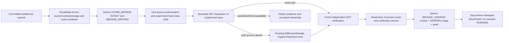

# E5 D1/D2/D3 — managed RSS, Bronze receipts and Silver

Status: **Partially implemented, internal checkpoint — October 29, 2026**, under
[issue #49](https://github.com/saurabh-tayade/distributed-data-intelligence-platform/issues/49).
This implements the accepted [RSS journal protocol](../architecture/durable-execution.md#rss-journal-and-recovery-protocol),
[ADR 0001](../adr/0001-rss-raw-ingestion-contract.md), [ADR 0002](../adr/0002-bronze-object-storage.md)
and [ADR 0010](../adr/0010-durable-execution-coordination-and-recovery.md).
D2 adds internal fenced Bronze publication, independent object reads and durable receipt confirmation.
[D3](#d3-managed-silver-lifecycle) adds fenced native Silver processing and independent qualification.
Managed Content remains **Partially implemented**. D3 adds internal Silver below. Production Content dispatch, managed Gold,
Content publication, activation, cancellation, retry, scheduling and automatic recovery remain deferred.
The D1 sections below describe the original fetch checkpoint; the [D2 lifecycle](#d2-storage-and-receipt-lifecycle)
and validation record describe the extension without changing those journal bytes or native contracts.

## Lifecycle and authorization

Acceptance requires one durable fetch authorization, exact original bytes/metadata, a validated private
journal, a transactionally fenced checkpoint, no refetch after uncertainty, and unchanged native outputs.

The package-private [RssFetchExecution](../../services/content-api/src/main/java/platform/contentapi/execution/RssFetchExecution.java)
is an internal stage adapter. Production WorkerExecutionCapability and WorkerIdleLifecycle still dispatch
only the existing Reliability adapter. Test-only capability wiring admits Content runs for acceptance;
there is no new HTTP endpoint, production startup flag or operator command that activates Content execution.

```mermaid
flowchart LR
  frozen[Frozen source and runtime validation] --> intent[Committed FETCH_SOURCE INTENT]
  intent --> auth[Consume one durable launch authorization]
  auth --> child[Supervised Java fetch and candidate files]
  child --> candidate[Parent validates bytes and current authority]
  candidate --> complete[Completion marker written last and read back]
  complete --> checkpoint[Atomic RSS reference + VERIFIED stage + audit]
  checkpoint --> stop[D1 stops: no Bronze PUT or run success]
```



The adapter selects a source by its frozen UTF-8 ordering/ordinal, never a request URL or current source
revision. Existing FrozenRunSelection checks the captured configuration, endpoint digest, immutable
profile/storage bindings and relational source revision. A later source revision does not replace it.
The reviewed endpoint-ID immutability guard remains intact. Production URI checks retain public HTTP(S),
no credentials/query/fragment and approved source identity. Only an explicitly isolated immutable test
runtime accepts literal loopback endpoints; the production reviewed catalog still rejects them.

WorkerRepository uses the existing coordinator/run/attempt locks, exact instance/epoch/version tokens,
controls, attempt deadline, host guard and audit capacity. The committed INTENT binds the command SHA,
source identity and private namespace. Any earlier FETCH_SOURCE invocation for that run/source or
ordinal vetoes another intent, including an unacknowledged intent in another attempt. Binding the
command address/hash consumes authorization once. No transaction includes HTTP, filesystem I/O or
process execution. Child identity and start time are recorded through the existing supervisor pattern.

The prebuilt [ManagedRssFetch](../../ingestion/src/main/java/platform/ingestion/managed/ManagedRssFetch.java)
child uses the original HttpFeedFetcher with its default 5 MiB subscriber limit, no redirects, explicit
no-proxy policy, 10-second connection timeout and at most the existing 30-second request timeout.
Content-Length/chunked/conflicting-framing behavior is retained. The supervisor bounds the complete
child operation to 45 seconds, rejects descendants and bounds/drains stdout/stderr. Its existing
five-second heartbeat rechecks runtime, host ownership and database fencing. A 128 MiB Java heap is
an additional child bound, not a whole-process memory guarantee. XML is opaque: malformed HTTP framing
fails retrieval, while payload bytes are not parsed, decoded, normalized or decompressed here.

## Runtime and build boundary

No new Maven library dependency or database migration is required. The ingestion module's existing
Jackson and SDK dependency pins remain unchanged. The Content API launches the prebuilt ingestion JAR
with its exact explicit dependency-JAR list; it does not build/install dependencies during execution.
The PostgreSQL CI job now packages ingestion before its existing verify command. The independent
ingestion job continues to run its complete tests.

An immutable rssFetchRuntimeVersion=1 execution-profile row contains exactly pipeline, runProfileId,
runProfileSha256, deploymentSha256, javaHome, manifest, controlBindingId, testEndpoint and
httpTimeoutMillis. Its manifest contains exactly adapter, javaRuntime and classpath. The adapter is
fixed to platform.ingestion.managed.ManagedRssFetch; every classpath item has an absolute regular-file
JAR path and SHA-256. The manifest digest must equal the run's frozen deployment digest. The actual
Java runtime must be Java 21 and exactly match the manifest tuple and parent JAVA_HOME. Paths cannot
be substituted through request arguments or an ambient classpath. Hash checks are bounded to 128 JARs,
64 MiB per JAR and 256 MiB total. Rebuilding a JAR requires a newly reviewed runtime/deployment binding.

The runtime row and run profile must authorize the exact immutable CONTROL binding. Captured local
native roots must be disjoint from CONTROL. The held installation/root/file identities are rechecked;
stage admission requires at least the existing 1 GiB free-space floor. This is cooperative admission,
not a filesystem quota or a throughput/capacity measurement. The subprocess environment contains only
PATH, TZ and LANG, with no database, cloud or S3 credentials.

## Immutable private evidence

The fixed address beneath the installation's CONTROL root is:

```text
runs/<run UUID>/attempts/<attempt UUID>/fetch-source/<source ID>/<checkpoint UUID>/
  command.json
  payload.xml
  metadata.json
  descriptor.json
  result.json
  complete.json
```

Directories require the current owner and exact POSIX mode 0700; files require 0600. Files and the final
directory are created exclusively. Aliases, symlinks, hard-linked files, unexpected membership and
permission changes fail. Earlier evidence is never overwritten, moved, repaired or deleted.

| File | Bound and content |
| --- | --- |
| command.json | At most 64 KiB; protocolVersion=1, run/attempt/epoch/stage/ordinal/checkpoint, source/revision/config/endpoint hashes, frozen URI, runtime hash, exact Java tuple and fixed timeout/test policy |
| payload.xml | At most 5 MiB; exact received bytes, including empty or non-UTF-8 bytes |
| metadata.json | At most 64 KiB separately; exact original Bronze serializer bytes, including source URI, original UUID/UTC Instant, HTTP status, content type, declared length, payload length/hash/key |
| descriptor.json | At most 64 KiB; journalVersion=1, command SHA, immutable stage/source/runtime provenance, original RawFeed fields, actual length/SHA and expected payload/metadata keys and metadata length/SHA |
| result.json | At most 64 KiB; the existing strict version-1 safe machine-result shape, success or allowlisted retrieval failure; no payload or free-form exception |
| complete.json | At most 64 KiB; journalCompletionVersion=1, directory identity and exact candidate file membership, byte lengths, SHA-256 and device/inode/mtime/size stamps |

The additive S3BronzeStorage.preparedMetadata helper delegates to the writer's existing serializer;
the original write/retry/key algorithm is unchanged. The child reconstructs RawFeed from read-back
files and compares the exact shared serializer output. A deterministic nanosecond timestamp vector
verifies that no SQL timestamp conversion truncates the original Instant string.

The child writes only a candidate. After observing clean child exit, the parent verifies strict schemas,
identities, RawFeed/metadata/key agreement, hashes and directory membership. It checks authority again,
writes completion last, reads it back and revalidates all files. The final pre-checkpoint read must
match the original evidence, including completion-file identity/stamp. JSON stamp comparison uses
canonical bytes so equivalent parsed integer representations cannot be confused with a file change.

Each file is written with CREATE_NEW/NOFOLLOW_LINKS and FileChannel.force(true), then read back.
There is no directory fsync or tested power-loss/storage-controller guarantee. A crash during marker
creation can leave a partial marker, which cannot qualify as completion. Existence alone is never
verification. POSIX local filesystems and the existing cooperative installation/one-writer model are
required; hostile filesystem writers and distributed filesystem fencing are not claimed.

## Database checkpoint and failure boundaries

One existing PostgreSQL transaction inserts rss_deliveries in FETCH_JOURNALED, records the stage as
VERIFIED and appends its audit event. It retains exact descriptor bytes/hash, owning attempt, original
ingestion UUID and Instant text, payload length/hash and immutable relative journal address. Its
expected_evidence object contains bronze (the original expected keys/metadata length/hash),
completionSha256 and completionStamp. Stage result_address/hash anchor the exact completion file.
The descriptor carries run/attempt/epoch/checkpoint/stage/source identity. Existing foreign keys and
immutable-row triggers continue to apply. No response body enters SQL or public audit records.

The ledger is a stage checkpoint, not an analytical artifact or successful Content run. D1 leaves the
run RUNNING and coordinator occupied after success. It does not authorize STORE_BRONZE. Detailed fetch
codes stay in the private result; public history uses the existing VERIFIED, FETCH_FAILED and
FETCH_EVIDENCE_LOST classifications. Audit details contain only the fixed protocol version.

| Observation | D1 outcome |
| --- | --- |
| Intent/authorization acknowledgment lost, or interruption before launch | No second authorization/fetch; retain intent and any command files |
| Timeout, HTTP error/redirect, oversized or malformed HTTP framing | Safe private retrieval code; no successful journal; UNKNOWN stage and occupied RECOVERY_REQUIRED when fencing/DB are available |
| Retrieval/candidate lost before completion | Retain partial files; FETCH_EVIDENCE_LOST, no invented UUID/response or automatic refetch |
| Complete journal but no database checkpoint | Retain an orphan; read-only inspection reports no committed checkpoint and never adopts it |
| Database checkpoint acknowledgment lost | Stop authorization; explicit read-only exact-match inspection can confirm the committed row without any journal write, retrieval or token refresh. Database-backed inspection also works without an in-memory stage receipt and under a newly held guard; it never reconstructs an Owner token. |
| Database unavailable or token/host guard stale | No further completion/checkpoint authorization; retain the last durable state and occupied ownership |
| Changed/missing/unexpected/incomplete files, identity, permission or I/O failure | Verification fails; preserve evidence; no repair, silent adoption or successful checkpoint |

Runtime/host/database checks immediately precede effects, but no DB/filesystem distributed transaction
or exactly-once HTTP transport guarantee is implied. A committed intent permits at most one managed
fetch invocation; a lost acknowledgment is not proof that a request did not reach the publisher.
Existing explicit Reliability recovery remains restricted to its qualified pipeline. D1 introduces
no Content recovery command, lease takeover or automatic slot release. Keep production Content
dispatch disabled; qualified Content recovery and the remaining managed processing stages are prerequisites.

## D1 local validation and reproduction (historical)

Use the repository-pinned JDK 21 selection and a disposable PostgreSQL 17.11 image, never an operational
database. From the repository root, with JAVA_HOME pointing to JDK 21:

```sh
mvn -B -ntp -f ingestion/pom.xml verify
python3 scripts/test-rss-fetch-postgres.py --offline
python3 scripts/test-rss-fetch-postgres.py --offline --regression
python3 -I -B -m unittest discover -s .github/ci/tests -v
actionlint .github/workflows/ci.yml
npm run check
git diff --check
```

Omit --offline when populating the existing Maven cache. The harness owns a uniquely named container,
random disposable credentials and loopback port, waits for readiness, actually restarts PostgreSQL at
the test signal and removes only that container/its anonymous volumes in finally. It does not touch
existing databases or native datasets. The regression option adds all Content API unit tests and
existing PersistenceIT, WorkerCoordinationIT and ControlAdmissionIT. Their negative startup tests need
an absolute executable Python path; the harness supplies one when absent. They do not execute Python
or qualify native package versions. No Spark suite runs in this harness. For a single development case,
use --case followed by a RssFetchIT method name. Single-case mode requests a database restart only for
the restart case; default and regression modes require the restart controller acknowledgment.

Tests cover exact bytes, headers/absent headers, UUID and nanosecond Instant preservation; 5 MiB and
64 KiB limits; HTTP fixed/chunked/error/redirect/timeout/conflicting-framing cases; concurrent and
repeated invocation; faults at intent/authorization/child/completion/checkpoint/commit-ack boundaries;
stale epoch/version and guard loss; DB outages/rollback/restart; changed source/runtime binding;
missing/extra/replaced/symlinked/hard-linked/permissive private files; and untouched synthetic native
sentinels (bytes, mtimes and identities). Fault hooks are package-private test seams, not environment
or request-controlled production options.

Validation on October 26, 2026 used macOS 27.0.1/arm64, Oracle GraalVM JDK 21.0.7+8.1, Maven 3.10.0 and
the existing pinned PostgreSQL 17.11-bookworm digest in Docker. Maven ran offline against the existing
cache, with -Daether.syncContext.named.factory=noop for the local cache-lock environment. No dependency
upgrade was performed. These are local correctness measurements, not hosted CI performance or throughput.

| Executed validation | Result | Measured local elapsed |
| --- | --- | --- |
| ingestion Maven verify | 55 cases: 26 new journal/protocol vectors and all 29 earlier cases; zero failures/errors/skips | Maven total 5.156s |
| Scoped regression harness | All 326 Content API units and 184 PostgreSQL cases: PersistenceIT 28, WorkerCoordinationIT 56, ControlAdmissionIT 52 and then-current D1 48; zero failures/errors/skips; actual database restart | Full harness 123.30s |
| Final focused harness after receipt inspection and numeric-boundary additions | 43 existing runtime/guard/supervisor units and all 51 D1 cases; zero failures/errors/skips; actual database restart | Full harness 48.58s; D1 tests alone 39.46s |
| CI policy/gate tests | All 21 tests passed, including 32,768 selection/result combinations and D1 dependency cases | 1.499s on local Python 3.9.6 |
| Actionlint 1.7.12 | Workflow syntax, expressions and dependencies passed | No performance claim |
| Node.js 24.19.0 npm run check | All 52 Markdown files/local links and repository hygiene passed | No performance claim |
| Git whitespace check | git diff --check passed; no staged changes | No performance claim |

The regression and focused counts overlap; they are not additive distinct-test counts. The final focused
pass rechecked every D1 case after read-only receipt inspection and strict numeric guards were complete.
The broad pass exercised existing Reliability metadata, startup fencing, controls and recovery process
unit boundaries; full native Reliability execution/Spark recovery was not rerun. Hosted D1 CI is pending.
IntelliJ exposed debugger tools but could not create a run configuration for the new test, so runtime
validation used Maven. Development faults found and corrected an endpoint-ID fixture violation, JSON
integer/stamp comparison and acknowledgment-proxy leakage between test cases. Production endpoint
immutability and database foreign-key guards were preserved.

## D1 changed file inventory (historical)

```text
.github/ci/tests/test_policy.py
.github/workflows/ci.yml
README.md
docs/architecture/durable-execution.md
docs/operations/ci.md
docs/operations/managed-rss-fetch.md
ingestion/src/main/java/platform/ingestion/bronze/S3BronzeStorage.java
ingestion/src/main/java/platform/ingestion/managed/ManagedRssFetch.java
ingestion/src/test/java/platform/ingestion/managed/ManagedRssFetchTest.java
scripts/test-rss-fetch-postgres.py
services/content-api/pom.xml
services/content-api/src/main/java/platform/contentapi/execution/WorkerRepository.java
services/content-api/src/main/java/platform/contentapi/execution/RssFetchExecution.java
services/content-api/src/main/java/platform/contentapi/execution/RssFetchRuntime.java
services/content-api/src/main/java/platform/contentapi/execution/RssJournalFiles.java
services/content-api/src/test/java/platform/contentapi/execution/RssFetchTestSupport.java
services/content-api/src/test/java/platform/contentapi/management/RssFetchIT.java
```

## D2 storage and receipt lifecycle

Acceptance requires a committed D1 reference; unchanged journal bytes, original RawFeed identity and
frozen source/storage linkage; one durable storage authorization; actual bounded reads of both objects;
an atomic fenced receipt/stage/audit checkpoint; and no refetch, implicit repair or downstream execution.
The package-private RssBronzeExecution adapter is internal acceptance wiring, with no production caller,
HTTP endpoint, worker flag or operator retry command. WorkerExecutionCapability remains Reliability-only.



The parent resolves the captured revision/endpoint, immutable original fetch runtime/JAR hashes and
the exact frozen BRONZE binding. A newer source revision is never substituted. A separate immutable
bronzeRuntimeVersion=1 profile has exactly adapter (fixed to platform.ingestion.managed.ManagedBronze),
fetchRuntimeId, fetchRuntimeSha256, runProfileId, runProfileSha256, deploymentSha256, controlBindingId,
storageBindingId and storageBindingSha256. Its CONTROL and BRONZE associations must match the installation
and exact binding bytes. The original deployment/classpath remains authoritative. No new dependency,
migration, configurable command or alternative S3 client is introduced.

The accepted importBronzeVersion=1 binding supplies only endpoint, region, bucket and credentialsFile.
The existing LocalS3 restrictions remain: explicit HTTP loopback endpoint/port, no user info, query,
fragment or non-root path; explicit static credentials; no ambient credential chain or proxy; path-style
SDK requests, maxAttempts=1, and existing 5/10/30/20-second connection/acquisition/call/attempt bounds.
The private canonical credentials file must be owner-only 0600, bounded to 8 KiB, with exactly accessKey
and secretKey. Bytes/hash/file stamp are rechecked; no secrets enter commands, SQL, public audit or
stdout. The child has the existing restricted environment and 128 MiB heap. The supervisor allows at
most 180 seconds for the bounded sequence of SDK calls, rejects descendants and checks runtime,
host guard, evidence and database authority on the existing five-second heartbeat.

The existing coordinator locks, exact worker/attempt/epoch/versions, controls and attempt deadline fence
every authorization and checkpoint. Intent changes FETCH_JOURNALED to BRONZE_WRITING. A prior storage
intent for that ingestion or source ordinal in any attempt vetoes another invocation, including after
an unknown acknowledgment. Command binding consumes authorization once. PostgreSQL transactions do
not encompass object I/O. A database epoch cannot stop an already-issued S3 request; loss of authority
stops further managed authorization/checkpointing and retains the occupied slot for qualified review.

## D2 exact objects and private receipt evidence

The fixed child reopens D1 using its committed descriptor, completion hash/stamp, strict membership and
file identities, then delegates RawFeed reconstruction and exact metadata comparison to ManagedRssFetch.
It never calls HttpFeedFetcher. The unchanged BronzeKeys and S3BronzeStorage preserve original UUID,
nanosecond Instant text, keys, metadata serialization, content and overwrite rules. D1 files remain
byte-for-byte unchanged, including mtimes/inodes. No native analytical output is created or modified.

BronzeObjectVerifier independently GETs both original keys using the existing LocalS3 factory. Fresh
clients perform read-back after writing and a second complete confirmation for an exact pair. It checks
headers, exact body bytes, length and SHA-256 against original payload/metadata, using an 8 KiB read
buffer, the original 5 MiB/64 KiB bounds and abort-on-mismatch to avoid draining oversized responses.
Content-Encoding must be absent/empty. Metadata must have application/json. The writer still sends
application/octet-stream for payload; real pinned SeaweedFS 4.48 returns application/xml for payload.xml.
Its [GET implementation](https://github.com/seaweedfs/seaweedfs/blob/4.48/weed/s3api/s3api_object_handlers.go#L2185)
falls back to the filename MIME when stored MIME is absent. D2 accepts only these two payload read types
and retains the actual observed type in the receipt. It never alters native PUT headers or uses a
response-content-type override. Other types, encodings, lengths or bytes are conflicts.

New evidence is separate from the original journal:

```text
runs/<run>/attempts/<original attempt>/store-bronze/<checkpoint>/
  command.json
  evidence.json
  result.json
  verified.json
```

Each file is bounded to 64 KiB and uses existing exclusive 0600 writes/read-back, private 0700 directory,
no-symlink/hard-link checks and file forcing. verified.json anchors checkpoint/command/evidence/result
hashes plus observed child PID/start and clean exit; the terminal stage stores its exact hash/address.
No directory fsync or additional power-loss guarantee is claimed. An incomplete anchor is not completion.

The strict receiptVersion=1 object contains original runId, attemptId, sourceId, revision,
capturedConfigSha256, ingestionId, ingestedAt, payloadByteLength, payloadSha256, journalSha256,
storageBindingId, storageBindingSha256, bucket, expected (original keys/metadata length/hash),
payloadContentType and metadataContentType. It contains neither response bodies nor credential bytes.
One short transaction CASes the original BRONZE_WRITING row with null receipt to BRONZE_VERIFIED,
stores canonical receipt_bytes and metadata_sha256, verifies the stage and appends audit. Existing
V1–V7 migrations are unchanged. Application writes are write-once; existing DB guards alone do not
make every receipt column immutable against direct administrative SQL. Replay additionally checks
the canonical receipt against original evidence and the immutable terminal stage/private hash anchor;
tampering is rejected rather than adopted.

## D2 recovery classifications and boundaries

Read-only inspection uses a fresh INSPECT_BRONZE private namespace and the same fixed child in GET-only
mode. It accepts no Owner token, changes no receipt or object, refreshes no authority and cannot qualify
writer quiescence. It reports facts, not permission to retry. Repeated store calls cannot launch again.

| Observation | D2 outcome |
| --- | --- |
| Both exact objects | Read-only confirmation; a fresh one-shot stage can verify this existing pair without PUT. A committed receipt is confirmed only with its immutable original stage anchor. |
| Exact NoSuchKey for both keys | ABSENT; a fresh original authorization may publish. Following a consumed intent, inspection only classifies eligibility for future explicit storage-only retry. |
| Matching payload, exact NoSuchKey metadata | PAYLOAD_ONLY; no PUT by D2. ADR 0002 permits completion only under additional explicit retry authority, which is not activated here. |
| Metadata only, wrong bytes/type/length/encoding or inconsistent pair | METADATA_ONLY/CONFLICT; no repair, overwrite, delete or adoption. |
| Generic HTTP 404/NotFound, NoSuchBucket, authentication failure, timeout or I/O error | UNAVAILABLE, never proof of absence; no writes based on that observation. |
| Crash before first PUT or between PUTs | Keep committed intent, partial files and occupied ownership. Independent inspection distinguishes ABSENT/PAYLOAD_ONLY; it does not relaunch. |
| Both PUTs complete, read-back unavailable, or crash before receipt transaction | Exact pair may be inspected, but no verified receipt is invented or automatically finalized. Explicit Content reconciliation remains deferred. |
| Metadata PUT acknowledgment lost, independent GETs exact in the original authorized child | Verify and checkpoint once from actual reads; no repeated PUT. |
| Receipt transaction acknowledgment lost | Stop further authorization. Read-only inspection confirms the committed receipt/stage facts and original anchor; no second fetch, PUT or receipt rewrite. |
| Receipt transaction rolls back, or PostgreSQL unavailable | No partial receipt/stage/audit success. Retain original stage/slot; restore DB access for inspection, never infer rollback from a transport error. |
| Stale worker/epoch/version, host guard loss, changed journal/credentials/runtime/storage binding | Reject authorization/checkpoint; preserve earlier evidence and ownership. Already-issued object effects remain an external ambiguity. |

When ownership is current and DB access works, conflict/partial/unavailable results mark the stage
UNKNOWN and run RECOVERY_REQUIRED while retaining the active attempt. An interruption or lost DB/guard
may leave its last committed INTENT/RUNNING state instead. Neither outcome releases uncertain ownership.
Receipt success alone also leaves the Content run RUNNING with no stage_artifacts or publication.

## D2 local validation and reproduction

With the repository JDK 21 selected, Docker available and no operational database/storage selected:

```sh
mvn -B -ntp -f ingestion/pom.xml verify
python3 scripts/test-rss-fetch-postgres.py --offline --bronze
python3 scripts/test-rss-fetch-postgres.py --offline --bronze --regression
python3 -I -B -m unittest discover -s .github/ci/tests -v
actionlint .github/workflows/ci.yml
npm run check
git diff --check
```

The extended harness owns uniquely named PostgreSQL 17.11 and SeaweedFS 4.48 containers, digest-pinned
to the existing local infrastructure images. Synthetic random credentials, bucket ddip-d2 and random
host loopback ports are private to the run. It uses actual SDK bucket reads for readiness, restarts
PostgreSQL independently for D1/D2 receipt tests, and removes only its owned containers/volumes in finally.
--bronze --case METHOD selects one D2 method; omitting --bronze preserves D1 behavior. --regression
adds all Content API units and existing persistence/coordination/control plus all D1/D2 cases. It does
not execute Spark or the native processing chain. No Bronze production dispatch is enabled for testing.

The real storage suite uses synthetic exact RSS bytes, the actual Java child, a signed-request-preserving
HTTP fault proxy in front of real SeaweedFS, and a direct SDK fixture for seeding/snapshot inspection.
Only test code can seed conflicting pairs. Faults cover intent/authorization/child/read-back/checkpoint
and commit-ack boundaries, each PUT boundary, dropped PUT acknowledgment, DB outages/restart/rollback,
stale/concurrent owners, lost guard, changed private evidence/credentials and receipt/object tampering.
No production fault flags or test helper classes enter the child classpath.

Validation on October 26, 2026 used macOS 27.0.1/ARM64, Oracle GraalVM JDK 21.0.7+8.1, Maven 3.10.0,
PostgreSQL 17.11-bookworm and SeaweedFS 4.48 with the pinned digests above. Maven ran offline with
-Daether.syncContext.named.factory=noop for the local cache environment. The local interpreter was
Python 3.9.6 for harness/policy orchestration; no pinned Spark runtime is claimed by these tests.

| Executed validation | Actual result | Measured local elapsed |
| --- | --- | --- |
| Ingestion Maven verify | 73 cases: all 55 earlier cases plus 18 new verifier cases; zero failures/errors/skips | Maven 4.185s |
| Scoped stable regression, --offline --bronze --regression | 326 Content API units plus 229 PostgreSQL cases: Persistence 28, WorkerCoordination 56, ControlAdmission 52, D1 51, then-current D2 42; all passed, no skips; actual separate D1/D2 database restarts | Harness 204.18s; Maven 3m21s; D2 78.37s |
| Final focused D2 pass after metadata-digest guard | 43 runtime/guard/supervisor units and all 43 D2 cases; zero failures/errors/skips; actual database restart | Harness 92.59s; Maven 1m26s; D2 79.71s |
| CI policy/gate/workflow checks | All 22 passed, including 32,768 gate combinations, new shared-helper selection and pinned storage isolation/cleanup | Python 2.346s |
| Actionlint 1.7.12 | Workflow syntax/expressions/dependencies passed | No performance claim |
| Node.js 24.19.0 npm run check | All 52 Markdown files/local links and repository hygiene passed | No performance claim |
| git diff --check and scope review | Passed; no staged changes; native writer/keys/LocalS3, accepted ADRs, migrations and production worker capability unchanged | No performance claim |

The regression and focused counts overlap. The additional final case rejects tampering with the ledger
metadata digest; the focused pass rechecked every D2 case after this final guard. The broad pass covers
existing Reliability metadata, admission, fencing, controls, import/process/recovery unit boundaries;
full native Reliability execution/recovery and expensive Spark suites were not rerun. CI retains all
those suites. Hosted D2 execution remains pending. These timings measure local correctness runs, not
hosted CI improvement, throughput or capacity. The initial sandboxed ingestion attempt could not bind
its existing loopback fixtures; the same command passed once local socket access was allowed. Earlier
development fixes canonicalized the test credential path and accounted for the real SeaweedFS MIME
fallback; production endpoint and native PUT policies were preserved. IntelliJ had no runnable
configuration for the new integration test, so runtime evidence came from Maven and real services.

The happy-path real SeaweedFS assertions independently read the ten original bytes (base64
PGZlZWQ+AP8NCg==, SHA-256 7d1b649c3a062baf04233412d57c5c792cb0236a0638cdb61f2584e6e4bbb0e7),
compare stored metadata byte-for-byte with D1 metadata.json, verify UUID/Instant and the stored metadata
digest, observe exactly two PUTs and at least eight GETs, then repeat read-only receipt confirmation.
Backend snapshots include actual Base64/length/type/ETag/last-modified values and remain identical across
replay. Journal file hashes/mtimes/inodes and native sentinel snapshots are unchanged; RSS retrieval count
remains one and DELETE count zero. A pre-existing exact pair requires zero PUTs. Receipt bytes and object
snapshots survive an actual PostgreSQL restart. Conflicting pairs and partial or unavailable states never
produce a verified receipt or trigger repair. The real storage test fixture is excluded from the
production child classpath.

### D2 exact changed files

The checkout was on main at merged D1 commit d45a814; no branch switch, staging, commit, push, PR or
GitHub mutation was performed. The expected feature/e5-d2-managed-bronze-receipts branch still needs
owner-managed preparation before any publication. All changes are uncommitted:

```text
.github/ci/classify.py
.github/ci/tests/test_policy.py
.github/workflows/ci.yml
README.md
docs/architecture/durable-execution.md
docs/operations/ci.md
docs/operations/managed-rss-fetch.md
ingestion/src/main/java/platform/ingestion/bronze/BronzeObjectVerifier.java
ingestion/src/main/java/platform/ingestion/managed/ManagedBronze.java
ingestion/src/test/java/platform/ingestion/bronze/BronzeObjectVerifierTest.java
ingestion/src/test/java/platform/ingestion/managed/BronzeFixture.java
scripts/test-rss-fetch-postgres.py
services/content-api/pom.xml
services/content-api/src/main/java/platform/contentapi/execution/PreflightFiles.java
services/content-api/src/main/java/platform/contentapi/execution/RssBronzeContext.java
services/content-api/src/main/java/platform/contentapi/execution/RssBronzeExecution.java
services/content-api/src/main/java/platform/contentapi/execution/RssFetchExecution.java
services/content-api/src/main/java/platform/contentapi/execution/RssFetchRuntime.java
services/content-api/src/main/java/platform/contentapi/execution/WorkerRepository.java
services/content-api/src/test/java/platform/contentapi/execution/RssBronzeTestSupport.java
services/content-api/src/test/java/platform/contentapi/management/BronzeFaultProxy.java
services/content-api/src/test/java/platform/contentapi/management/RssBronzeIT.java
services/content-api/src/test/java/platform/contentapi/management/RssFetchFixtures.java
services/content-api/src/test/java/platform/contentapi/management/RssFetchIT.java
```

No consequential departure from ADR 0002/0010 required a new ADR. The narrow SeaweedFS read-MIME mapping
is an observed adapter compatibility rule; the original writer, metadata serializer, key scheme and
standalone Content pipeline are unchanged. Owner-managed next steps are to prepare the intended branch,
review the uncommitted patch and run hosted CI after publication, retaining existing branch protection.
Do not activate production Content dispatch from this checkpoint.

## D3 prerequisites and remaining limits

Managed Content remains **Partially implemented**. D3 must consume only these original verified receipt
keys and qualify Silver/retained-history evidence before any later Gold/Content work. Internal storage
acceptance is not complete worker-managed RSS→Silver→Gold processing. Production Content dispatch,
operator retry activation, orphan receipt finalization, explicit Content writer-quiescence qualification,
automatic recovery, cancellation and scheduling remain deferred. A matching payload-only orphan is
classified but cannot yet be resumed by a managed operator action. Existing Reliability recovery remains
pipeline-restricted; no Content takeover is introduced.

Keep PostgreSQL/SeaweedFS/CONTROL persistent and restricted. Private journals contain original publisher
bytes/provenance; do not expose them in public artifacts/logs or prune active, unresolved or referenced
evidence. Retention, capacity management and qualified recovery remain manual. No automatic cleanup,
backup/restore certification, distributed fencing, filesystem quota or end-to-end power-loss durability
is supplied. Hosted CI and full native Spark processing are separate from the scoped local evidence.

## D3 managed Silver lifecycle

Status: **Partially implemented, internal checkpoint — October 29, 2026**.
D3 adds Silver processing to D1/D2. Production Content dispatch remains disabled. The
historical D2 stop point above describes that checkpoint, not D3's current internal seam.
The run remains `RUNNING` at `SILVER` with its global ownership slot occupied after verified
Silver. No Gold or Content enrichment is launched or activated.

Acceptance criteria are exact committed D2 inputs, unchanged D1/D2 evidence, actual native
accepted/rejected Parquet, independent full qualification, immutable verified replay,
fenced single-use launch and atomic stage/artifact registration. Failure tests must preserve
occupied ownership and demonstrate no replacement writer or downstream stage.

### Input selection and native compatibility

`RssSilverExecution` requires a confirmed Content owner and all selected source deliveries
in `BRONZE_VERIFIED`. It revalidates the frozen source revisions and storage/runtime bindings,
reopens the original D1 journal, checks the D2 stage's private immutable anchor and uses D2's
GET-only inspection to compare the original receipt against actual Bronze objects.
Each Silver invocation consumes exactly one frozen source ordinal and its original receipt.
The adapter GETs only its metadata and payload keys, checks their object MIME/encoding/length evidence and byte hashes against
that receipt, validates native metadata/source/ingestion/time/key identity, then passes those
verified bytes to native `process_one`. Bronze is rechecked after processing and qualification.
There is no S3 listing, source-prefix discovery, second RSS fetch or implicit retained-history
expansion. Source enablement/configuration edits cannot replace a captured revision.

The existing CLI already accepts exact `--metadata-key` selection. D3's small private command
adapter supplies additional receipt checks and supervision without modifying the CLI or
normalizer. The native `v1/<bucket SHA-256>/source_id=…/ingestion_date=…/ingestion_id=…`
namespace, completion bytes/identity, schemas, warnings/rejections, repeated observation
semantics and partitioning stay native. Original Bronze nanosecond timestamp text stays in
the receipt; native Silver retains its existing microsecond precision.

### Stage, runtime and supervision

| Boundary | Durable behavior |
| --- | --- |
| Admission | Confirm owner, complete D2 set, frozen source/run/storage/runtime and D2 evidence; no Silver writer yet |
| Intent | Insert one `SILVER` row for the frozen ordinal, command digest and exact selection identity; advance run version |
| Authorization | Commit command address/digest exactly once against attempt/epoch/instance and stage/owner versions |
| Child | Record PID, process start instant and child instance; `RUNNING`; use the existing Spark-capable supervisor |
| Qualification | Separate read-only Spark process; capture its identity and hashes in private evidence |
| Checkpoint | Final GET/hash/inventory recheck; atomically register/reuse exact artifact, link stage, mark `VERIFIED`, append audit |
| After checkpoint | Return without releasing ownership, completing the run or starting Gold/enrichment |

The additive reviewed runtime profile pins Python 3.12.15, PySpark 4.0.2, Boto3/Botocore
1.43.114 and Java 21; module hashes bind the adapter, native producer/normalizer, native
reader and import qualifier. It binds the D2 runtime digest, original run profile/deployment,
canonical processing root, frozen Silver/TEMP roots and root device/inode identities.
The Python interpreter is explicit, isolated (`-I -B`), with an environment whitelist; no
ambient credentials, shell text, dependency installation or runtime build is accepted.

Spark uses the existing `local[2]`, UTC, two shuffle partitions and native publication path.
A private per-child scratch directory contains Spark temporary state; the read-only qualifier also binds its warehouse there. The existing
supervisor enforces at most 900 seconds per child, five-second heartbeats, 16 MiB per output
stream and at most 32 observed descendants; cleanup uses the existing bounded grace/force
windows. The writer explicitly shuts down and reaps its gateway. The independent import
qualifier retains its supported shutdown checks. All children run outside PostgreSQL
transactions; authority and guard are rechecked at launch, heartbeat and checkpoint boundaries.
Private commands/results and scratch evidence are retained; native outputs are never cleanup
or recovery targets. This is a trusted single-host worker boundary, not hostile-process
containment, multi-node Spark or a performance/scalability claim.

### Verification, replay and recovery classifications

The read-only verifier calls existing `silver_import_qualification.execute` and
`silver_inputs.load_inputs` for the exact intended completion marker. It checks original
publication identity, completion bytes, physical schema/data files, accepted/rejected counts,
required row values, replay keys, source/ingestion/Bronze provenance, all namespace membership
and file hashes/identities. Its evidence preserves the native completion and managed inventory
fingerprint. Qualification does not reconstruct every content field from the raw feed.

The final read-only recheck compares the entire captured local/Bronze baseline after all
verification actions and immediately before registration. Existing artifact rows must match
full qualification bytes; a database row, child exit or completion marker alone is insufficient.
Stage evidence anchors the original D2 receipt digest, reviewed runtime, qualification
bytes and native `silver_inputs.inventory` manifest/input-set fingerprint. The manifest is
retained as private `selection.json`; no native product metadata is rewritten. Registration uses the same format as qualified Silver imports. No migration is added.

| Observation | D3 action |
| --- | --- |
| Missing/unverified/changed D2 receipt or object | Reject before Spark processing; never substitute a later snapshot |
| Changed binding/runtime/module or original identity | Fail closed; never move data to another root or UUID |
| Launch failure, processing failure, timeout or interrupted child | Block the stage and retain ownership; no automatic relaunch |
| Missing/incomplete/corrupt/unexpected Silver output | No verified artifact; never overwrite, repair, delete or resume namespace |
| Output created before a crash or failed verification | Retain output and intent/history, with ownership occupied |
| Stale owner, guard loss or PostgreSQL outage | Stop authorization/heartbeat progression; supervisor cleans up conservatively; retain occupied evidence |
| Lost intent/authorization acknowledgment | No launch without confirmed acknowledgment; repeated invocation cannot create a new intent |
| Lost verification acknowledgment | Full read-only inspection may confirm the existing committed stage/artifact; no owner refresh or duplicate registration |
| Identical completed publication | Full applicable qualification and original identity/baseline checks required; bytes remain unchanged |
| Uncertain child termination or unknown acknowledgment | Preserve recovery ownership and private process/evidence records; no automatic retry |

`inspect` is a read-only internal committed-result inspection, not Content reconciliation.
It can confirm success after a lost acknowledgment; it cannot adopt an owner, finalize a
failed run or release the global slot. The current Reliability operator-recovery command
continues to reject Content. Do not use it to force a Content disposition.

### D3 reproduction and evidence

Use the existing pinned local environment; all feeds and storage are disposable synthetic
fixtures. No publisher requests or cloud credentials are used.

```sh
export JAVA_HOME=$(/usr/libexec/java_home -v 21)
export DDIP_TEST_PYTHON="$PWD/outputs/silver-python312/.venv/bin/python"
export PYSPARK_PYTHON="$DDIP_TEST_PYTHON"
export SPARK_LOCAL_IP=127.0.0.1
PYTHONPATH=processing:processing/tests "$DDIP_TEST_PYTHON" -B -m unittest test_managed_silver
python3 scripts/test-rss-fetch-postgres.py --offline --silver
# One scoped backend regression after focused stabilization:
python3 scripts/test-rss-fetch-postgres.py --offline --silver --regression
# Scoped native regression, using the same pinned runtime:
PYTHONPATH=processing:processing/tests "$DDIP_TEST_PYTHON" -B -m unittest \
  test_managed_silver test_bronze test_silver test_silver_inputs test_silver_import_qualification
```

`--silver --case METHOD` restricts development runs to one D3 method. `--silver` implies
`--bronze`; the harness creates PostgreSQL 17.11 and SeaweedFS 4.48 at the existing pinned
image digests, builds the existing ingestion adapter before tests, and removes only its
owned disposable containers/volumes in `finally`. Regression includes the existing D1/D2
restart checks. D3 does not introduce a production command or worker dispatch option.
Measured evidence and exact changed files are recorded below after validation.

### D4 prerequisites

Managed Content Processing remains **Partially implemented**. D4 still needs explicit
retained-history/fresh-Silver dependency freezing, applicable reference qualification,
native Gold/Content preparation and publication boundaries, downstream full verification
and final run disposition. Content-specific occupied-owner/process review and reconciliation
must be designed and tested before any operational recovery claim. Production dispatch
requires a separately authorized capability/worker integration and end-to-end acceptance.
Cancellation/guarded retry, storage-only retry, Operations UI and production performance
remain outside D3. No accepted ADR is changed by this checkpoint.

### D3 exact changed files

Paths are repository-relative; generated datasets, runtime caches and logs are ignored.

- `docs/adr/0015-managed-silver-receipt-adapter.md`

- `docs/adr/README.md`

- `docs/architecture/durable-execution.md`

- `docs/operations/managed-rss-fetch.md`

- `ingestion/src/test/java/platform/ingestion/managed/BronzeFixture.java`

- `processing/managed_silver.py`

- `processing/tests/test_managed_silver.py`

- `scripts/test-rss-fetch-postgres.py`

- `services/content-api/README.md`

- `services/content-api/pom.xml`

- `services/content-api/src/main/java/platform/contentapi/execution/PreflightFiles.java`

- `services/content-api/src/main/java/platform/contentapi/execution/RssSilverExecution.java`

- `services/content-api/src/main/java/platform/contentapi/execution/RssSilverRuntime.java`

- `services/content-api/src/main/java/platform/contentapi/execution/WorkerRepository.java`

- `services/content-api/src/test/java/platform/contentapi/execution/RssSilverTestSupport.java`

- `services/content-api/src/test/java/platform/contentapi/management/RssFetchFixtures.java`

- `services/content-api/src/test/java/platform/contentapi/management/RssSilverIT.java`

### D3 measured local validation — October 29, 2026

Environment: macOS 27.2 arm64; GraalVM Java 21.0.7; Python 3.12.15; PySpark 4.0.2;
Boto3/Botocore 1.43.114; disposable PostgreSQL 17.11 and SeaweedFS 4.48 at the harness's
pinned digests. The scoped regression ran ingestion, backend and native Spark sequentially.
Timings below measure correctness workloads, not performance or production scalability.

| Run | Actual result | Elapsed |
| --- | --- | --- |
| Initial passing exact publication/replay smoke | 43 existing runtime/guard/supervisor units plus 1 D3 case; no failures/errors/skips | Harness 38.21s; D3 29.68s |
| Initial focused fault matrix | Same 43 units plus 20 then-current D3 cases; no failures/errors/skips | Harness 156.38s; D3 147.2s |
| Expanded development matrix | 43 units passed; 30 D3 cases: 28 passed, 1 fixture assertion failure, 1 fixture source-revision error | Harness 242.99s; D3 232.9s |
| Corrected exact publication/replay smoke with final headers/process evidence | 43 units plus 1 D3 case; no failures/errors/skips | Harness 40.56s |
| Corrected deterministic process-start failure | 43 units plus 1 D3 case; no failures/errors/skips | Harness 10.73s |
| Final scoped ingestion regression | 73 tests, no failures/errors/skips | Driver 4.75s; Maven 4.014s |
| Final scoped backend regression | 326 units plus 261 PostgreSQL cases, no failures/errors/skips | Harness 450.65s; driver 450.73s |

The final PostgreSQL cases are WorkerCoordination 56, ControlAdmission 52, D1 51, D2 43,
Persistence 28 and D3 31. D3 took 245.1s, D1 39.69s and D2 77.35s. D1 and D2 each
survived a separate actual PostgreSQL container restart. D3's outage fault disables new
connections and terminates target-database sessions immediately after writer child identity
registration; supervision then stops on loss of authority. These are distinct fault mechanisms.

Development failures were corrected before the final regression: initial fixture setup lacked
`PER_CLASS` and used an incorrect Silver binding; the expanded matrix submitted a historical
source revision for its unrelated queued run and relied on macOS behavior for an invalid
executable. The final launch test instead removes its disposable executable immediately after
committed authorization, deterministically exercising `PROCESS_START_FAILED` with occupied
ownership. Intermediate runs are overlapping development evidence, not additional distinct
coverage or successful final passes.

The final D3 success fixture produced accepted=1 and rejected=1 using actual native Parquet.
Its registered artifact was `d6d06843-775b-479d-a8d3-27744a5cbba6`, with completion SHA-256
`0b99920a896009480d85fecee0d0f223a251c6a71f3e6b185d5c28dd05deeabf` and managed inventory
SHA-256 `49e4f83be61fea2a9f3982ed76e7570194f393224ec1b9765fc2e1cc8945bdad`.
These identify this disposable synthetic run; UUIDs, publication bytes and fingerprints vary
with original ingestion identity/time across fresh runs. Within the run, two full read-only
inspections preserved all publication hashes, timestamps and inode identities. The original
D1 journal, D1/D2 stage checkpoint hashes/versions and committed D2 receipt remained unchanged.
The native selection manifest/input-set fingerprint and qualifier process evidence are bound
to the private stage anchor; neither management run IDs nor runtime settings enter products.
Disposable evidence is removed by test teardown; this is a test-log witness, not a retained
operator artifact or a claim about a private dataset.

The 31 final D3 cases cover committed exact selection, frozen-byte handoff, real publication,
full verified replay, missing/changed Bronze metadata and payload, unavailable receipt/object
reads, changed module/runtime veto, malformed feed processing failure, child-start failure,
crashes before/after authorization and after output/qualification, lost launch/verification
acknowledgments, stale owner, guard loss, worker interruption, database connection outage,
incomplete/corrupt/unexpected output, post-qualification Bronze mutation and atomic artifact,
stage-link, stage-result and audit registration. They assert no second ambiguous writer,
duplicate artifact/link, unrelated queued execution or managed Gold/enrichment stage.

The final scoped native regression passed **83 tests** in **74.274s** (driver **74.49s**):
`test_managed_silver`, `test_bronze`, `test_silver`, `test_silver_inputs` and
`test_silver_import_qualification`. It printed Python socket `ResourceWarning` diagnostics;
there were no unittest failures/errors/skips. Managed D3 child termination is checked
separately by the supervised acceptance cases.

The sequential ingestion/backend/native driver took **529.97s**. Its **743 distinct cases**
are 73 ingestion + 326 backend units + 261 PostgreSQL + 83 native Python/Spark. The native
group includes the 9 new receipt-adapter tests. Earlier focused runs repeat cases within
these groups; their counts must not be added. The separate **22 passing CI-policy tests**
bring distinct test coverage to **765 cases**, not a sum of every development invocation.
Markdown/hygiene checks are consistency checks and are excluded from test-case totals.

The change-aware classifier was evaluated against the complete working-tree change inventory
(tracked diff plus new files, since staging/commits were prohibited). It selects all five
backend jobs: ingestion, processing_python, analytics_jdbc, content_postgres and analytics_http.
The PostgreSQL Maven profile includes `RssSilverIT`; the existing CI job already builds the
Java adapters, installs the pinned Bronze/Spark dependencies and starts isolated SeaweedFS.
No workflow, dependency or migration change is required. Hosted CI and the full platform
suite were not run locally; the evidence above is the requested scoped backend/Spark regression.
Production Content dispatch, managed Gold/enrichment, operational Content recovery and
large-scale validation remain deferred. ADR 0015 remains an implementation record awaiting
owner acceptance; accepted ADRs are unchanged.

### PR #71 hosted CI correction

The initial hosted D3 run exposed a test ordering dependency on the 30-second active-owner
admission heartbeat window. Full read-only replay intentionally does not heartbeat execution;
submitting another run after two slow inspections correctly failed closed. The fixture now
checks queued admission/competing ownership while actively heartbeating, before replay, and adds
a deterministic stale-owner replay/admission rejection case. The original immutable publication,
receipt, duplicate-launch and occupied-slot checks remain. No application fencing, supervision,
recovery or native processing behavior changes. See the
[root cause, hosted/local evidence and 90-minute PostgreSQL job budget](ci.md#pr-71--d3-hosted-failure-and-postgresql-budget).
Managed Content remains **Partially implemented**; D4, Gold/enrichment, operational Content recovery
and production Content dispatch remain deferred.
